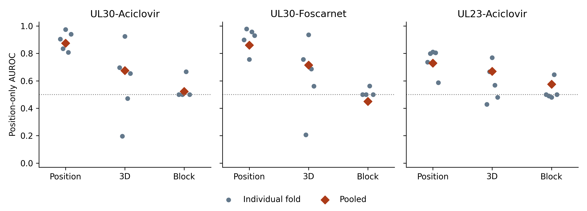

# Generalization across residues, studies and time in HSV-1 antiviral resistance prediction

## Abstract

A model that recognizes a well-studied region of a protein can score highly on a new substitution in that region. Whether it can rank substitutions in a poorly characterized region is a different question. We evaluated 929 curated HSV-1 missense–drug records using regional holdouts, within-publication comparisons and a retrospective time split. UL30–aciclovir was the primary arm. On 262 coordinate-matched records, a control given only residue number achieved an area under the receiver operating characteristic curve (AUROC) of 0.875 under position grouping and 0.523 under contiguous regional holdout. On the full primary arm, an exploratory comparison favoured fitted language-model features over fitted classical conservation features under regional holdout (random forest paired difference 0.150, 95% interval 0.070 to 0.232). Within publications, however, a classical evolutionary profile and an unfitted ESM-2 score both achieved concordance of 0.708 across 267 resistant–sensitive pairs (paired difference 0.000, interval −0.111 to 0.101). In later UL23–aciclovir reports, supervised AUROC was 0.887 at previously observed positions and 0.700 at new positions. These comparisons identify where learned features contributed on the curated data and where the available evidence could not separate them from simpler alternatives.

## Introduction

For a laboratory interpreting a previously uncharacterized HSV-1 substitution, “new” can mean several things. The substitution may occur at a residue with a different substitution already on record, far from any characterized residue, or in a publication using a different assay. These conditions need not yield the same model ranking. A retrospective benchmark is most informative when the reader can identify which condition each result describes.

HerpesDRG and the clinical resistance literature provide the observations for such a comparison [1,2]. Prior HSV work evaluated genotype-to-phenotype models against external mutation data [3], and protein-property benchmarks have used position-based and contiguous splits to study extrapolation [4]. We use these approaches to ask how much of a benchmark score residue number alone can explain, whether learned representations add information under regional holdout, and whether that advantage persists under other definitions of generalization.

---

## Materials and methods

**Population and phenotype.** We analyzed 630 distinct single-site missense substitutions comprising 332 UL30–aciclovir, 311 UL30–foscarnet and 286 UL23–aciclovir records. UL30 encodes DNA polymerase and UL23 encodes thymidine kinase. The curated binary outcome used quantitative susceptibility changes under the project’s threefold criterion or the source’s qualitative phenotype. Records with conflicting labels or multiple substitutions were excluded from the primary comparison. One substitution can contribute to both UL30 drug arms. Counts refer to variant–drug records.

**Position and regional holdouts.** Five-fold position grouping kept every observation at a residue in one fold. The structural partition used five clusters of resolved alpha-carbon coordinates per protein (PDB 8V1Q chain A and 1OF1 chain B). The sequence partition used fixed blocks of 247 residues in UL30 and 75 in UL23, with the terminal residue assigned to the last block. The three-way comparison used the same 737 records with resolved coordinates. The two sequence-based designs also used all 929 records. A random forest restricted to normalized residue number served as the position control. We measured the distance in sequence from each distinct test position to its closest training position.

**Model comparisons.** We compared a supervised regularized logistic classifier using sequence-derived features with the unfitted ESM-2 score on the same evaluable blocks. Separately, we compared two fitted feature families: protein-language-model scores and classical substitution and evolutionary conservation scores. Each family was evaluated with a random forest and logistic regression. This latter question arose during inspection of the regional results. Its paired intervals describe an exploratory comparison.

**Outcome measures and uncertainty.** Pooled AUROC ranks all resistant–sensitive pairs, including records scored by different fold models. Mean within-fold AUROC compares only records scored by the same fitted model and weights evaluable folds equally. Both classes must occur in a fold to estimate its AUROC. We used paired position-bootstrap intervals for pooled family and position-control contrasts and paired Student intervals across evaluable blocks for the supervised versus unfitted comparison. Position resampling retains all records at a residue and conditions on the observed predictions and partition. Brier scores measure squared probability error.

**Study and temporal designs.** Within a publication we compared resistant and sensitive records, pooled the resulting pair concordances and resampled publications for uncertainty. Only publications reporting both classes contribute. Additional analyses used buffered domains and the quantitative phenotype subset. For temporal evaluation, 622 records first reported before 2016 supplied training data and 307 first reported from 2016 onward supplied test data. The test set was stratified by whether training data included the residue position.

---

## Results

### Position grouping permits strong discrimination from residue number alone

On UL30–aciclovir, changing the held-out unit increased the median distance to the nearest training site from 2 residues under position grouping to 17 under structural clustering and 78.5 under contiguous blocks. The corresponding position-only scores declined in that order (Table 1). Three of the four evaluable contiguous blocks had AUROC 0.500; the fourth scored 0.666. One block contained only one phenotype.

**Table 1. Position-only pooled AUROC on the same coordinate-mapped records under each split.** The 95% interval for the grouped-minus-block difference resamples positions within the arm.

| Arm | Records | Grouped | 3D clusters | Blocks | Difference (95% interval) |
|---|---|---|---|---|---|
| UL30 / Aciclovir | 262 | 0.875 | 0.675 | 0.523 | 0.352 (0.253 to 0.447) |
| UL30 / Foscarnet | 242 | 0.861 | 0.715 | 0.450 | 0.412 (0.273 to 0.538) |
| UL23 / Aciclovir | 233 | 0.730 | 0.670 | 0.575 | 0.154 (0.050 to 0.255) |

**Figure 1.** Circles show individual evaluable-fold AUROCs; diamonds show pooled AUROC. The dotted line marks 0.5. A fold with a single phenotype contributes to the pooled score but has no circle.

Including the 70 primary-arm records without coordinates changed the pooled block score to 0.459. Within-fold pairs had concordance 0.566. Across-fold pairs had concordance 0.436 and accounted for 13,717 of 16,740 comparisons (81.9%). The weighted average recovers the pooled score. Thus every evaluable block could score at or above chance while the pooled score fell below chance, a known risk of pooling predictions from different folds [5].

---

### The advantage of a learned representation depends on the comparator

Under regional holdout, the fitted language-model family outscored fitted classical conservation features on UL30–aciclovir under both classifiers. On UL30–foscarnet the interval excluded zero only with logistic regression. On UL23–aciclovir neither classifier separated the families (Table 2). The two classifiers share the same records and labels. Their agreement on the primary arm is a sensitivity check.

**Table 2. Exploratory paired differences in pooled out-of-block AUROC.** Entries give the bootstrap mean difference for learned minus classical features and its position-bootstrap 95% interval.

| Arm | Random forest (95% interval) | Logistic regression (95% interval) |
|---|---|---|
| UL30 / Aciclovir | 0.150 (0.070 to 0.232) | 0.215 (0.149 to 0.290) |
| UL30 / Foscarnet | 0.081 (-0.022 to 0.192) | 0.134 (0.049 to 0.228) |
| UL23 / Aciclovir | 0.013 (-0.070 to 0.093) | 0.054 (-0.024 to 0.131) |

The supervised-versus-unfitted comparison used a different baseline and a different unit of averaging. It asked whether supervision improved the mean performance within held-out blocks over an unfitted ESM-2 score. All three paired intervals included zero (Table 3). For UL30–aciclovir, the fitted and unfitted scores had nearly identical mean within-block discrimination. There were only four evaluable blocks on that arm.

**Table 3. Supervised versus unfitted ESM-2 performance within blocks.** The paired difference is supervised minus unfitted AUROC. Brier and constant-prevalence reference scores use exactly the same evaluable-block records. Lower Brier scores indicate lower squared error.

| Arm | Blocks | Difference (95% interval) | Brier | Reference | Records |
|---|---|---|---|---|---|
| UL30 / Aciclovir | 4 | -0.005 (-0.043 to 0.032) | 0.114 | 0.177 | 269 |
| UL30 / Foscarnet | 4 | 0.004 (-0.064 to 0.071) | 0.084 | 0.115 | 250 |
| UL23 / Aciclovir | 5 | 0.079 (-0.031 to 0.189) | 0.178 | 0.243 | 286 |

All three supervised Brier scores improved on the corresponding cohort-prevalence reference. A Brier score reflects both discrimination and calibration. These retrospective values do not establish calibrated probabilities in another laboratory or clinical population.

---

### Comparing records from the same publication changes the available evidence

The classical position-specific scoring matrix (PSSM) and ESM-2 gave identical primary-arm pair concordance to three decimals. Their rankings of individual variants need not be identical to produce the same aggregate statistic. The paired interval allows appreciable differences in either direction (Table 4). Across all three arms, a simple evolutionary profile remained a meaningful comparator.

**Table 4. Concordance within publications.** Each pair comprises a resistant and a sensitive record in the same publication. Differences and 95% intervals compare PSSM minus unfitted ESM-2 with shared study resampling.

| Arm | Pairs | PSSM | ESM-2 | Difference (95% interval) |
|---|---|---|---|---|
| UL30 / Aciclovir | 267 | 0.708 | 0.708 | 0.000 (-0.111 to 0.101) |
| UL30 / Foscarnet | 82 | 0.774 | 0.805 | -0.030 (-0.199 to 0.375) |
| UL23 / Aciclovir | 331 | 0.699 | 0.773 | -0.074 (-0.203 to 0.038) |

On UL30–aciclovir, 14 mixed-label publications supplied the 267 pairs, and one publication accounted for 27.3%. A composite of structural distance and evolutionary constraint had concordance 0.787, compared with 0.556 for the BLOSUM62 substitution baseline. The paired difference was 0.230 (95% interval 0.015 to 0.496). The corresponding between-gene difference of contrasts was 0.141 (−0.118 to 0.482). Component ablations could not distinguish the composite from either individual component with precision. These results support a within-study association on the primary arm while leaving the between-gene interpretation unresolved.

### Later reports still contain familiar positions

**Table 5. Supervised AUROC in reports from 2016 onward.** The two right-hand columns give AUROC and the number of resistant records among all records in the stratum.

| Arm | Later records | Overall | Familiar sites (R/N) | New sites (R/N) |
|---|---|---|---|---|
| UL30 / Aciclovir | 92 | 0.829 | 0.923 (2/15) | 0.808 (15/77) |
| UL30 / Foscarnet | 84 | 0.853 | 0.929 (2/16) | 0.813 (7/68) |
| UL23 / Aciclovir | 131 | 0.764 | 0.887 (19/33) | 0.700 (41/98) |

UL23–aciclovir supplies the clearest descriptive contrast: 19 of 33 records at familiar positions and 41 of 98 at new positions were resistant. Its 0.764 overall AUROC averages over a materially different case mix from the new-position subset. Each UL30 familiar-position stratum had just two positive observations, so even a high AUROC there provides limited precision.

---

## Replication, sensitivity and clinical scope

**Cross-herpesvirus assessment.** In the original HCMV polymerase–ganciclovir replication arm, 25 mixed-label studies supplied 399 pairs. The prespecified structural comparison failed its intended replication. Reanalysis using a different structural reference produced a drug-dependent pattern. The follow-up hypothesis arose from inspection of the same HCMV data; fixing the follow-up calculation before running it did not provide an independent test. Likewise, the exploratory HCMV kinase-versus-polymerase contrast in substitution-score concordance was 0.106 (95% interval −0.086 to 0.274). These findings limit the case for a transferable mechanism across proteins and drugs.

**Sensitivity and negative controls.** In the quantitative phenotype subset, agreement between labels at 2.5-fold and threefold cutoffs was 96.2% on both UL30 arms and 100% on UL23–aciclovir. This checks threshold sensitivity among quantitatively characterized records. It cannot validate qualitative phenotypes in other publications. Varying the structural radius produced similar distance rankings; agreement between related definitions is a robustness check rather than independent evidence. The historical UL23–foscarnet control included nine resistant labels in 189 records, illustrating why an isolate-level drug phenotype alone cannot assign causation to a particular gene.

**Coverage and software.** The structural census measured which contact residues had published phenotype records. An uncovered residue may reflect study selection, incomplete reporting or other factors. Absence from the compilation does not reveal a viability mechanism. The six-target cross-virus audit measured nearest-training-site distances under modulo assignment. The fraction within two residues ranged from 20.0% to 97.6%; those measurements establish proximity, not prediction error. The accompanying splitgap utility makes the same coverage and separation checks available for other partitions.

**Corrected retrospective clinical analysis.** Among 352 labelled HSV-1 UL23–aciclovir records, 351 were eligible for the historical rule; one combination record was excluded. There were 130 true positives, 51 false positives, 119 true negatives and 51 false negatives. The positive predictive value was 71.8% (130/181), with sensitivity 71.8% and specificity 70.0%. For the 286 missense records alone, positive predictive value was 59.5% (69/116). This calculation uses the same classifications for shared missense records and restricts both cohorts to HSV-1. Its predictive values depend on the curated case mix. The earlier 94.4% estimate used mixed virus types and inconsistent inputs and is withdrawn.

---

## Discussion

The project supports one particular advantage of learned sequence features: under contiguous holdout on UL30–aciclovir they ranked records better than fitted classical features. It also specifies two important limits. Supervision did not yield a resolved gain over unfitted ESM-2 within blocks, and the within-publication comparison could not separate ESM-2 from a classical profile. These findings can coexist because the comparator, the records contributing pairs, and the unit of averaging change. Treating the three results as a single model leaderboard would discard the most informative part of the study.

The position-only control provides a practical way to read the results. A high score for normalized residue number shows how much discrimination regional composition can supply on a particular split. The temporal analysis asks a related question about publication: a later record can still come from a familiar region. Neither comparison establishes that proximity alone caused the change in a fitted model’s performance.

The evidence comes from retrospectively curated literature. Two arms share a protein, and all arms draw from overlapping sources. Investigators chose what to assay. Within-study comparisons reduce between-publication differences while retaining that selection. Bootstrap intervals are conditional on the available studies or positions. Exploratory family comparisons and the HCMV follow-up require independent confirmation. None of the analyses measures treatment response in an independently recruited patient cohort.

## Data and code availability

The accompanying repository contains the frozen variant–drug table, fold assignments, splitgap utility and machine-readable results. The audited position analysis uses data/processed/primary_3d_spatial_folds.tsv. Primary result archives in logs/ are position_control_folds.json, paired_family_contrast_results.json, phase1_deliverables_results.json, pssm_vs_esm2_d3_paired_contrast.json and step1_ascertainment_control_results.json. The corrected rule is recorded in clinical_triage_evaluation.json. The split and pooling analyses overlap with the companion HSV-1/BRCA1 methods manuscript; they represent the same HSV observations.

## References

[1] Charles OJ et al. HerpesDRG: a comprehensive resource for human herpesvirus antiviral drug resistance genotyping. BMC Bioinformatics. 2024;25:279. doi:10.1186/s12859-024-05885-5.

[2] Dähne T et al. Herpes simplex virus and drug resistance—comprehensive update on resistance mutations and implications for clinical management: a narrative review. Clin Microbiol Infect. 2025;31:1484–1490. doi:10.1016/j.cmi.2025.04.046.

[3] Charles OJ. Modelling the genomic structure, and antiviral susceptibility of Human Cytomegalovirus. University College London, doctoral thesis, 2023. Chapter 3. UCL Discovery 10169477.

[4] Notin P, Weitzman R, Marks DS, Gal Y. ProteinNPT: Improving protein property prediction and design with non-parametric transformers. NeurIPS. 2023.

[5] Parker BJ, Günter S, Bedo J. Stratification bias in low signal microarray studies. BMC Bioinformatics. 2007;8:326. doi:10.1186/1471-2105-8-326.
