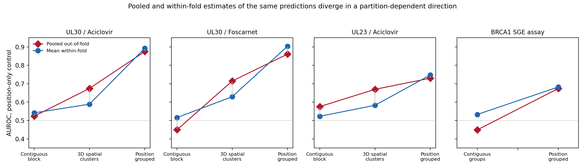

# The direction of cross-fold pooling bias depends on partition geometry

### A pair-level decomposition of held-out AUROC in HSV-1 resistance records and a BRCA1 functional assay

## Abstract

Grouped cross-validation is standard when records cluster by residue, patient or study, and the held-out scores are usually pooled into a single area under the receiver operating characteristic curve (AUROC). Pooling compares records scored by different fitted models. The resulting bias is reported in the literature as negative, so a pooled score is treated as a conservative estimate. We show that its direction is a property of the partition, not of pooling itself. Pooled AUROC decomposes exactly into the concordance of positive–negative pairs scored within one fold and the concordance of pairs scored across folds, weighted by pair counts. We verified the identity on 17 evaluation designs drawn from a frozen HSV-1 resistance benchmark and an external BRCA1 saturation genome editing assay, using a control whose only input was residue number; reconstruction error did not exceed 2.3 × 10−16 AUROC units. Between-fold pairs supplied 79.5% to 83.4% of all comparisons in every design. The pooling offset, defined as pooled minus mean within-fold AUROC, was negative in 13 designs, reaching −0.084 under contiguous blocks, and positive in all three three-dimensional spatial-cluster designs at +0.085 to +0.087. Decomposing the contiguous-to-spatial change on the primary arm, between-fold pairs accounted for 104% of the +0.151 rise in pooled AUROC while within-fold concordance fell by 0.004. A predictor holding a constant score inside each fold, whose every evaluable fold has AUROC exactly 0.5 by construction, reproduced 26% to 121% of that rise. The same comparison applied to position-grouped holdout behaved differently: mean within-fold AUROC rose by 0.225 to 0.388, so that contrast does not depend on pooling. Whether a held-out design appears to control regional interpolation can therefore be decided by the pooling step rather than by the design.

---

## 1. Introduction

When observations cluster, a benchmark partitions by the cluster rather than by the record. Variant-effect prediction groups by residue, clinical prediction groups by patient, and spatial ecology groups by region. The held-out predictions are then almost always combined the same way: concatenate the out-of-fold scores and compute one AUROC over the pooled vector.

This step is not free. A pooled AUROC compares records scored by different fitted models, and those models need not place their scores on a common scale. Airola and colleagues characterized the consequence for small samples and recommended averaging per-fold estimates or leave-pair-out schemes instead [1,2]. Parker and colleagues described the same effect as stratification bias in low-signal microarray studies [3]. A spatial leave-pair-out variant restricts comparisons to pairs scored in the same round for exactly this reason [4]. Across this literature the bias is described in one direction: pooling is pessimistic, and a pooled estimate is therefore safe to quote.

We find that this description is incomplete in a way that matters for how holdout designs are chosen. The sign of the offset depends on how the partition is arranged relative to the feature the model actually uses. When folds are contiguous blocks of that feature, cross-fold comparisons are misleading and pooling is pessimistic. When folds are interleaved along it — as happens when residues are clustered by three-dimensional proximity, or grouped by position — cross-fold comparisons are informative, and pooling can be optimistic relative to the within-fold estimate. Because roughly four fifths of all positive–negative pairs are cross-fold in a five-fold design, this is not a small correction.

The practical consequence is specific. A benchmark that compares candidate holdout designs by their pooled scores, and selects the design under which a negative control scores lowest, may be ranking the designs by their pooling offsets. We quantify this on a frozen antiviral-resistance benchmark and an independent functional assay.

---

## 2. Methods

### 2.1 The decomposition

Let a partition assign every record to one of *K* folds, each fold scored by a model fitted on the remaining folds. Enumerate all positive–negative record pairs and score each as 1 for a correct ordering, ½ for a tie and 0 otherwise. Pooled AUROC is the mean over all pairs. Partition the pairs by whether both members were scored by the same fitted model, giving *n*w within-fold pairs with mean concordance *C*w and *n*b between-fold pairs with mean concordance *C*b. Then

> AUROCpooled = *w*w *C*w + *w*b *C*b,  *w*b = *n*b / (*n*w + *n*b)

This is an identity, not an approximation: the two pair sets are disjoint and exhaust the comparisons. *C*w is a pair-count-weighted relative of the mean within-fold AUROC, which instead weights evaluable folds equally. We report both, and define the **pooling offset** as pooled AUROC minus mean within-fold AUROC, and the **between-pair contribution** as *w*b(*C*b − *C*w).

To compare two designs on the same records we decompose the change in pooled AUROC at the first design's pair weights:

> Δpooled = *w*wΔ*C*w + *w*bΔ*C*b + (residual weight term)

The residual absorbs the change in pair composition and was negligible throughout (|·| ≤ 0.001).

A fold with one phenotype has no defined AUROC and is excluded from the fold mean, but its records still enter pooled and between-fold comparisons. We report evaluable fold counts alongside every estimate.

### 2.2 Evaluation designs

We reused the frozen audit outputs of two position-only controls without refitting any model. Both are random forests (100 trees, maximum depth five, seed 42) whose sole input is residue number divided by reference protein length. A position-only control is the right probe here because it has no access to the substitution, so any variation in its score across designs reflects the partition and the pooling rule rather than the model.

The HSV-1 benchmark comprises 929 curated single-site missense–drug records, integrated from published phenotype compilations including HerpesDRG [6], over three arms: UL30–aciclovir (332 records, the primary arm), UL30–foscarnet (311) and UL23–aciclovir (286). Each arm was evaluated under five-fold position grouping and under contiguous sequence blocks on all records, and under position grouping, five k-means clusters of resolved Cα coordinates, and contiguous blocks on the subset with resolved coordinates (262, 242 and 233 records). The coordinate-matched subset holds the records fixed across all three designs, which is the comparison used below.

The external dataset is the Findlay BRCA1 saturation genome editing assay [5], restricted to 441 nonfunctional and 1,476 functional author-classified missense single-nucleotide variants at 326 residues, under position grouping and five contiguous groups of observed sites.

As a null, each design also carries a **training-prevalence-only predictor** that assigns every record in a test fold the positive fraction of its training folds. This predictor is constant inside a fold, so all within-fold pairs tie, *C*w = 0.5, and every evaluable fold has AUROC exactly 0.5. Any movement in its pooled score is carried entirely by between-fold pairs and measures the pooling offset in isolation.

### 2.3 Reproduction

`scripts/audit_pooling_decomposition.py` reads `logs/position_control_folds.json` and `logs/brca1_external_audit.json`, verifies the identity in every design, and writes `logs/pooling_decomposition.json` and Figure 1. It fits nothing and introduces no randomness. The HSV input file SHA-256 and scikit-learn version (1.9.0) are carried through from the source audits.

---

## 3. Results

### 3.1 The identity holds and between-fold pairs dominate

Across all 17 designs the reconstruction matched the logged pooled AUROC to machine precision; the largest absolute error was 2.3 × 10−16. Between-fold pairs made up 79.5% to 83.4% of comparisons, close to the 80% expected from five balanced folds. Pooled AUROC is therefore, in these benchmarks, approximately four parts cross-fold comparison to one part within-fold comparison.

### 3.2 The offset changes sign with the partition

**Table 1. Pair-level decomposition of the position-only control.** *C*w and *C*b are within- and between-fold pair concordance. Offset is pooled minus mean within-fold AUROC. HSV rows use the coordinate-matched subset unless marked "all records".

| Dataset | Design | Between pairs | *C*w | *C*b | Pooled | Mean within-fold | Offset | Evaluable folds |
|---|---|---:|---:|---:|---:|---:|---:|---:|
| UL30 / aciclovir | Contiguous block | 81.3% | 0.605 | 0.505 | 0.523 | 0.541 | −0.018 | 4/5 |
| UL30 / aciclovir | 3D spatial clusters | 80.0% | 0.584 | 0.697 | 0.675 | 0.589 | **+0.086** | 5/5 |
| UL30 / aciclovir | Position grouped | 80.1% | 0.888 | 0.872 | 0.875 | 0.893 | −0.018 | 5/5 |
| UL30 / foscarnet | Contiguous block | 80.2% | 0.539 | 0.428 | 0.450 | 0.516 | −0.066 | 4/5 |
| UL30 / foscarnet | 3D spatial clusters | 79.5% | 0.707 | 0.717 | 0.715 | 0.629 | **+0.085** | 5/5 |
| UL30 / foscarnet | Position grouped | 80.2% | 0.883 | 0.856 | 0.861 | 0.904 | −0.043 | 5/5 |
| UL23 / aciclovir | Contiguous block | 83.4% | 0.532 | 0.584 | 0.575 | 0.523 | **+0.053** | 5/5 |
| UL23 / aciclovir | 3D spatial clusters | 79.6% | 0.644 | 0.676 | 0.670 | 0.583 | **+0.087** | 5/5 |
| UL23 / aciclovir | Position grouped | 80.1% | 0.749 | 0.725 | 0.730 | 0.747 | −0.018 | 5/5 |
| UL30 / aciclovir, all records | Contiguous block | 81.9% | 0.566 | 0.436 | 0.459 | 0.535 | −0.076 | 4/5 |
| UL30 / foscarnet, all records | Contiguous block | 81.3% | 0.552 | 0.447 | 0.467 | 0.528 | −0.061 | 4/5 |
| UL23 / aciclovir, all records | Contiguous block | 82.9% | 0.554 | 0.543 | 0.545 | 0.547 | −0.002 | 5/5 |
| BRCA1 SGE | Contiguous groups | 80.4% | 0.524 | 0.430 | 0.449 | 0.533 | −0.084 | 5/5 |
| BRCA1 SGE | Position grouped | 80.1% | 0.682 | 0.672 | 0.674 | 0.682 | −0.008 | 5/5 |

**Figure 1.** Pooled out-of-fold AUROC (diamonds) and mean within-fold AUROC (circles) for the same stored predictions under each design. The two estimates agree under position grouping, diverge downward under contiguous holdout, and cross under three-dimensional spatial clustering, where the pooled estimate is the higher of the two in all three arms. The dotted line marks 0.5.

Three patterns are consistent across datasets. Under position grouping the two estimates nearly coincide (offsets −0.008 to −0.043): folds are interleaved along residue number, so cross-fold comparisons behave much like within-fold ones. Under contiguous holdout the offset is negative in five of six designs, reaching −0.084 on BRCA1 and −0.076 on the full primary arm. Under three-dimensional spatial clustering the offset is positive in all three arms and strikingly uniform, +0.085 to +0.087.

The UL23 contiguous design is the exception to the second pattern, with an offset of +0.053 on the coordinate-matched subset and −0.002 on all records. UL23 blocks are 75 residues against 247 in UL30, so its blocks are less separated in sequence; the sign of the offset is not fixed by the design's name.

### 3.3 The spatial "rebound" is a between-pair effect on the primary arm

Moving from contiguous blocks to spatial clusters on identical records raises the pooled position-only score, and the natural reading is that spatial clusters partially restore the model's ability to interpolate along the sequence. The decomposition does not support that reading on the primary arm.

**Table 2. Decomposition of the change in pooled AUROC from contiguous blocks to each alternative design**, coordinate-matched records, evaluated at the block design's pair weights.

| Arm | Comparison | Δ pooled | Within component | Between component | Between share | Δ mean within-fold |
|---|---|---:|---:|---:|---:|---:|
| UL30 / aciclovir | block → 3D clusters | +0.151 | **−0.004** | +0.157 | 104% | +0.047 |
| UL30 / foscarnet | block → 3D clusters | +0.265 | +0.033 | +0.232 | 87% | +0.114 |
| UL23 / aciclovir | block → 3D clusters | +0.094 | +0.019 | +0.077 | 82% | +0.060 |
| UL30 / aciclovir | block → position grouped | +0.352 | +0.053 | +0.298 | 85% | **+0.351** |
| UL30 / foscarnet | block → position grouped | +0.412 | +0.068 | +0.343 | 83% | **+0.388** |
| UL23 / aciclovir | block → position grouped | +0.154 | +0.036 | +0.118 | 76% | **+0.225** |

On UL30–aciclovir, the whole of the +0.151 rise is carried by between-fold pairs; within-fold concordance is 0.004 lower under spatial clustering than under contiguous blocks. By the within-fold measure, spatial clustering gives this control no more discrimination than a contiguous block does. The two secondary arms disagree in degree but not in direction of dominance: within-fold concordance does rise there, by 0.033 and 0.019, and mean within-fold AUROC by 0.114 and 0.060, but between-fold pairs still account for 82% to 87% of the pooled change. We report the three arms separately because the primary arm is the one where the within-fold change vanishes, and a reader should not take the 104% figure as the typical value.

The prevalence-only null puts a floor under how much of this is attributable to pooling alone. That predictor carries no within-fold information whatsoever, yet its pooled score also rises from blocks to spatial clusters: 0.216 → 0.304 on UL30–aciclovir (+0.088), 0.228 → 0.297 on UL30–foscarnet (+0.069) and 0.262 → 0.376 on UL23–aciclovir (+0.114). These movements are 58%, 26% and 121% of the corresponding rise in the fitted control's pooled score. On UL23–aciclovir a predictor with no information at all gains more from the change of design than the fitted forest does.

The same null also bounds how far below chance a pooled score can fall for reasons unrelated to the model. Its pooled values range from 0.190 (UL30–aciclovir, full cohort, contiguous blocks) to 0.463 (same arm, position grouped), while every evaluable fold has AUROC exactly 0.5 by construction. A pooled AUROC of 0.19 is attainable with predictions that are, within each fold, perfectly uninformative and not wrong.

### 3.4 The grouped-versus-regional contrast does not depend on pooling

The decomposition is not a general argument against the project's headline comparison. Moving from contiguous blocks to position grouping raises mean within-fold AUROC by 0.351, 0.388 and 0.225 across the three arms (Table 2, final column) — changes of the same order as the pooled changes of 0.352, 0.412 and 0.154. Both estimators agree that a position-only control discriminates far better when neighbouring residues are available in training. On BRCA1 the same holds: mean within-fold AUROC rises from 0.533 to 0.682 while pooled rises from 0.449 to 0.674.

What the decomposition removes is the intermediate position of the spatial design. On the pooled scale the three designs appear ordered as 0.523 < 0.675 < 0.875 on the primary arm, suggesting a graded relationship between fold separation and apparent performance. On the within-fold scale the ordering is 0.541, 0.589, 0.893: the spatial design sits beside the contiguous one, not between it and position grouping.

---

## 4. Discussion

Pooling bias in cross-validated AUROC is established, and so is the recommendation to average within folds or to restrict comparisons to same-round pairs [1–4]. What these results add is that the bias is not reliably signed. Its direction follows from whether the folds are blocks or interleaved strata in the feature the model is using, and on these data it is positive wherever the partition interleaves. Treating a pooled estimate as conservative is therefore unsafe in exactly the setting where grouped cross-validation is most often used: when the grouping variable is also a predictor.

This has a direct bearing on how holdout designs get compared. A common and reasonable procedure is to run a negative control under several candidate partitions and prefer the partition under which the control scores lowest. Applied to the pooled scores here, that procedure prefers contiguous blocks over spatial clustering by 0.151 AUROC units on the primary arm. Applied to the within-fold scores it finds almost nothing to choose between them (0.541 against 0.589), and most of the difference it does find is reproduced by a predictor that is constant inside every fold. The ranking of the designs is partly a ranking of their pooling offsets.

Three limits apply. First, these are 17 designs from two datasets and one model class, with a deliberately degenerate single-feature model; the sign pattern we report is an empirical regularity in that material, not a theorem about partitions. Second, the decomposition is exact but descriptive. It attributes a pooled score to pair sets; it does not identify why between-fold concordance moves, and training prevalence shifts, score miscalibration between folds and genuine regional composition all contribute without being separated here. Third, we reused stored predictions, so the estimates are conditional on the single stored partition for each design; repeated partitioning would add variability we do not measure, and a repeated-CV estimate of the same quantity need not match.

The reporting consequence is cheap to adopt. Any benchmark that reports a pooled out-of-fold AUROC can also report the pair counts, the two concordances and the evaluable fold count, which cost one pass over the stored predictions and require no refitting. Where those four numbers disagree with the pooled figure, the disagreement is the finding. We release the audit script and the per-design outputs so the check can be run against other partitions.

---

## 5. Data and code availability

The decomposition is computed by `scripts/audit_pooling_decomposition.py` from two frozen audit logs, `logs/position_control_folds.json` and `logs/brca1_external_audit.json`, and writes every quantity quoted here to `logs/pooling_decomposition.json` together with Figure 1. The underlying HSV-1 variant table, fold assignments and the `splitgap` separation utility are in the accompanying repository; the BRCA1 scores are the public MaveDB score set `urn:mavedb:00000097-0-2` matched to GEO GSE117159 Supplementary Table 1. The HSV records are retrospectively curated from published literature and the BRCA1 endpoint is a cellular survival assay; neither measures patient outcome.

## References

[1] Airola A, Pahikkala T, Waegeman W, De Baets B, Salakoski T. An experimental comparison of cross-validation techniques for estimating the area under the ROC curve. Comput Stat Data Anal. 2011;55:1828–1844. doi:10.1016/j.csda.2010.11.018.

[2] Airola A, Pahikkala T, Waegeman W, De Baets B, Salakoski T. A comparison of AUC estimators in small-sample studies. Proc Mach Learn Res. 2010;8:3–13.

[3] Parker BJ, Günter S, Bedo J. Stratification bias in low signal microarray studies. BMC Bioinformatics. 2007;8:326. doi:10.1186/1471-2105-8-326.

[4] Airola A, Pohjankukka J, Torppa J, et al. The spatial leave-pair-out cross-validation method for reliable AUC estimation of spatial classifiers. Data Min Knowl Discov. 2019;33:730–747. doi:10.1007/s10618-018-00607-x.

[5] Findlay GM, Daza RM, Martin B, et al. Accurate classification of BRCA1 variants with saturation genome editing. Nature. 2018;562:217–222. doi:10.1038/s41586-018-0461-z.

[6] Charles OJ et al. HerpesDRG: a comprehensive resource for human herpesvirus antiviral drug resistance genotyping. BMC Bioinformatics. 2024;25:279. doi:10.1186/s12859-024-05885-5.
