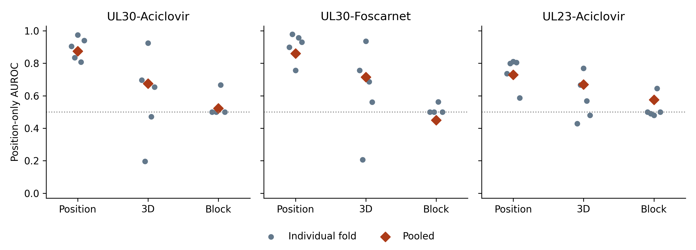
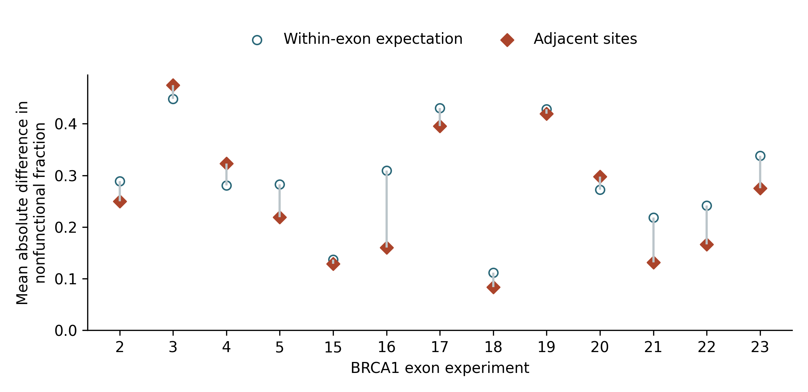

# Position-only prediction under regional holdout in HSV-1 resistance records and a BRCA1 functional assay

## Abstract

Grouping substitutions by residue prevents the same position from appearing in training and test data. Nearby positions can still occur in both. We measured the implications for a retrospective HSV-1 benchmark using a random forest whose sole input was residue number. Among 262 structure-mapped UL30–aciclovir records, median test-to-training sequence distance increased from 2 residues under position grouping to 17 under structural clustering and 78.5 under contiguous sequence blocks. Pooled out-of-fold AUROC fell from 0.875 to 0.675 and 0.523, respectively. Three of four evaluable contiguous blocks had AUROC exactly 0.500. Across all 332 primary-arm records, 81.9% of positive–negative pairs crossed fold boundaries under block holdout. Within-block concordance was 0.566 and across-block concordance was 0.436, yielding a pooled AUROC of 0.459. In an external BRCA1 saturation genome editing assay, grouped and regional AUROCs were 0.674 and 0.449 across 1,917 missense single-nucleotide variants (paired difference 0.225, conditional 95% interval 0.135 to 0.311). Adjacent BRCA1 sites within an exon had more similar fractions of nonfunctional variants than expected after within-exon permutation. Regional sampling and cross-fold pooling both influenced how much the position-only control appeared to discriminate.

## Introduction

An unseen substitution can lie next to a well-characterized position or in a region with little training data. These are different prediction tasks. A benchmark can exclude every training position from its test set and still reward a model for recognizing which parts of the protein have historically contained more records labelled resistant.

Prior work establishes both the general evaluation problem and the HSV application. Notin and colleagues compared random, modulo-position and contiguous-position splits for protein property prediction. Oscar James Charles evaluated HSV-1 aciclovir classifiers using several feature families and reported evaluation on external mutation data. Published herpesvirus databases also provide extensive historical genotype–phenotype curation. Our question is narrower. On the same HSV-1 records, how much discrimination can residue number alone achieve as the sequence separation between training and test positions increases? [ProteinNPT](https://papers.nips.cc/paper_files/paper/2023/file/6a4d5d85f7a52f062d23d98d544a5578-Paper-Conference.pdf) · [Charles, 2023, chapter 3](https://discovery.ucl.ac.uk/id/eprint/10169477/) · [HerpesDRG](https://doi.org/10.1186/s12859-024-05885-5)

## Methods

**Cohort.** The repository integrates published phenotype compilations, including HerpesDRG and the CMI review, by virus, gene, drug and substitution. The recorded binary phenotype derives from curated qualitative calls or quantitative susceptibility data using the project's threefold change criterion. The primary table excludes conflicting phenotypes and multisite records. Its 929 HSV-1 missense–drug records represent 630 distinct substitutions across two proteins. UL30–aciclovir is the primary analysis. UL30–foscarnet shares a protein and some substitutions with it. UL23–aciclovir provides a second protein. We held the records constant across all three splits by restricting the principal comparison to records with resolved coordinates, then repeated the two sequence-based splits on all records. [HerpesDRG](https://doi.org/10.1186/s12859-024-05885-5) · [CMI compilation](https://doi.org/10.1016/j.cmi.2025.04.046) · [Frozen input table](../data/processed/primary_3d_spatial_folds.tsv)

**Fold construction.** Within each gene–drug arm the stored position-grouped assignments use five-fold GroupKFold with residue number as the group. The structural assignments use five k-means clusters of resolved Cα coordinates per protein (seed 42, ten initializations, UL30 PDB 8V1Q chain A and UL23 PDB 1OF1 chain B). The sequence blocks use fixed intervals of 247 residues for UL30 and 75 for UL23 with the terminal residue included in the fifth block. The coordinate-matched analyses retain the original assignments. For each unique test position we computed the absolute difference in residue number to its closest training position. Each position contributes once to the median gap, regardless of how many substitutions were reported there. [Grouped folds](../scripts/build_reproducible_folds_and_subsets.py) · [Structural and sequence folds](../scripts/run_spatial_3d_holdout_experiment.py)

**Position-only control.** For each fold we fitted the repository's random forest with 100 trees, maximum depth five and seed 42. Its only input was residue number divided by reference protein length, standardized on the training fold. Each held-out record received one score. We enumerated all positive–negative score pairs and counted a win as one and a tie as one half, separating pairs by whether both scores came from the same fitted forest. Pooled AUROC compares all positive–negative pairs, including pairs scored by different fitted forests. Mean within-fold AUROC weights each evaluable fold equally and compares records scored by the same forest. A single-class fold contributes to pooled evaluation and has undefined within-fold AUROC. We report both quantities and show each evaluable fold. As a post-hoc check on the pooling effect, we also gave every record in a test fold the fraction of positive records in its training set. This constant score ties every pair within a fold. [Estimator](../scripts/run_split_degradation_benchmark.py) · [Audit implementation](../scripts/audit_position_control.py)

**Uncertainty.** We estimated a paired percentile interval for the difference in pooled AUROC between position-grouped and contiguous folds on matched records. In each of 2,000 draws we resampled whole residue positions with replacement, retained all their records and applied identical weights to both schemes. This retrospective sensitivity analysis conditions on the observed fold assignments and fitted scores. It measures sensitivity to the sampled positions. Uncertainty from selecting other studies, refitting models or changing block boundaries remains unmeasured.

**External experimental test.** We fixed a local analysis plan after inspecting the HSV results and before calculating the BRCA1 outcomes. Findlay and colleagues measured the effects of single-nucleotide variants (SNVs) in 13 selected exons of human BRCA1 using a cell-survival assay. We matched all 3,893 normalized MaveDB records to GEO Supplementary Table 1 by transcript variant. Maximum absolute score disagreement was below 10−14. We retained author-classified functional and nonfunctional missense SNVs, with nonfunctional as positive. We excluded 169 intermediate missense calls. We reused the position-only forest, position grouping and paired position bootstrap. The five contiguous groups each contain 65 or 66 observed sites to accommodate the long unmeasured interval between domains. The experimental endpoint and boundary rule therefore differ from HSV. [Local analysis plan](../docs/BRCA1_EXTERNAL_AUDIT.md) · [Findlay et al., 2018](https://doi.org/10.1038/s41586-018-0461-z) · [MaveDB score set](https://mavedb.org/score-sets/urn:mavedb:00000097-0-2)

**Within-exon comparison.** For each measured BRCA1 residue we calculated the fraction of retained SNVs with a nonfunctional call. We measured the absolute difference between these fractions for consecutive residue numbers assigned to the same exon experiment. Each pair contributed once. Six sites assigned to two experiments were excluded from this comparison. We permuted site fractions within their exon 9,999 times, keeping the observed adjacency pattern and exon-specific distribution fixed. The lower-tail permutation test used the add-one correction. This tests whether immediate neighbours have more similar experimental outcomes than other sites available within the same exon.

## Results

### The same records support different performance estimates under different holdouts

**Table 1. Position-only control on records with resolved coordinates.** Gap is the median nearest-training distance in residues. Evaluable folds contain both phenotypes.

| Arm | Records / sites | Held out | Gap | Pooled AUROC | Mean within-fold AUROC | Evaluable folds |
|---|---:|---|---:|---:|---:|---:|
| UL30-Aciclovir | 262 / 236 | Position-Grouped | 2 | 0.875 | 0.893 | 5/5 |
| UL30-Aciclovir | 262 / 236 | 3D k-Means Spatial | 17 | 0.675 | 0.589 | 5/5 |
| UL30-Aciclovir | 262 / 236 | Contiguous Block | 78.5 | 0.523 | 0.541 | 4/5 |
| UL30-Foscarnet | 242 / 219 | Position-Grouped | 2 | 0.861 | 0.904 | 5/5 |
| UL30-Foscarnet | 242 / 219 | 3D k-Means Spatial | 19 | 0.715 | 0.629 | 5/5 |
| UL30-Foscarnet | 242 / 219 | Contiguous Block | 81 | 0.450 | 0.516 | 4/5 |
| UL23-Aciclovir | 233 / 173 | Position-Grouped | 1 | 0.730 | 0.747 | 5/5 |
| UL23-Aciclovir | 233 / 173 | 3D k-Means Spatial | 5 | 0.670 | 0.583 | 5/5 |
| UL23-Aciclovir | 233 / 173 | Contiguous Block | 22 | 0.575 | 0.523 | 5/5 |

**Figure 1.** Each circle represents one evaluable fold and each diamond the pooled estimate. Horizontal offsets separate overlapping points. The horizontal line marks AUROC 0.5. Each panel uses the same structure-mapped records across its three designs.

In UL30–aciclovir, all five grouped folds had AUROC above 0.80. Under contiguous holdout, one block contained only one phenotype, three scored 0.500 and the fourth scored 0.666. The matched pooled difference was 0.352 AUROC units (paired position-bootstrap 95% interval 0.253 to 0.447). Structural holdout produced an intermediate pooled score, but individual structural folds ranged from 0.197 to 0.925. The pooled score alone gives little indication of that variation.

The two secondary arms showed the same ordering of pooled AUROCs. The size of the difference varied. The paired pooled difference was 0.412 for UL30–foscarnet (95% interval 0.273 to 0.538) and 0.154 for UL23–aciclovir (0.050 to 0.255). The three arms share source literature, and the two UL30 arms share sequence coordinates.

### Including unresolved positions changes the pooled estimate

Across all 332 UL30–aciclovir records, the median gap increased from 2 to **85** residues between grouped and contiguous holdouts. Pooled AUROC changed from 0.880 to **0.459**. Within the four evaluable contiguous folds the values were 0.500, 0.500, 0.639 and 0.500, for a mean of **0.535**. Of the 16,740 possible positive–negative pairs, 3,023 were scored within one fold and 13,717 (81.9%) across folds. Counting tied scores as half concordant, within-fold pairs had concordance 0.566 and across-fold pairs 0.436. Their pair-count-weighted average recovers the pooled 0.459. Every evaluable fold was at or above chance even though the pooled score was below chance. Across-fold comparisons can therefore change the interpretation of the result. The 78.5-residue figure applies specifically to the 262 coordinate-matched records. [Fold counts, gaps and AUROCs](../logs/position_control_folds.json)

A control using only the training-set prevalence illustrates the scale of the pooling effect. In the five full-cohort contiguous test blocks, the positive counts were 0/63, 1/39, 26/77, 32/77 and 3/76. Assigning each block its complementary training-set prevalence gave pooled AUROC **0.190**, despite an AUROC of exactly 0.500 in every evaluable block. Holding out a block rich in positive labels leaves fewer positives in training. This example shows how a below-chance pooled result can arise even with constant predictions inside each block. The fitted forest also varies its scores within blocks.

### Study ascertainment is a separate source of uncertainty

The repository's within-publication analysis compares resistant and sensitive records reported by the same study. For UL30–aciclovir, 14 mixed-label studies contributed 267 pairs, with 27.3% coming from one study. The previously reported difference in concordance between the composite of structural distance and evolutionary constraint and the BLOSUM62 substitution baseline was 0.230 (study-clustered 95% interval 0.015 to 0.496). The corresponding difference of contrasts between the two genes was 0.141 (−0.118 to 0.482). Comparing records within a publication reduces the contribution of between-study differences. Investigators still chose which positions to assay. These estimates concern a separate comparison and do not identify the source of regional label variation. [Ascertainment analysis](../logs/step1_ascertainment_control_results.json)

### Regional holdout also reduces discrimination in an independent functional assay

The BRCA1 comparison included 441 nonfunctional and 1,476 functional missense SNVs at 326 residues. Grouped-to-block pooled AUROC decreased by **0.225** (paired position-bootstrap 95% interval **0.135 to 0.311**), meeting the pre-analysis criterion for same-direction transfer. The mean within-fold AUROC also fell, from 0.682 to 0.533. Four of five evaluable blocks had AUROC exactly 0.500. Thus the drop persisted under an experimental sampling design that assayed substitutions systematically within selected exons. [External audit results](../logs/brca1_external_audit.json)

| BRCA1 split | Median gap, residues | Pooled AUROC | Within-fold pair concordance | Between-fold pair concordance | Prevalence-only pooled AUROC |
|---|---:|---:|---:|---:|---:|
| Grouped by position | 1 | 0.674 | 0.682 | 0.672 | 0.462 |
| Contiguous groups of sites | 21 | 0.449 | 0.524 | 0.430 | 0.406 |

**The assay contains measurable local similarity.** Across 307 adjacent pairs from 13 exon experiments, the average absolute difference in the nonfunctional fraction was **0.255**, against a mean of **0.295** under within-exon permutation (one-sided *p* = 0.0006). In percentage-point units, immediate neighbours differed by about four points less than the shuffled comparison. This describes the assayed SNVs and the authors' functional thresholds. Codon composition, numbers of variants assayed per site, splicing effects and local measurement effects could each influence these fractions. The result does not establish which of these accounts for the similarity or how much of the AUROC difference it explains.

**Figure 2.** For each exon, the diamond shows the mean absolute difference between adjacent measured sites and the circle shows the expected difference between two distinct sites sampled uniformly within that exon. Ten of 13 exons showed smaller differences between neighbours. In a post-hoc check, dropping each exon in turn left the overall reduction between 2.9 and 4.7 percentage points. The reduction was smallest after omitting exon 16.

## Discussion

In this benchmark, excluding a test residue and excluding its surrounding region gave markedly different estimates for a model with access only to residue number. The result persists on identical records and is visible within the primary arm's individual folds. Holding out a three-dimensional cluster also changes sequence separation, so its performance difference cannot be attributed solely to spatial structure.

Parker and colleagues demonstrated that pooling scores across folds can yield pessimistic AUROCs in small biological datasets. Our pair counts quantify that effect for this fixed partition. They do not identify the contribution of training prevalence, regional composition or score calibration separately. [Parker et al., 2007](https://doi.org/10.1186/1471-2105-8-326)

Position grouping answers a legitimate question when the intended use includes substitutions near previously observed positions. For an intended use involving poorly sampled regions, reporting the distribution of distances to training data makes that claim assessable. A small gap establishes an opportunity to interpolate. The observed score change also depends on which labels and regions each fold contains. Our design cannot isolate the causal contribution of distance, distinguish biological clustering from publication practices, or estimate performance at a new clinical centre.

The associated six-target geometry audit found that 20.0% to 97.6% of positions lay within two residues of a training site under its modulo split. The 20.0% value belongs to HIV-1 reverse transcriptase. That analysis used different position sets and a different assignment rule from the main grouped split. Its outcome was distance alone. The BRCA1 experiment extends the performance comparison to a cellular function assay. Replication in an independently collected antiviral susceptibility cohort remains open. [Geometry audit](../logs/cross_pathogen_leakage_audit.json)

The main empirical observation is the loss of within-region discrimination by a position-only control. Its practical consequence for benchmark reporting is straightforward. Give readers the test-to-training distances, the performance on identical records, and the individual fold results needed to interpret a pooled score.

## Data and code availability

The repository retains the frozen input, fold assignments and executable analysis. The audit writes all arm, cohort and fold counts, the SHA-256 of the input file, the scikit-learn version, paired intervals and Figure 1. The analyses use published, retrospectively curated records. Independent phenotype adjudication and external clinical validation remain outstanding. [Reproduction instructions](../README.md) · [Complete audit results](../logs/position_control_folds.json)
