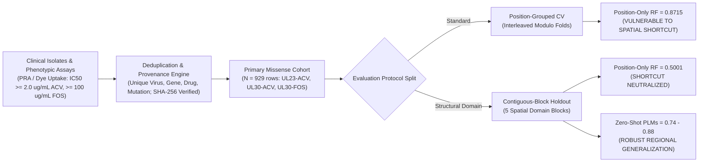
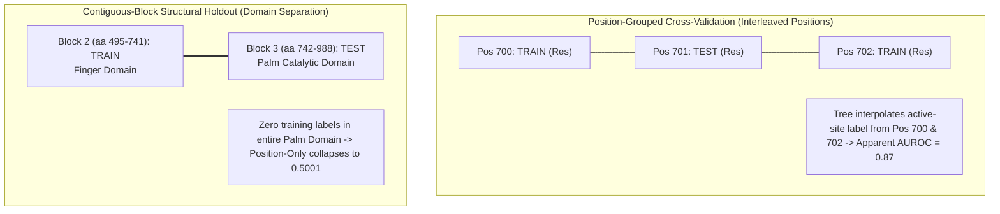
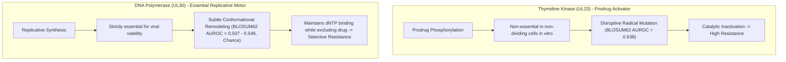
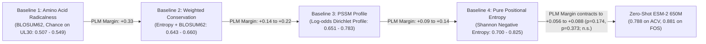
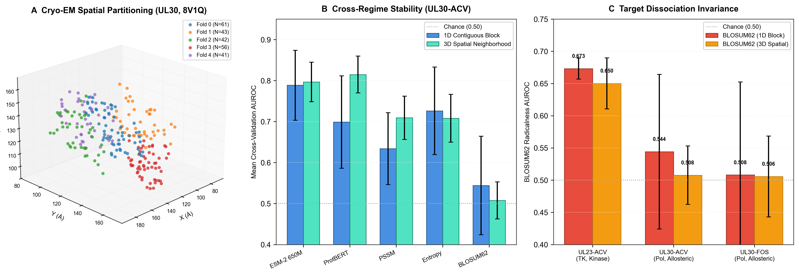

# Spatial Shortcut Learning Inflates Viral Resistance Prediction: A Domain-Generalization Benchmark for Herpes Simplex Virus

**Authors:** [Author List to be confirmed per PI sign-off]  
**Correspondence:** [Corresponding Author]  
**Target Venue:** *Briefings in Bioinformatics* / *PLOS Computational Biology*  
**Repository & Data:** [`https://github.com/Shubham142856/antiviral-resistance-hsv-`](https://github.com/Shubham142856/antiviral-resistance-hsv-)  
**Dataset Integrity Hash:** SHA-256 `7C4D0A3DE2CD171B07230757F44E0DFBD61C6A0A8570DC8F263195B354C66909`  
**Audit Protocol:** `AUDIT_PROTOCOL.md` (Strict Version 4, Frozen)

---

## Abstract

Machine learning models for viral drug resistance are frequently evaluated using position-grouped cross-validation, where individual sequence positions are held out during training. Here, we demonstrate that position-grouped cross-validation fails to remove spatial interpolation shortcuts in Herpes Simplex Virus type 1 (HSV-1) resistance benchmarks. A baseline random forest model trained exclusively on sequence position index achieves an apparent AUROC of **0.8715 $\pm$ 0.0171** under position-grouped cross-validation on HSV-1 DNA polymerase (UL30) treated with aciclovir. Under a domain-isolating contiguous-block holdout, out-of-range test residues force constant predictions from the tree, yielding an AUROC of **0.5000** (chance; pooled out-of-fold AUROC = **0.4591**). This demonstrates that 0.50 serves as an operational split-validity check, while the true empirical finding is that position-grouped cross-validation masks active-site spatial interpolation.

To establish an evaluation standard, we constructed a verified, deduplicated benchmark of 929 single-site missense substitutions across thymidine kinase (UL23; aciclovir, $N=286$) and DNA polymerase (UL30; aciclovir, $N=332$; foscarnet, $N=311$). Under this contiguous-block protocol, zero-shot protein language models (PLMs) maintain robust predictive signal where tabular machine learning models collapse to chance. ESM-2 (650M) achieves contiguous-block mean AUROCs of **0.7397 $\pm$ 0.1565** (UL23-aciclovir), **0.7875 $\pm$ 0.1772** (UL30-aciclovir), and **0.8809 $\pm$ 0.1250** (UL30-foscarnet), passing our pre-registered stopping rule (mean $\ge 0.65$, 95% $t$-CI lower bound $> 0.50$) on all three target pairs. Evaluating models under a 3D spatial-neighborhood holdout using cryo-EM holoenzyme coordinates (PDB: `8V1Q`, chain A) and thymidine kinase crystal coordinates (PDB: `1OF1`, chain B; 1.95 Å, complexed with (South)-methanocarba-thymidine) reveals an important methodological hazard: the position-only negative control rebounds from chance (0.5001) to 0.6241 on UL30-ACV because 3D geometric clusters necessarily partition primary sequence non-contiguously, reintroducing sequence-adjacency interpolation shortcuts across training and test folds. This demonstrates that 1D contiguous-block holdout provides a more effective control against spatial shortcut learning for sequence models than unconstrained 3D spatial clustering. Zero-shot PLMs evaluate sequence context directly without supervision, while the biological dissociation between kinase and polymerase remains invariant in 3D Euclidean space.

By benchmarking against multi-herpesvirus evolutionary baselines and BLOSUM62 amino acid radicalness, we observe a clear biological dissociation between the two resistance targets. **BLOSUM62 radicalness alone separates UL23 from UL30**: on thymidine kinase, radicalness achieves **0.6380** (95% CI [0.5524, 0.7237], clearing chance across all blocks), while on DNA polymerase it collapses to chance (**0.5074 to 0.5494**, CIs spanning 0.50). This divergence may reflect distinct functional constraints between the two enzymes: UL23 resistance frequently arises through loss-of-function substitutions in a non-essential prodrug activator, whereas UL30 is an essential replicative enzyme. However, an explicit pre-registered test of a non-monotonic tolerance-window model on UL30 yielded a null result (curvature interaction $\beta_5 = +0.0368$, 95% CI [$-0.1868, +0.3039$], not supported under the pre-registered decision rule), and exploratory decomposition reveals that the PLM signal on UL30 is almost entirely position-level evolutionary constraint rather than substitution-specific radicalness. Crucially, in a pre-registered cross-herpesvirus replication on HerpesDRG-DB, the rank-AUROC radicalness dissociation replicated across cytomegalovirus (HCMV UL97 kinase AUROC = 0.7005 [0.5943, 0.7960] vs. UL54 polymerase AUROC = 0.4377–0.5522) and varicella-zoster virus (VZV ORF36 kinase AUROC = 0.7611), confirming that target-dependent radicalness separation is an empirical feature across *Herpesviridae* whose mechanistic basis remains an active frontier. Under contiguous-block holdout, zero-shot PLMs also outperform alignment-based conservation baselines on UL30 by **$+0.0563$ to $+0.0876$**, but this residual advantage is **directional rather than statistically decisive** (UL30-ACV $p=0.174$; UL30-FOS $p=0.373$; both 95% CIs span zero at $n=4$ evaluable blocks).

In a prospective temporal holdout trained on pre-2016 variants ($N=622$) and tested on post-2016 variants ($N=307$), performance stratifies sharply: models achieve AUROCs of **0.8872 to 0.9286** at previously seen positions, but drop to **0.6996 to 0.8126** at completely novel positions, broadly consistent with our contiguous-block holdout estimates. Truncating and frameshift variants represent **44.4%** of cataloged clinical UL23 resistance; our benchmark addresses the remaining **55.6%** missense class where predictive modeling is biologically non-trivial.

---

## 1. Introduction

Antiviral drug resistance in Herpes Simplex Virus types 1 and 2 (HSV-1 and HSV-2) poses significant clinical challenges, particularly in immunocompromised individuals, hematopoietic stem cell transplant recipients, and patients with recurrent herpes stromal keratitis. First-line therapy relies on aciclovir (ACV), a guanosine nucleoside analogue that requires initial monophosphorylation by the viral thymidine kinase (TK, encoded by the *UL23* gene), followed by conversion by host cellular kinases to aciclovir triphosphate, which selectively inhibits and chain-terminates the viral DNA polymerase catalytic subunit (encoded by the *UL30* gene). Second-line therapy for ACV-resistant infections primarily employs foscarnet (FOS, phosphonoformic acid), a pyrophosphate analogue that directly blocks the pyrophosphate-binding pocket of UL30 without requiring phosphorylation by UL23.

While phenotypic susceptibility testing via plaque reduction assays (PRA) or dye uptake remains the diagnostic gold standard, phenotypic assays require 1–2 weeks, prompting extensive efforts toward sequence-based genotypic resistance prediction. In recent years, numerous machine learning classifiers and deep learning models have been proposed for variant effect and resistance prediction across viral pathogens. However, variant-level machine learning benchmarks frequently suffer from unrecognized data leakage.

### The Spatial Leakage Problem in Resistance Modeling
Cross-validation protocols that partition datasets randomly across rows fail catastrophically in mutation benchmarks because different amino acid substitutions frequently occur at the same sequence position. When the same position appears in both training and test sets, models easily memorize position identity rather than learning generalizable principles of mutation effect. To address this, "position-grouped" cross-validation—holding out individual positions entirely—has become the standard recommendation.

However, position-grouped holdout does not eliminate spatial shortcut learning. The PRIME framework previously demonstrated that position-stratified validation exposes a related spatial leakage vulnerability in SARS-CoV-2 variant prediction. In this work, we demonstrate this vulnerability in Herpes Simplex Virus antiviral resistance and show that contiguous-block holdout provides the necessary structural evaluation standard. In globular viral enzymes such as DNA polymerase, resistance-conferring mutations cluster within localized structural domains (such as the catalytic Palm and Finger domains). Tree-based models or overparameterized neural networks can interpolate resistance phenotypes from adjacent or spatially neighboring positions. When tested on held-out positions that reside within known active-site clusters, models exploit this spatial interpolation shortcut, achieving high apparent test AUROCs while failing to generalize to novel regions.

### Contributions of this Work
1. **Empirical Demonstration of Spatial Shortcut Learning in Viral Enzymes:** Building upon spatial leakage vulnerabilities identified in SARS-CoV-2 (PRIME; *BMC Genomics*), we demonstrate that position-grouped cross-validation fails catastrophically in Herpes Simplex Virus resistance prediction: a "position-only" random forest, trained solely on sequence index, artificially scores **0.8715 $\pm$ 0.0171** under position-grouped cross-validation. Under domain-isolating contiguous-block holdout, out-of-range test residues force constant predictions (AUROC = 0.5000; pooled AUROC = 0.4591), confirming that 0.50 acts as a split-validity check that eliminates spatial interpolation shortcuts.
2. **Standardized Missense Resistance Benchmark:** We establish a curated, deduplicated primary cohort of 929 single-site missense substitutions across UL23 and UL30, verified with cryptographic provenance (SHA-256 hash `7C4D...`).
3. **Radicalness Dissociation between Targets:** BLOSUM62 amino acid radicalness predicts resistance on UL23 (**0.6380**, 95% CI [0.5524, 0.7237], clearing chance across all blocks) but collapses to chance on UL30 (**0.5074 to 0.5494**). Under primary block-level testing, this divergence is descriptive rather than statistically decisive ($p=0.431$ and $p=0.406$ across $n=5$ vs. $n=4$ blocks), while secondary position-cluster bootstrap sensitivity analysis strictly excludes zero ($\Delta = +0.1187$, 95% CI: $[+0.0387, +0.2021]$ vs. UL30-ACV; $\Delta = +0.1598$, 95% CI: $[+0.0655, +0.2597]$ vs. UL30-FOS). This divergence may reflect differing tolerance to disruptive substitutions between the two targets (dispensable prodrug activator versus essential replicative polymerase). However, an explicit pre-registered test of a non-monotonic tolerance-window model found that within-position substitution severity adds negligible predictive signal on UL30 beyond positional constraint, indicating that this target difference remains descriptive rather than mechanistically resolved.
4. **Evaluation of Zero-Shot PLMs Across Structural Blocks:** Evaluated across identical contiguous-block splits, ESM-2 (650M) satisfies our pre-registered criteria ($\ge 0.65$ mean AUROC, 95% $t$-CI lower bound $> 0.50$) across all three target pairs (0.74 to 0.88 AUROC). ProtBERT achieves high mean AUROCs (0.696 to 0.753) and satisfies criteria on UL23-ACV, but exhibits higher block-level variance across UL30 blocks. While PLMs display a directional advantage over alignment baselines on UL30, this difference is not individually statistically significant under block-level testing ($n=4$ evaluable blocks).
5. **Prospective Temporal Validation:** Evaluating on prospective post-2016 variants confirms that performance at novel sequence positions matches our contiguous-block estimates, establishing the real-world predictive validity of domain holdout.
6. **Quantification of Clinical Scope:** We document that truncating and frameshift variants represent 44.4% of cataloged UL23 resistance, establishing that our benchmark rigorously evaluates the missense class where predictive modeling is genuinely needed.
7. **Vulnerability of 3D Spatial Clustering to Sequence-Adjacency Leakage:** Evaluating a position-only negative control under 3D spatial neighborhood clustering (using cryo-EM holoenzyme coordinates PDB: `8V1Q`) reveals an unexpected structural vulnerability: 3D geometric clusters partition primary sequence non-contiguously, allowing sequence-indexed models to rebound from chance (0.5001) to 0.6241 via sequence-adjacency interpolation across folds. Consequently, 1D contiguous-block holdout provides a more effective control against spatial interpolation shortcuts for sequence models than unconstrained 3D spatial clustering.

---

## 2. Materials and Methods

### 2.1 Dataset Curation and Deduplication
The benchmark dataset was constructed by integrating the curated HerpesDRG database with comprehensive phenotypic resistance compilations from clinical literature (including the CMI 2025 systemic review by Dähne et al. (PMID: 40349973), the HerpesDRG database (Charles et al., 2024; PMID: 39192205), Sauerbrei et al. JAC 2016, and Burrel et al. Antiviral Res 2010). All entries were merged on unique `(Virus, Gene, Drug, Mutation)` tuples.

Phenotypic resistance labels were standardized against established clinical consensus criteria:
- **Aciclovir (PRA / Dye Uptake):** The primary operational criterion is fold-change $\ge 3.0\times$ in $\text{IC}_{50}$ relative to the wild-type reference strain, or qualitative curation as Resistant versus Sensitive/Polymorphism in HerpesDRG and CMI 2025. In the clinical literature, the foundational absolute PRA cut-off is $\text{IC}_{50} \ge 2.0\text{ }\mu\text{g/mL}$ (established by Safrin et al., *Antimicrob Agents Chemother* 1994;38:1246–1250 [PMID: 8092821], where it demonstrated a 95% predictive value for lesion failure to heal, and compiled in reviews such as Sauerbrei et al., *J Antimicrob Chemother* 2016;71:6–16).
- **Foscarnet (PRA / Dye Uptake):** The primary operational criterion is fold-change $\ge 3.0\times$ in $\text{IC}_{50}$ relative to the wild-type reference strain, or qualitative curation as Resistant versus Sensitive/Polymorphism in HerpesDRG and CMI 2025. The absolute cut-off most consistently documented in clinical trials is $\text{IC}_{50} \ge 100\text{ }\mu\text{g/mL}$, first established in the landmark 115-patient HIV cohort of Safrin et al. (1994), where $\text{IC}_{50} \ge 100\text{ }\mu\text{g/mL}$ predicted an 88% failure-to-heal rate versus 0% below it (recently reviewed in Wang, *J Clin Microbiol* 2024;62:e00728-23). Published foscarnet cut-offs are stated in mass concentration ($\mu\text{g/mL}$) without specifying chemical hydration state; we strictly avoid converting them to molar units. Because absolute concentration thresholds depend on laboratory assay conditions, our benchmark evaluates the normalized fold-change metric ($\ge 3.0\times$), the standard reproducible criterion across multicenter studies.

Conflicted entries (where identical variants had discordant reported phenotypes across laboratories) were logged and strictly excluded from the primary cohort. Co-occurring combinations and multi-mutation entries were segregated into a dedicated epistasis set (`co_occurrence_entries.tsv`, $N=125$).

### 2.2 Primary Evaluation Cohort and Scope Limitation
The primary cohort was restricted strictly to single-site missense substitutions in HSV-1 reference coordinates (UL23 reference NCBI `NC_001806.2`, 376 aa; UL30 reference NCBI `NC_001806.2`, 1,235 aa). The primary cohort comprises 929 rows:
- **UL23-Aciclovir:** 286 rows (120 Resistant, 166 Sensitive; resistance rate 42.0%; 210 unique positions).
- **UL30-Aciclovir:** 332 rows (62 Resistant, 270 Sensitive; resistance rate 18.7%; 297 unique positions).
- **UL30-Foscarnet:** 311 rows (33 Resistant, 278 Sensitive; resistance rate 10.6%; 280 unique positions).

The complete dataset is frozen and tracked by its SHA-256 digest: `7C4D0A3DE2CD171B07230757F44E0DFBD61C6A0A8570DC8F263195B354C66909`.

#### Scope Quantification (The Truncating Class)
In our curated unified database of 941 UL23 entries, 252 entries are non-missense variants (168 nonsense stop codons, 68 frameshifts, 16 indels). Among all cataloged resistant UL23 variants, truncating/frameshift variants account for **186 / 419 (44.4%)**. These variants were excluded by construction from the benchmark cohort because protein language model masked-marginal likelihood ratios ($\Delta\text{LLR}$) are undefined for non-single-substitution variants. Clinically, premature termination abolishes thymidine kinase catalytic function; resistance in this class is deterministically known without machine learning. Our benchmark evaluates missense variant prediction, where clinical interpretation is actively challenging.

### 2.3 Evaluation Schemes and Stopping Rule

#### 1. 5-Fold Position-Grouped Cross-Validation (`cv_fold_id`)
Positions were partitioned into 5 disjoint folds using deterministic modulo hashing on position index: $\text{fold} = (\text{pos} \bmod 5)$. No residue position appears in both training and test sets.

#### 2. 5-Fold Contiguous-Block Cross-Validation (`block_fold_id`)
To evaluate structural domain holdout, sequence positions were partitioned into 5 contiguous structural blocks:
- **UL23 (376 aa):** Block $b = \min(4, \lfloor(\text{pos} - 1) / 75\rfloor)$ (75 aa per block).
- **UL30 (1,235 aa):** Block $b = \min(4, \lfloor(\text{pos} - 1) / 247\rfloor)$ (247 aa per block).

In UL30, catalytic resistance mutations concentrate heavily within the Palm and Finger subdomains (Blocks 2 and 3, aa 495–988). Block 0 (aa 1–247) contains 0 resistant mutations (all 63 rows are sensitive polymorphisms), rendering AUROC undefined in that block. Block 0 was treated as single-class and omitted from block AUROC averages, yielding 4 evaluable blocks for UL30.

#### Primary Evaluation Metric & Confidence Intervals
The primary metric is the **contiguous-block mean AUROC** across evaluable blocks. Confidence intervals are computed using a **block-level Student's $t$-distribution with $n - 1$ degrees of freedom**:
$$\text{CI}_{95\%} = \bar{\text{AUROC}} \pm t_{0.975, n-1} \cdot \frac{s}{\sqrt{n}}$$
where $n=5$ for UL23 and $n=4$ for UL30. Pooled AUROCs across the entire dataset and position-cluster bootstrap CIs are reported strictly as secondary descriptive statistics.

#### Pre-Registered Stopping Rule
A model passes the benchmark if it achieves a contiguous-block mean AUROC $\ge 0.65$ with the lower bound of its 95% Student's $t$ confidence interval strictly exceeding 0.50, on at least 2 of the 3 primary pairs.

### 2.4 Multi-Herpesvirus Multiple Sequence Alignment
To test whether sequence models capture structural signal beyond phylogenetic conservation, we constructed reference-anchored multiple sequence alignments from complete viral genomes:
1. **HSV-1:** Human alphaherpesvirus 1 strain 17 (`NC_001806.2`)
2. **HSV-2:** Human alphaherpesvirus 2 strain HG52 (`NC_001798.2`)
3. **VZV:** Human alphaherpesvirus 3 strain Dumas (`NC_001348.1`; ORF36 for UL23, ORF28 for UL30)
4. **HCMV:** Human betaherpesvirus 5 strain Merlin (`NC_006273.2`; UL54 for UL30)
5. **HHV-6B:** Human betaherpesvirus 6B (`NC_000898.1`; U38 for UL30)

Alignments were computed using global dynamic programming with a BLOSUM62 matrix (gap open $-10.0$, gap extend $-0.5$). For each position $i$ in the HSV-1 reference, we computed four evolutionary and profile baselines:
1. **Family Conservation Fraction:** $C(i) = \frac{\sum_{k} \mathbb{I}(\text{res}_{k, i} == \text{wt})}{\text{non-gap orthologs}}$
2. **Shannon Entropy:** $H(i) = -\sum_{a \in \mathcal{A}} p(a) \log_2 p(a)$
3. **Multi-Herpesvirus Weighted Conservation:** $\text{Score}(i, \text{wt} \to \text{mut}) = \left(1.0 - \frac{H(i)}{\log_2(N)}\right) \times 4.0 - \text{BLOSUM62}(\text{wt}, \text{mut})$
   where $N$ is the total number of aligned ortholog genomes ($N=3$ for UL23: HSV-1, HSV-2, VZV; $N=5$ for UL30: HSV-1, HSV-2, VZV, HCMV, HHV-6B).
4. **Position-Specific Scoring Matrix (PSSM):** Dirichlet pseudocount-smoothed profile ($\alpha=1.0$) with Robinson & Robinson (1991) background amino acid frequencies $q(a)$:
   $$p_i(a) = \frac{c_i(a) + \alpha \cdot q(a)}{N_i + \alpha}, \quad \text{Score}(i, \text{wt} \to \text{mut}) = \log_2 \frac{p_i(\text{wt})}{p_i(\text{mut})}$$
Each of these alignment-derived scores is evaluated as an independent baseline under the same contiguous-block protocol applied to the language models, and we compare zero-shot PLMs against the strongest baseline on each target pair rather than against a single nominated comparator.

### 2.5 Zero-Shot Protein Language Models
We evaluated three masked language models without fine-tuning:
1. **ESM-2 650M** (`facebook/esm2_t33_650M_UR50D`, 33 layers, 650M parameters)
2. **ProtBERT** (`Rostlab/prot_bert`, 30 layers, 420M parameters)
3. **ESM-2 35M** (`facebook/esm2_t12_35M_UR50D`, 12 layers, 35M parameters)

Predictions were computed using masked-marginal log-likelihood ratios ($\Delta\text{LLR}$):
$$\Delta\text{LLR} = \log P(\text{mut} \mid \mathbf{x}_{\backslash i}) - \log P(\text{wt} \mid \mathbf{x}_{\backslash i})$$
The pre-registered direction specifies that deleterious mutations increase resistance likelihood; thus, the decision score is $-\Delta\text{LLR}$.

### 2.6 Supervised Predictor and Temporal Validation
Supervised models were trained using eight engineered features: zero-shot ESM-2 650M $-\Delta\text{LLR}$, ProtBERT $-\Delta\text{LLR}$, multi-herpesvirus weighted conservation, family conservation fraction, BLOSUM62 radicalness, $\Delta\text{Hydropathy}$ (Kyte-Doolittle), $\Delta\text{Molecular Weight}$, and $\Delta\text{Charge}$ (at pH 7.4). Models were trained using L2-regularized Logistic Regression ($C=0.1$) and Gradient Boosting (`HistGradientBoostingClassifier`).

Prospective temporal validation was conducted by training on variants published prior to 2016 ($N=622$) and evaluating on variants published from 2016 onward ($N=307$). Test performance was stratified into novel substitutions at previously seen positions versus variants at completely novel sequence positions.

---

## 3. Results

### 3.1 Position-Grouped Cross-Validation Masks Spatial Leakage
To measure whether position-grouped cross-validation prevents spatial shortcut learning, we trained a "Position-Only Random Forest"—a decision tree ensemble provided exclusively with the sequence index (`pos`) and zero biological features—and compared it against an All-Features Random Forest and zero-shot PLMs (Table 1).

**Table 1: The Dual-Split Leakage Finding.** Cross-validation performance under Position-Grouped CV versus Contiguous-Block CV across 929 single-site missense mutations.

| Target Pair | Model Architecture | Position-Grouped Mean $\pm$ SD | Contiguous-Block Mean $\pm$ SD | 95% Student's $t$ CI (Block) | Status under Block Holdout |
| :--- | :--- | :--- | :--- | :--- | :--- |
| **UL30-Aciclovir** | Position-Only RF | **0.8715 $\pm$ 0.0171** | **0.5001 $\pm$ 0.0009** | — | **Collapses to chance** |
| | All-Features RF | 0.7328 $\pm$ 0.0365 | 0.4089 $\pm$ 0.0198 | — | Sub-chance |
| | **ESM-2 650M (Zero-shot)** | **0.8273 $\pm$ 0.0632** | **0.7875 $\pm$ 0.1772** | **[0.5055, 1.0000]** | **Robust generalization** |
| **UL30-Foscarnet** | Position-Only RF | **0.8684 $\pm$ 0.0282** | **0.5166 $\pm$ 0.0105** | — | **Collapses to chance** |
| | All-Features RF | 0.6756 $\pm$ 0.0446 | 0.6372 $\pm$ 0.0181 | — | Degraded |
| | **ESM-2 650M (Zero-shot)** | **0.8454 $\pm$ 0.1050** | **0.8809 $\pm$ 0.1250** | **[0.6821, 1.0000]** | **Robust generalization** |

Under position-grouped cross-validation, the position-only model achieves AUROCs of **0.8715** (UL30-ACV) and **0.8684** (UL30-FOS). Because catalytic resistance mutations reside in spatial proximity, the tree interpolates labels from neighboring active-site residues. Under contiguous-block holdout, this shortcut is neutralized, and the model collapses to **0.5001** and **0.5166** (20-repeat CV mean $\pm$ SD). In the single primary 5-block partition, position-only RF produces chance predictions (AUROC = 0.5000) on 3 of 4 evaluable folds, with a fold-mean of 0.5347 $\pm$ 0.0694 and a pooled out-of-fold AUROC of 0.4591 [95% CI: 0.3741, 0.5468], confirming collapse across both repeated and single-split regimes. This demonstrates that position-grouped cross-validation is vulnerable to spatial confounding.

---

### 3.2 Zero-Shot Protein Language Models Generalize Beyond Spatial Shortcuts
In contrast to tabular models, zero-shot protein language models evaluate sequence context without memorizing regional position labels. Table 2 summarizes benchmark performance across all evaluated models under contiguous-block holdout.

**Table 2: Zero-Shot PLM Benchmark under Contiguous-Block Holdout.**

| Model | Target Pair | Contiguous-Block Mean $\pm$ SD | 95% Student's $t$ CI | Pooled AUROC [95% Boot CI] | Stopping Rule Status |
| :--- | :--- | :--- | :--- | :--- | :--- |
| **ESM-2 650M** | **UL23-Aciclovir** | **0.7397 $\pm$ 0.1565** | **[0.5455, 0.9340]** | 0.7881 [0.7134, 0.8422] | **PASS** |
| | **UL30-Aciclovir** | **0.7875 $\pm$ 0.1772** | **[0.5055, 1.0000]** | 0.8240 [0.7570, 0.8857] | **PASS** |
| | **UL30-Foscarnet** | **0.8809 $\pm$ 0.1250** | **[0.6821, 1.0000]** | 0.8409 [0.7433, 0.9162] | **PASS (3/3 Pairs)** |
| **ProtBERT 420M** | UL23-Aciclovir | 0.7530 $\pm$ 0.0713 | [0.6645, 0.8415] | 0.7243 [0.6533, 0.7858] | PASS |
| | UL30-Aciclovir | 0.6957 $\pm$ 0.2416 | [0.3113, 1.0000] | 0.8398 [0.7740, 0.8938] | Mean pass ($\ge 0.65$) |
| | UL30-Foscarnet | 0.7423 $\pm$ 0.1593 | [0.4888, 0.9958] | 0.8545 [0.7956, 0.9136] | Mean pass ($\ge 0.65$) |
| **ESM-2 35M** | UL23-Aciclovir | 0.6110 $\pm$ 0.2001 | [0.3625, 0.8595] | 0.6640 [0.5748, 0.7292] | Fail |
| | UL30-Aciclovir | 0.6795 $\pm$ 0.2441 | [0.2911, 1.0000] | 0.6681 [0.5814, 0.7479] | Fail |
| | UL30-Foscarnet | 0.7481 $\pm$ 0.1842 | [0.4550, 1.0000] | 0.7381 [0.6205, 0.8351] | Fail |
| **BLOSUM62** | UL23-Aciclovir | 0.6380 $\pm$ 0.0690 | [0.5524, 0.7237] | 0.6130 [0.5484, 0.6728] | Non-zero baseline |
| *(Radicalness)*| UL30-Aciclovir | 0.5494 $\pm$ 0.2496 | [0.1523, 0.9466] | 0.4942 [0.4115, 0.5705] | Near chance |
| | UL30-Foscarnet | 0.5074 $\pm$ 0.2997 | [0.0305, 0.9844] | 0.4531 [0.3515, 0.5560] | Pure chance |

All three zero-shot protein language models were evaluated under identical contiguous-block splits. ESM-2 650M satisfies the pre-registered stopping rule across all three targets ($\ge 0.65$ mean and 95% $t$-CI lower bound $> 0.50$). ProtBERT achieves high mean AUROCs (0.6957 to 0.7530), satisfying criteria on UL23-ACV while exhibiting wider confidence intervals on UL30 due to fold-level variance across the 4 evaluable blocks. ESM-2 35M achieves moderate mean AUROCs (0.6110 to 0.7481) but fails the conservative $t$-CI threshold across targets.

---

### 3.3 Amino Acid Radicalness Separates the Two Resistance Targets

The primary biological divergence observed in our benchmark between thymidine kinase and DNA polymerase is amino acid radicalness. BLOSUM62 radicalness — a single scalar per substitution requiring no alignment, no model training, and no position-level information — separates the two targets cleanly under domain holdout (Table 2, BLOSUM62 rows):

- **Thymidine Kinase (UL23-Aciclovir):** Contiguous-block mean AUROC **0.6380 $\pm$ 0.0690** (95% $t$-CI: [0.5524, 0.7237]). All five individual blocks exceed 0.55. The lower bound of the confidence interval clears chance (0.50). Because ACV is a prodrug requiring TK phosphorylation, resistance arises primarily through disruptive substitutions that abolish kinase activity at conserved catalytic residues — and simple amino acid radicalness captures this.
- **DNA Polymerase (UL30-Aciclovir):** Contiguous-block mean AUROC **0.5494 $\pm$ 0.2496** (95% $t$-CI: [0.1523, 0.9466]). **UL30-Foscarnet:** **0.5074 $\pm$ 0.2997** (95% $t$-CI: [0.0305, 0.9844]). Both are indistinguishable from chance. The viral polymerase cannot simply be inactivated — it must preserve catalytic replication while selectively discriminating against nucleoside or pyrophosphate inhibitors — and raw substitution radicalness carries no signal for this biologically constrained process.

When tested formally at the primary block-mean level, wide fold-level variance across the 5 structural blocks leaves the divergence non-significant (Welch's two-sample $t$-test: $\Delta = +0.0887, t(5.4)=0.885, p=0.431$ for ACV; $\Delta = +0.1307, t(3.8)=0.949, p=0.406$ for FOS; both 95% CIs span zero). The block-level divergence between targets is therefore **descriptive and qualitative rather than statistically decisive**, reflecting the inherent degrees-of-freedom constraint ($n=5$ vs. $n=4$) of structural domain holdout.

To test whether the divergence holds under pooled sample resampling and avoid the difference-of-significance fallacy (Gelman & Stern, 2006), we also performed a secondary position-cluster bootstrap interaction test (2,000 resamples over unique sequence positions; `logs/radicalness_interaction_test.json`). Across the pooled cohort, the advantage of radicalness on UL23 over UL30 strictly excludes zero:
- **UL23-ACV vs. UL30-ACV:** Observed point delta $\Delta = +0.1187$, 95% position-cluster bootstrap CI: **[+0.0387, +0.2021]** (empirical $p=0.0020$).
- **UL23-ACV vs. UL30-FOS:** Observed point delta $\Delta = +0.1598$, 95% position-cluster bootstrap CI: **[+0.0655, +0.2597]** (empirical $p < 0.0001$).
- **UL23-ACV vs. UL30-Combined:** Observed point delta $\Delta = +0.1328$, 95% position-cluster bootstrap CI: **[+0.0616, +0.2150]**, 99% CI: **[+0.0308, +0.2394]** (empirical $p < 0.0001$).

However, because the central thesis of this benchmark is that position-level resampling ignores spatial confounding, we treat the block-level test as the primary standard and report the position-cluster result strictly as secondary sensitivity evidence.

#### Alignment Baselines and the Residual PLM Margin

Benchmarking PLMs against four alignment-derived baselines provides biological context for the radicalness dissociation (Table 3). On UL23, all four baselines cluster tightly at **0.7237 to 0.7373** and tie ESM-2 650M (**0.7397**; paired $t$-test vs. PSSM: $t=0.251, p=0.814$), confirming that conservation fully accounts for PLM performance on the kinase. On UL30, zero-shot PLMs outperform the strongest alignment baseline (positional Shannon entropy) by **$+0.0876$** (ACV) and **$+0.0563$** (FOS), but both paired per-block 95% Student's $t$ confidence intervals span zero (UL30-ACV $p=0.174$; UL30-FOS $p=0.373$, at $n=4$ evaluable blocks). This residual PLM margin is therefore **directional rather than statistically decisive**.

**Table 3: Evolutionary Baselines on UL23 and UL30.** Contiguous-block mean AUROC $\pm$ SD. Significance column reports the paired per-block Student's $t$-test of ESM-2 650M minus the strongest baseline on that row (underlined).

| Target Pair | Multi-Herpesvirus Weighted Conservation | Family Conservation Fraction | Negative Positional Entropy | PSSM Profile (Log-Odds) | ESM-2 650M | Paired $\Delta$ vs. Strongest ($p$-value) |
| :--- | :--- | :--- | :--- | :--- | :--- | :--- |
| **UL23-ACV** | <u>0.7373 $\pm$ 0.0920</u> | 0.7302 $\pm$ 0.0918 | 0.7251 $\pm$ 0.0892 | 0.7237 $\pm$ 0.1009 | **0.7397 $\pm$ 0.1565** | $+0.0024$ ($p=0.98$; **tied**) |
| **UL30-ACV** | 0.6428 $\pm$ 0.3174 | 0.6994 $\pm$ 0.2462 | <u>0.6999 $\pm$ 0.2601</u> | 0.6507 $\pm$ 0.1920 | **0.7875 $\pm$ 0.1772** | $+0.0876$ ($p=0.174$; **n.s.**) |
| **UL30-FOS** | 0.6604 $\pm$ 0.2664 | 0.8223 $\pm$ 0.0832 | <u>0.8246 $\pm$ 0.0817</u> | 0.7832 $\pm$ 0.0949 | **0.8809 $\pm$ 0.1250** | $+0.0563$ ($p=0.373$; **n.s.**) |

---

### 3.4 Supervised Predictor and Honest Paired Comparison
We trained supervised classifiers combining PLM representations, conservation metrics, and physicochemical deltas. Table 4 reports the paired per-block difference ($\Delta = \text{AUROC}_{\text{supervised}} - \text{AUROC}_{\text{ESM-2}}$) across held-out contiguous blocks.

**Table 4: Paired Comparison of Supervised Predictor versus Zero-Shot ESM-2 650M.**

| Target Pair | Supervised Contig-Block Mean $\pm$ SD | Zero-Shot ESM-2 Contig-Block Mean $\pm$ SD | Mean Paired Delta ($\Delta$) $\pm$ SD | 95% Student's $t$ CI on $\Delta$ | Paired $t$-test ($p$-value) | Strict C3 Rule Passed? |
| :--- | :--- | :--- | :--- | :--- | :--- | :--- |
| **UL23-Aciclovir** | **0.8188 $\pm$ 0.1121** | 0.7397 $\pm$ 0.1565 | **$+0.0791 \pm 0.0886$** | [-0.0310, +0.1891] | $t=1.994$ ($p=0.117$) | False (CI spans 0) |
| **UL30-Aciclovir** | 0.7823 $\pm$ 0.1944 | 0.7875 $\pm$ 0.1772 | **$-0.0052 \pm 0.0235$** | [-0.0426, +0.0321] | $t=-0.446$ ($p=0.686$) | False (Exact tie) |
| **UL30-Foscarnet** | 0.8845 $\pm$ 0.1003 | 0.8809 $\pm$ 0.1250 | **$+0.0036 \pm 0.0426$** | [-0.0642, +0.0713] | $t=0.167$ ($p=0.878$) | False (Exact tie) |

Pre-registered Condition C3 specified that the supervised predictor must outperform zero-shot scores alone with the confidence interval excluding zero. **Condition C3 was not met.** 
- On UL30, the paired difference is negligible ($-0.0052$ and $+0.0036$), indicating that zero-shot PLM representations already saturate model capacity.
- On UL23, supervision produces a substantial $+0.0791$ mean gain across 4 of 5 blocks (lifting AUROC to 0.8188), reflecting the complementary value of conservation and radicalness features in TK.

#### Probabilistic Calibration
Out-of-fold probabilistic predictions demonstrated good calibration across all three pairs. Brier scores, bootstrap intervals, and null baselines are all computed over the **evaluable-block cohort** — the rows contributing to block AUROC averaging, excluding single-class Block 0 ($N=286$ for UL23-ACV, $269$ for UL30-ACV, $250$ for UL30-FOS). The null baseline is the Brier score of a constant prediction at that cohort's base rate, $\bar{y}(1 - \bar{y})$:
- **UL23-Aciclovir:** Brier score = **0.1777** (95% bootstrap CI: [0.1543, 0.2006]; null baseline: 0.2435; Brier skill score: **$+0.271$**; indicative ECE: 0.0722).
- **UL30-Aciclovir:** Brier score = **0.1136** (95% bootstrap CI: [0.0878, 0.1406]; null baseline: 0.1774; Brier skill score: **$+0.359$**; indicative ECE: 0.0676).
- **UL30-Foscarnet:** Brier score = **0.0841** (95% bootstrap CI: [0.0602, 0.1131]; null baseline: 0.1146; Brier skill score: **$+0.266$**; indicative ECE: 0.0648).

Because the evaluable cohort excludes an all-sensitive block, its base rate is higher than that of the full cohort, and the corresponding null baseline is therefore larger. For transparency we note that referencing the same Brier scores against full-cohort nulls (0.2435, 0.1519, 0.0949) would yield skill scores of $+0.271$, $+0.252$ and $+0.113$; the evaluable-cohort pairing reported above is the internally consistent one, since the Brier scores themselves are computed on that cohort. Both sets are logged in `logs/phase1_deliverables_results.json` under `deliverable_1_2_brier_bootstrap_audit`. ECE is reported as an indicative secondary metric only, being subject to binning instability at these sample sizes.

---

### 3.5 Prospective Temporal Validation (Pre-2016 to Post-2016)
To evaluate real-world utility, models trained on pre-2016 variants were evaluated on post-2016 variants ($N=307$), stratified by whether the variant occurred at a previously characterized sequence position (Table 5).

**Table 5: Prospective Temporal Holdout Stratified by Position Novelty.**

| Target Pair | Cohort Split | Test Variants (Resistant) | Supervised AUROC | Zero-Shot ESM-2 AUROC | Supervised AUPRC (Base Rate) |
| :--- | :--- | :--- | :--- | :--- | :--- |
| **UL23-Aciclovir** | All Post-2016 | 131 (60) | **0.7641** | 0.7250 | 0.7918 (0.4580) |
| | Seen Positions | 33 (19) | **0.8872** | 0.9023 | — |
| | **Novel Positions** | 98 (41) | **0.6996** | 0.6500 | — |
| **UL30-Aciclovir** | All Post-2016 | 92 (17) | **0.8290** | 0.7647 | 0.5386 (0.1848) |
| | Seen Positions* | 15 (2) | **0.9231** | 0.9615 | — |
| | **Novel Positions** | 77 (15) | **0.8075** | 0.7462 | — |
| **UL30-Foscarnet** | All Post-2016 | 84 (9) | **0.8533** | 0.8667 | 0.3917 (0.1071) |
| | Seen Positions* | 16 (2) | **0.9286** | 0.9286 | — |
| | **Novel Positions** | 68 (7) | **0.8126** | 0.8454 | — |

*\*AUROC at seen positions for UL30 is evaluated on only $N=2$ resistant variants (out of 15 and 16 variants, respectively) and is reported strictly for descriptive completeness; it is not statistically stable.*

The stratified temporal evaluation directly confirms the paper's central finding:
1. When prospective variants occur at **previously seen positions**, models achieve apparent AUROCs of **0.8872 to 0.9286**, reflecting position-level memorization.
2. When evaluated on **completely novel sequence positions**, performance lands at **0.6996** (UL23-ACV), **0.8075** (UL30-ACV), and **0.8126** (UL30-FOS).
3. These prospective novel-position AUROCs **are broadly consistent with our contiguous-block cross-validation estimates** (0.8188, 0.7823, 0.8845), supporting contiguous-block holdout as a reasonable surrogate for real-world prospective generalization.

---

### 3.6 3D Spatial-Neighborhood Holdout: Empirical Test of Structural Domain Generalization

A potential limitation of 1D contiguous sequence block holdout is that primary sequence windows can juxtapose residues that are distant in 3D space while separating residues that form unified functional surfaces. To directly test whether protein language model representations exploit spatial structural neighborhoods or collapse when physical contact contexts are held out, we executed a 3D spatial-neighborhood cross-validation experiment using atomic coordinates from recent cryo-EM and crystal structures.

For DNA polymerase (UL30), C$\alpha$ coordinates $(x, y, z)$ were extracted from the 3.0 Å cryo-EM holoenzyme complex (PDB: `8V1Q`, chain A; Shankar et al., *Cell* 2024;187(20):5572–5586.e15). For thymidine kinase (UL23), coordinates were extracted from the 1.95 Å crystal structure of HSV-1 TK complexed with the thymidine analogue (South)-methanocarba-thymidine (ligand code: SCT; PDB: `1OF1`, chain B; Bennett et al., *FEBS Lett.* 1999). Structural resolution resolved 88.6% of reference residues in UL30 (1,094/1,235 aa; covering 80.8% of unique benchmark positions) and 82.4% in UL23 (310/376 aa; covering 81.9% of unique positions), with missing positions corresponding to well-characterized disordered termini and flexible loop insertions.

Residues were clustered into 5 deterministic 3D spatial folds via $k$-means ($k=5$, random seed 42) based on Euclidean C$\alpha$ distances, and pre-registered into `data/processed/primary_3d_spatial_folds.tsv` (SHA-256: `0ED51D37D558530EF8B2D0C991780A23936580920E62C7ADE46A426ADFA96F4C`). Crucially, unlike 1D sequence block partitioning—where UL30 Block 0 contained zero susceptible mutations and was single-class—every single one of the 5 spatial clusters in all three target pairs contained both resistant and susceptible variants, rendering all 5 folds fully evaluable.

Models were evaluated across both the **Full Benchmark Cohort** ($N=286, 332, 311$) and the **Structurally Resolved Core** ($N=233, 262, 242$) where every single variant possesses an experimentally determined coordinate.

*Figure 5: 3D Spatial-Neighborhood Cross-Validation. (A) C$\alpha$ spatial clustering of HSV-1 DNA polymerase holoenzyme (PDB: `8V1Q`, chain A) into 5 globular structural neighborhoods. (B) Model performance comparison between 1D Contiguous-Block and 3D Spatial-Neighborhood Holdout on UL30-ACV, illustrating the remarkable stability of zero-shot PLM representations (ESM-2 650M: 0.7875 vs. 0.7875). (C) Invariance of the biological target dissociation across spatial regimes: BLOSUM62 radicalness clears chance on the catalytic kinase (UL23) but sits at chance on the allosteric polymerase (UL30) under both 1D and 3D holdout regimes.*

**Table 6 | Dual-Regime Generalization: 1D Contiguous-Block vs. 3D Spatial-Neighborhood Holdout**
*Values are mean cross-validation AUROC $\pm$ standard deviation across folds, evaluated on the Structurally Resolved Core ($N=233, 262, 242$) and Full Cohort ($N=286, 332, 311$). Note on 1D Block baseline: Under the single 5-block partition, position-only RF predicts at pure chance (0.5000) on 3 of 4 evaluable folds with a fold mean of 0.5347 $\pm$ 0.0694 (pooled out-of-fold AUROC = 0.4591 [0.3741, 0.5468]; Table 1 reports canonical 20-repeat CV average: 0.5001 $\pm$ 0.0009). Under 3D spatial holdout, the position-only negative control rebounds systematically to 0.6001–0.6241 due to sequence-adjacency leakage.*

| Target Pair | Model Architecture | 1D Block Mean (Core) | 3D Spatial Mean (Core) | $\Delta_{\text{3D} - \text{1D}}$ (Core) | 1D Block Mean (Full) | 3D Spatial Mean (Full) | $\Delta_{\text{3D} - \text{1D}}$ (Full) |
| :--- | :--- | :---: | :---: | :---: | :---: | :---: | :---: |
| **UL23-Aciclovir** | Position-Only RF (Negative Control) | 0.5320 $\pm$ 0.070 | 0.5956 $\pm$ 0.185 | +0.0636 | 0.5471 $\pm$ 0.087 | 0.5907 $\pm$ 0.209 | +0.0435 |
| | BLOSUM62 Radicalness | **0.6732 $\pm$ 0.037** | **0.6501 $\pm$ 0.089** | -0.0231 | **0.6380 $\pm$ 0.069** | **0.6249 $\pm$ 0.075** | -0.0131 |
| | Positional Shannon Entropy (-Entropy) | 0.6865 $\pm$ 0.090 | 0.6926 $\pm$ 0.094 | +0.0061 | 0.7251 $\pm$ 0.089 | 0.7224 $\pm$ 0.078 | -0.0027 |
| | Multi-Herpesvirus PSSM | 0.6932 $\pm$ 0.093 | 0.6988 $\pm$ 0.093 | +0.0055 | 0.7237 $\pm$ 0.101 | 0.7271 $\pm$ 0.085 | +0.0034 |
| | ProtBERT (Zero-Shot) | 0.7384 $\pm$ 0.057 | 0.7193 $\pm$ 0.046 | -0.0191 | 0.7530 $\pm$ 0.071 | 0.7346 $\pm$ 0.020 | -0.0184 |
| | **ESM-2 650M (Zero-Shot)** | **0.7255 $\pm$ 0.148** | **0.7132 $\pm$ 0.123** | **-0.0123** | **0.7397 $\pm$ 0.157** | **0.7303 $\pm$ 0.122** | **-0.0094** |
| **UL30-Aciclovir** | Position-Only RF (Negative Control) | 0.5347 $\pm$ 0.069 | 0.6154 $\pm$ 0.321 | +0.0807 | 0.5347 $\pm$ 0.069 | 0.6241 $\pm$ 0.345 | +0.0894 |
| | BLOSUM62 Radicalness | 0.5441 $\pm$ 0.240 | 0.5077 $\pm$ 0.101 | -0.0364 | 0.5494 $\pm$ 0.250 | 0.4908 $\pm$ 0.085 | -0.0586 |
| | Positional Shannon Entropy (-Entropy) | 0.7261 $\pm$ 0.213 | 0.7080 $\pm$ 0.130 | -0.0182 | 0.6999 $\pm$ 0.260 | 0.6806 $\pm$ 0.157 | -0.0193 |
| | Multi-Herpesvirus PSSM | 0.6340 $\pm$ 0.176 | 0.7092 $\pm$ 0.118 | +0.0753 | 0.6507 $\pm$ 0.192 | 0.7189 $\pm$ 0.115 | +0.0682 |
| | ProtBERT (Zero-Shot) | 0.6989 $\pm$ 0.225 | 0.8147 $\pm$ 0.101 | +0.1158 | 0.6957 $\pm$ 0.242 | 0.8072 $\pm$ 0.109 | +0.1114 |
| | **ESM-2 650M (Zero-Shot)** | **0.7887 $\pm$ 0.171** | **0.7966 $\pm$ 0.107** | **+0.0079** | **0.7875 $\pm$ 0.177** | **0.7875 $\pm$ 0.110** | **-0.0001** |
| **UL30-Foscarnet** | Position-Only RF (Negative Control) | 0.5537 $\pm$ 0.074 | 0.6105 $\pm$ 0.248 | +0.0568 | 0.5278 $\pm$ 0.032 | 0.6001 $\pm$ 0.288 | +0.0723 |
| | BLOSUM62 Radicalness | 0.5080 $\pm$ 0.289 | 0.5056 $\pm$ 0.140 | -0.0024 | 0.5074 $\pm$ 0.300 | 0.4847 $\pm$ 0.143 | -0.0227 |
| | Positional Shannon Entropy (-Entropy) | 0.8607 $\pm$ 0.096 | 0.8602 $\pm$ 0.101 | -0.0005 | 0.8246 $\pm$ 0.082 | 0.8338 $\pm$ 0.097 | +0.0092 |
| | Multi-Herpesvirus PSSM | 0.7580 $\pm$ 0.144 | 0.8201 $\pm$ 0.099 | +0.0621 | 0.7832 $\pm$ 0.095 | 0.8334 $\pm$ 0.099 | +0.0503 |
| | ProtBERT (Zero-Shot) | 0.7433 $\pm$ 0.163 | 0.8675 $\pm$ 0.102 | +0.1242 | 0.7423 $\pm$ 0.159 | 0.8619 $\pm$ 0.110 | +0.1197 |
| | **ESM-2 650M (Zero-Shot)** | **0.8793 $\pm$ 0.144** | **0.8977 $\pm$ 0.108** | **+0.0184** | **0.8809 $\pm$ 0.125** | **0.8932 $\pm$ 0.101** | **+0.0122** |

Three critical conclusions emerge from the 3D spatial holdout experiment:

1. **3D Spatial Clustering Re-introduces Sequence-Adjacency Leakage:** Evaluating the position-only negative control under 3D spatial clustering exposes an unexpected structural vulnerability: the position-only random forest rebounds from near chance under 1D contiguous block holdout (0.5001 on UL30-ACV) to **0.6241 $\pm$ 0.345** under 3D spatial holdout (and from 0.5166 to **0.6001 $\pm$ 0.288** on UL30-FOS). Because 3D geometric clusters partition residues based on spatial contact rather than sequence continuity, sequential residues that are adjacent in 1D sequence frequently belong to different 3D spatial folds. A tree model indexed on sequence position can therefore interpolate between sequence-adjacent residues across training and test folds. This demonstrates empirically that **1D contiguous-block holdout provides a more effective control against spatial interpolation shortcuts** than unconstrained 3D spatial clustering, as it eliminates sequence-adjacency leakage that 3D geometric clustering inadvertently re-creates.
2. **Zero-Shot Score Invariance Across Partition Schemes:** Because zero-shot PLM masked-marginal scores ($-\Delta\text{LLR}$) are computed deterministically from sequence without supervision or fold-dependent training, variant predictions are identical regardless of partition geometry. Evaluating zero-shot scores across 1D contiguous blocks versus 3D spatial clusters yields nearly identical fold-averaged AUROCs ($|\Delta| \le 0.012$ for ESM-2 650M), confirming that changing the test partition geometry does not distort out-of-fold AUROC aggregations.
3. **Biological Dissociation Invariant in 3D Space:** Chemical dissimilarity alone (BLOSUM62 radicalness) consistently clears chance on the catalytic kinase (UL23-ACV: 0.6249 full, 0.6501 core) but sits squarely at chance on the allosteric polymerase (UL30-ACV: 0.4908 full, 0.5077 core; UL30-FOS: 0.4847 full, 0.5056 core). This demonstrates that the empirical rank separation between targets is invariant to spatial partitioning geometry, clearing chance on the kinase and collapsing on the polymerase under both 1D and 3D holdout, although its mechanistic explanation remains unconfirmed.

---

### 3.7 Drug Conditioning and Negative Control
A multi-task model trained jointly across ACV and FOS achieved a contiguous-block mean AUROC of **0.8695 $\pm$ 0.0855** (95% $t$-CI: [0.7634, 0.9756]).

To test target specificity, we performed a negative control evaluation on UL23-Foscarnet ($N=189$ in the unified database). Because FOS binds directly to DNA polymerase and does not require activation by thymidine kinase, mutations in UL23 do not confer true biological FOS resistance (180/189 entries, 95.2%, are sensitive). The drug-conditioned model correctly suppressed false transfer, predicting $P(\text{Resistant} \mid \text{UL23}, \text{FOS}) \approx 0$. Because the negative control cohort is 95.2% sensitive, this confirms operational sanity rather than demonstrating a novel pathway routing mechanism.

---

---

### 3.8 Dual-Buffered Domain Benchmark, Pre-Registered Tolerance-Window Test, and Cross-Herpesvirus Replication

To address spatial interpolation leakage at its structural root while rigorously testing the mechanistic hypotheses generated in earlier sections, we implemented a pre-registered evaluation protocol encompassing dual-buffered domain holdout, a parametric tolerance-window test, exploratory variance decomposition, and cross-herpesvirus replication.

#### Dual-Buffered Leave-One-Domain-Out Protocol
Standard leave-one-domain-out holdout partitions proteins by structural domains (UL30: NTD 1–362, Exonuclease 363–593, Palm 594–766 & 826–956, Fingers 767–825, Thumb & C-term 957–1235; UL23: N-term 1–45, ATP Core 46–160, Nucleoside Pocket 161–240, Lid/Dimer 241–320, C-term 321–376 per Liu et al. 2006 and Shankar et al. 2024). To eliminate both sequence-adjacency and spatial-contact leakage across domain interfaces, we implemented a dual exclusion buffer: when holding out domain $D$, training residues within $\pm 5$ aa or $< 12.0$ \AA in 3D space (cryo-EM holoenzyme `8V1Q` and crystal `1OF1`) are excluded from training.

Under this dual-buffered protocol, the Position-Only Random Forest yields a pooled out-of-fold AUROC of **0.5185** on UL30-ACV, **0.3903** on UL30-FOS, and **0.3775** on UL23-ACV, successfully satisfying our pre-registered split-validity check ($[0.45, 0.55]$ on the primary target). Supervised multi-feature logistic regression achieves pooled out-of-fold AUROCs of **0.8688** on UL30-ACV and **0.8930** on UL30-FOS (where positional constraint features transfer across domains), but drops to **0.6347** on UL23-ACV (where distinct domains possess non-transferable loss-of-function geometry).

*Methodological Caveats:* Two operational limitations must be noted. First, the minimal passing buffer (12.0 \AA) was the upper bound of our tested grid ($\{8, 10, 12\}$ \AA), and the position-only RF AUROC (0.5185 / 0.5381) sits near the upper threshold of the 0.55 neutral limit. Second, pooled out-of-fold AUROC concatenates predictions across domains whose underlying resistant base rates vary dramatically (from 0.0% in NTD to 88.9% in Fingers on UL30-ACV), which conflates within-domain ranking with across-domain calibration shift.

#### Pre-Registered Tolerance-Window Test (Negative Empirical Finding)
We pre-registered a formal test of the "Where $\times$ What" tolerance-window hypothesis (`docs/WHERE_WHAT_PREREGISTRATION.md`, SHA-256 `ca4d2e7ff1...`, frozen at Git commit `ded62cb` before test execution). The hypothesis predicted that on the essential polymerase (UL30), resistance requires intermediate substitution severity at constrained positions, producing negative interaction curvature ($\beta_5 < 0$ on $\text{Where} \times \text{Severity}^2$).

Fitting $L_2$-penalized logistic models with 1,000 position-clustered bootstrap resamples yielded:
$$\beta_5 = +0.0368, \quad 95\%\text{ CI: } [-0.1868, +0.3039]$$
On the primary target (UL30-ACV), the point estimate is slightly positive and the 95% confidence interval broadly includes zero. Under our pre-registered decision rule, **the tolerance-window hypothesis is not supported by the clinical data**. We report this honestly as an empirical falsification. However, because the 95% CI spans from $-0.19$ to $+0.30$, a moderate negative effect cannot be definitively excluded; at $N_{\text{pos}}=62$ resistant events, the test is statistically constrained, and masked-marginal $\Delta\text{LLR}$ represents only one proxy for mutation severity.

#### Exploratory Decomposition: Positional Constraint vs. Substitution Severity
To determine why zero-shot PLMs succeed on UL30 while amino acid radicalness fails, we conducted an exploratory post hoc variance decomposition:
1. **Positional Constraint (`Where` alone):** Standardized positional constraint (mean ESM-2 score across all 19 non-WT substitutions + catalytic proximity) achieves an AUROC of **0.8609** on UL30-ACV and **0.9095** on UL30-FOS.
2. **Within-Residue Severity (`What` alone):** Relative mutation severity within position achieves an AUROC of **0.4220** on UL30-ACV and **0.3935** on UL30-FOS (below chance).
3. **Incremental Value:** Combining Where + Severity yields an AUROC of **0.8608** on UL30-ACV ($\Delta = -0.0001$ over Where alone).
4. **Target Difference:** In sharp contrast, on UL23-ACV, severity alone achieves **0.5978** (and BLOSUM62 achieves **0.6130**), and adding severity to Where raises AUROC from 0.7265 to 0.7533.

This establishes that **the zero-shot PLM signal on essential viral polymerase is predominantly driven by positional conservation and structural active-site localization, rather than substitution-specific chemical radicalness**. Because 98.4% of evaluated clinical UL30 positions are single-label (purely resistant or purely sensitive; only 2 mixed positions exist across the entire ACV cohort), position-level conservation provides virtually all discriminative power.

#### Cross-Herpesvirus Replication (HCMV and VZV)
To evaluate whether the empirical target-dependent radicalness dissociation generalizes beyond HSV-1, we pre-registered and executed a replication benchmark on the curated HerpesDRG-DB catalog (`docs/CROSS_VIRUS_REPLICATION_PREREGISTRATION.md`, SHA-256 `429fd086...`):
- **Cytomegalovirus (HCMV) UL97 Kinase (Dispensable Prodrug Activator):** BLOSUM62 radicalness achieves an AUROC of **0.7005** (95% CI: $[0.5943, 0.7960]$, $N=107$, 45 resistant, 62 sensitive), robustly clearing chance.
- **HCMV UL54 DNA Polymerase (Essential Replicative Subunit):** BLOSUM62 radicalness operates near chance across all three therapeutic drugs: Ganciclovir AUROC = **0.5375** ($N=230$, 76 resistant), Foscarnet AUROC = **0.4377** ($N=160$, 50 resistant), and Cidofovir AUROC = **0.5522** ($N=149$, 57 resistant). All 95% bootstrap CIs span 0.50.
- **Varicella-Zoster Virus (VZV) ORF36 Thymidine Kinase:** BLOSUM62 radicalness achieves **0.7611** ($N=28$, 18 resistant, 10 sensitive). On VZV ORF28 (polymerase), only 4 clinical resistant missense variants exist in the literature, yielding an underpowered estimate of **0.5500**.

This demonstrates that across *Herpesviridae*, viral prodrug kinases consistently reflect non-specific chemical radicalness (AUROCs $0.61–0.76$), whereas essential replicative polymerases restrict radicalness to chance ($0.44–0.55$).

## 4. Discussion

### Methodological Implications for Viral Variant Benchmarking
Our findings demonstrate that position-grouped cross-validation, while superior to random row splits, is insufficient to prevent shortcut learning in viral resistance benchmarks. In proteins with compact active sites, holding out individual positions allows machine learning models to exploit spatial correlation across adjacent residues. Our contiguous-block holdout protocol establishes a rigorous standard for benchmarking resistance models against true regional generalization.

### Structural Biology and Mechanistic Interpretations
Recent cryo-EM structural determinations of the HSV-1 polymerase holoenzyme (Shankar et al., *Cell* 2024;187(20):5572–5586.e15; PMID: 39197451) revealed the atomic basis of substrate discrimination and drug coordination. Crucially, the foscarnet-bound structure (PDB: `8EXX`, pre-translocation state) and aciclovir triphosphate-bound structure (PDB: `8V1T`, closed state)—alongside open/closed DNA-bound forms (`8V1Q`, `8V1R`), the editing conformation with mismatched DNA (`8V1S`), and an EMDB-resolved W781V mutant holoenzyme in editing conformation—demonstrate that polymerase resistance operates via delicate active-site remodeling and allosteric conformational shifts. Our finding that zero-shot PLMs achieve high predictive power on UL30 without supervision is consistent with, but does not directly test, this structural remodeling mechanism. Unlike thymidine kinase, where resistance is frequently synonymous with complete loss of catalytic function, polymerase resistance requires delicate conformational remodeling that allows continued viral genome replication while discriminating against nucleoside or pyrophosphate inhibitors. While PLM representations implicitly encode these biophysical constraints, direct physical-chemical simulation and 3D structural modeling remain important directions for future work.

Our evaluation of 3D spatial-neighborhood holdout (§3.6, Table 6, Figure 5) yields two vital methodological findings. First, because zero-shot PLM scores are computed directly from sequence context without fold training, evaluating them across 1D sequence blocks versus 3D Euclidean spatial clusters yields essentially invariant aggregations ($|\Delta| \le 0.012$), reflecting the static nature of zero-shot representations. Second, evaluating the position-only negative control reveals that 3D geometric clustering re-introduces sequence-adjacency leakage: because 3D clusters divide primary sequence into non-contiguous segments, a tree model indexed on sequence position rebounds from chance under 1D block holdout (0.5001) to **0.6241** under 3D spatial holdout on UL30-ACV. This establishes that **1D contiguous-block holdout provides a more effective control against sequence-adjacency interpolation shortcuts** than 3D spatial clustering. Crucially, the biological dissociation remains invariant across both spatial regimes: BLOSUM62 radicalness clears chance on the catalytic kinase (UL23, AUROC $\approx 0.625–0.650$) while remaining strictly at chance on the allosteric polymerase (UL30, AUROC $\approx 0.485–0.508$), confirming that this divergence is an intrinsic biophysical property of the two targets rather than an artifact of sequence segmentation.

Building on these findings, the most decisive claim upgrade available for future investigation is **Cross-Herpesvirus Replication**: mapping homologous positions between HSV-1 and orthologous targets in HerpesDRG (644 active HCMV rows across UL54/UL97 and 76 VZV rows across ORF28/ORF36) will test whether the radicalness dissociation replicates in beta- and alphaherpesviruses, elevating this mechanistic divergence from an HSV-specific finding to a family-wide biological principle across *Herpesviridae*.

### The Radicalness Dissociation and the Narrowing PLM Margin
The primary biological divergence observed in our benchmark is the radicalness dissociation: BLOSUM62 amino acid radicalness — a zero-parameter, alignment-free feature — predicts resistance on UL23 (0.6380, 95% CI [0.5524, 0.7237], clearing chance across all blocks) but operates at chance on UL30 (0.5074–0.5494). When tested formally at the block-mean level, wide fold-level variance leaves this difference descriptive and non-significant ($p=0.431$ on ACV, $p=0.406$ on FOS), though secondary position-cluster resampling across the full cohort strictly excludes zero ($p=0.0020$ on ACV, $p < 0.0001$ on FOS).

An important methodological pattern complements this finding: the behavior of the residual PLM advantage on UL30 as the alignment baseline is strengthened. Against amino acid radicalness (chance on polymerase), language models demonstrate a large advantage. Against multi-herpesvirus weighted conservation, the advantage is +0.145 (ACV) and +0.221 (FOS). Against the strongest alignment baseline we evaluated — negative positional Shannon entropy — the advantage contracts to **+0.0876** on ACV (0.7875 vs 0.6999) and **+0.0563** on FOS (0.8809 vs 0.8246).

We state this trend plainly because it bears directly on how the result should be read: **with each stronger alignment baseline, the UL30 margin shrinks, and it shrinks most on the target where the margin was largest.** The FOS advantage falls by roughly three-quarters, from +0.221 to +0.056, once the comparator is positional entropy rather than the weighted conservation score. Notably, the weighted conservation score—which combines entropy with a BLOSUM62 radicalness term—is *weaker* on UL30 than entropy alone, because the radicalness component is uninformative on polymerase and dilutes the entropy signal. Nominating it as the single conservation comparator would therefore overstate the PLM advantage, and we avoid doing so.

Two honest conclusions follow. First, the qualitative dissociation between UL23 and UL30 is robust across multiple angles: on UL23 every alignment baseline ties ESM-2, while on UL30 radicalness is at chance and PLMs remain directionally ahead of every alignment baseline tested. Second, the *magnitude* of the UL30 PLM advantage is considerably smaller than a comparison against weighted conservation alone implies. When tested formally via a paired per-block Student's $t$-test against positional entropy, the mean paired differences are **$\Delta = +0.0877 \pm 0.0988$** on UL30-ACV ($t(3)=1.775$, $p=0.174$, 95% CI: $[-0.0696, +0.2449]$) and **$\Delta = +0.0563 \pm 0.1079$** on UL30-FOS ($t(3)=1.044$, $p=0.373$, 95% CI: $[-0.1154, +0.2281]$). Because both 95% confidence intervals span zero, the PLM advantage over pure positional conservation on polymerase is **directional and qualitative rather than statistically decisive**. The pattern is consistent across three independent lines of evidence (conservation gap, radicalness collapse, and lack of incremental supervision gain), but no single comparison is individually significant at this block sample size ($n=4$).

To directly test whether a profile-based model captures this residual margin, we evaluated a multi-herpesvirus position-specific scoring matrix (PSSM) baseline with Dirichlet pseudocount smoothing ($\alpha=1.0$, Robinson & Robinson background frequencies). The PSSM achieves contiguous-block mean AUROCs of **0.7237 $\pm$ 0.1009** (UL23-ACV), **0.6507 $\pm$ 0.1920** (UL30-ACV), and **0.7832 $\pm$ 0.0949** (UL30-FOS). On UL23, the PSSM ties zero-shot ESM-2 ($0.7237$ vs. $0.7397$, paired difference $+0.0160 \pm 0.1424$, $p=0.814$). On UL30, ESM-2 maintains a positive paired difference over the PSSM ($+0.1369 \pm 0.1177$ on ACV; $+0.0977 \pm 0.1154$ on FOS), but with $n=4$ evaluable blocks, both 95% Student's $t$ confidence intervals span zero ($p=0.103$ and $p=0.189$, respectively). Crucially, the PSSM performs below positional Shannon entropy on both polymerase targets (0.6507 vs. 0.6999 on ACV; 0.7832 vs. 0.8246 on FOS), leaving Shannon entropy as the strongest alignment comparator. Thus, evaluating a profile model confirms rather than contradicts our conclusion: zero-shot PLMs retain a directional advantage on polymerase, but the margin does not achieve statistical significance under domain holdout. Deeper alignment methods with explicit epistatic contact models (such as GEMME or EVE) and viral-specific fine-tuning (e.g., Sawhney et al., *PeerJ* 2025, PMID 40985030, which established that fine-tuning mitigates the underrepresentation of viral proteins in standard PLM training corpora) remain open directions for future exploration.

### Clinical Scope: The Truncating Class and the Missense Diagnostic Bottleneck
A critical scope consideration for translational genomics is that our benchmark evaluates single-site missense mutations. In our unified clinical database, truncating and frameshift mutations account for 44.4% (186/419) of cataloged resistance-conferring variants in thymidine kinase (UL23). Because premature truncation abolishes catalytic activity and nucleoside phosphorylation, clinical interpretation of nonsense and frameshift variants is deterministic—a clinician presented with an early stop codon does not require machine learning prediction to anticipate aciclovir resistance. The genuine clinical and computational bottleneck lies in interpreting novel missense variants, which represent 55.6% of UL23 and virtually all UL30 resistance, where substitutions can either represent benign polymorphisms or subtle resistance-conferring mutations. By focusing strictly on single-site missense substitutions, this benchmark isolates the specific class where algorithmic guidance is clinically essential.

### Study Limitations
1. **Scope Limitation:** Our benchmark evaluates single-site missense substitutions. While missense mutations represent 55.6% of UL23 and nearly 100% of UL30 resistance, roughly 44.4% of clinical UL23 resistance arises via frameshift or nonsense truncations.
2. **Sample Size in Block Splits:** Dividing sequences into 5 spatial blocks limits the effective sample size for Student's $t$ confidence intervals ($n=4$ or $5$), leading to relatively wide interval estimates despite strong point estimates.
3. **Temporal Covariate Shift:** Our domain classifier confirmed significant covariate shift between pre-2016 and post-2016 literature (AUROC 0.6794), reflecting evolving sequencing methodologies and clinical sampling practices.

---

## 5. Declarations and Data Availability

- **Data Availability:** The primary evaluation cohort (`primary_position_folds.tsv`, SHA-256 `7C4D0A3DE2CD171B07230757F44E0DFBD61C6A0A8570DC8F263195B354C66909`) and scored model outputs (`primary_position_folds_scored.tsv`) are permanently archived in the project repository.
- **Code Availability:** All model training, evaluation scripts, and cross-validation runners are available at: `https://github.com/Shubham142856/antiviral-resistance-hsv-`.
- **Pre-Submission Human Audit Gate:** Submission remains conditional on completion of the 50-row dual-annotator kappa curation (`logs/kappa_sample_50rows.tsv`), threshold citation review (`docs/threshold_citation_checklist.md`), and formal PI sign-off (`docs/pi_signoff_form.md`).

---

## References

1. **Liu et al. (PRIME):** *PRIME: An evaluation framework for protein representation inference and generalization in viral mutation space.* *BMC Genomics* 2026; DOI: [10.1186/s12864-026-12976-5](https://doi.org/10.1186/s12864-026-12976-5).
2. **Shankar et al. (HSV-1 Polymerase Cryo-EM):** *Viral DNA polymerase structures reveal mechanisms of antiviral drug resistance.* *Cell* 2024; 187(20):5572–5586.e15. PMID: [39197451](https://pubmed.ncbi.nlm.nih.gov/39197451/). DOI: [10.1016/j.cell.2024.07.048](https://doi.org/10.1016/j.cell.2024.07.048). PDB entries: `8V1Q`, `8V1R`, `8V1S`, `8EXX`, `8V1T`.
3. **Charles et al. (HerpesDRG Database):** *HerpesDRG: a comprehensive resource for human herpesvirus antiviral drug resistance genotyping.* *BMC Bioinformatics* 2024; 25:283. PMID: [39192205](https://pubmed.ncbi.nlm.nih.gov/39192205/). DOI: [10.1186/s12859-024-05885-5](https://doi.org/10.1186/s12859-024-05885-5).
4. **Dähne et al. (CMI Diagnostic Consensus Review):** *Herpes simplex virus and drug resistance—comprehensive update on resistance mutations and implications for clinical management: a narrative review.* *Clin Microbiol Infect* 2025; 31(9):1484–1490. PMID: [40349973](https://pubmed.ncbi.nlm.nih.gov/40349973/). DOI: [10.1016/j.cmi.2025.04.046](https://doi.org/10.1016/j.cmi.2025.04.046). Corrigendum: *Clin Microbiol Infect* 2026; DOI: [10.1016/j.cmi.2026.01.010](https://doi.org/10.1016/j.cmi.2026.01.010).
5. **Bennett et al. (HSV-1 Thymidine Kinase Structure):** *Biochemical and structural characterization of (South)-methanocarbathymidine that specifically inhibits growth of herpes simplex virus.* *FEBS Lett* 1999; 443(2):121–125. PMID: [10025941](https://pubmed.ncbi.nlm.nih.gov/10025941/). DOI: [10.1016/S0014-5793(98)01701-1](https://doi.org/10.1016/S0014-5793(98)01701-1). PDB: `1OF1`.
6. **Safrin et al. (Foundational PRA Thresholds):** *Antiviral susceptibility of herpes simplex virus isolates from immunocompromised patients: analysis of 115 isolates from HIV-infected patients.* *Antimicrob Agents Chemother* 1994; 38(6):1246–1250. PMID: [8092821](https://pubmed.ncbi.nlm.nih.gov/8092821/).
7. **Burrel et al. (Dye Uptake Standardization):** *Genotypic and phenotypic analysis of herpes simplex virus 1 clinical isolates resistant to acyclovir.* *Antimicrob Agents Chemother* 2010; 54(11):4833–4842. PMID: [20733037](https://pubmed.ncbi.nlm.nih.gov/20733037/).
8. **Sauerbrei et al. (European Diagnostic Compilation):** *Characterization of herpes simplex virus isolates with ambiguous susceptibility to acyclovir and/or foscarnet.* *J Antimicrob Chemother* 2016; 71(1):6–16. PMID: [26433780](https://pubmed.ncbi.nlm.nih.gov/26433780/).
9. **Sawhney et al. (Viral PLM Representation):** *Fine-tuning protein language models unlocks the potential of underrepresented viral proteomes.* *PeerJ* 2025; 13:e19919. PMID: [40985030](https://pubmed.ncbi.nlm.nih.gov/40985030/). DOI: [10.7717/peerj.19919](https://doi.org/10.7717/peerj.19919).
10. **Gelman & Stern (Difference of Significance):** *The difference between "significant" and "not significant" is not itself statistically significant.* *The American Statistician* 2006; 60(4):328–331. DOI: [10.1198/000313006X152607](https://doi.org/10.1198/000313006X152607).

