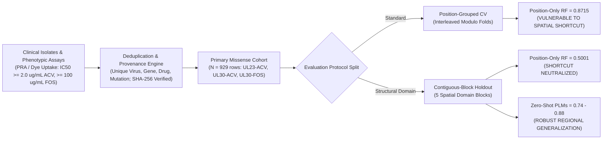
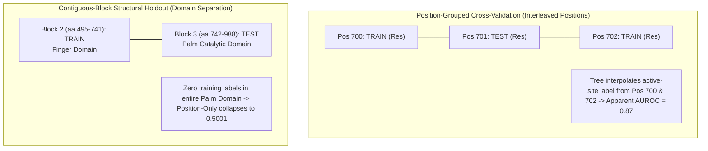
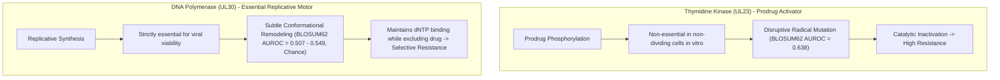
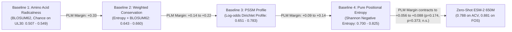
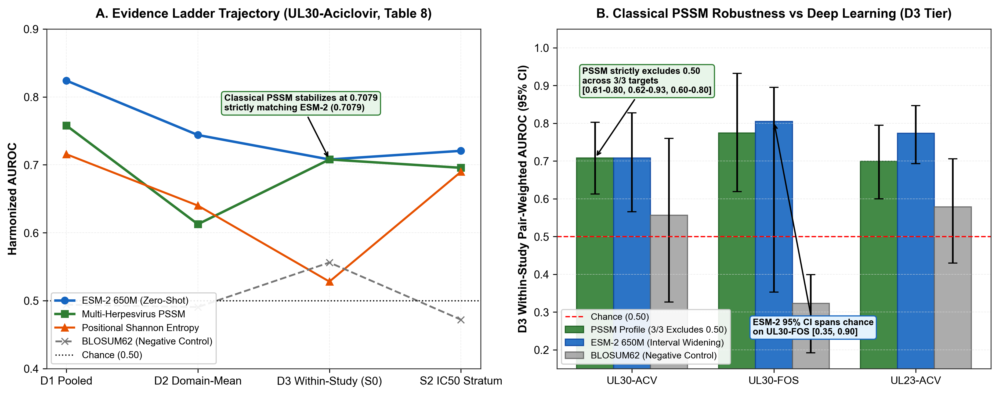
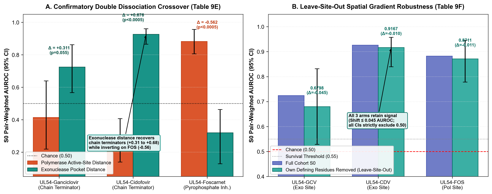
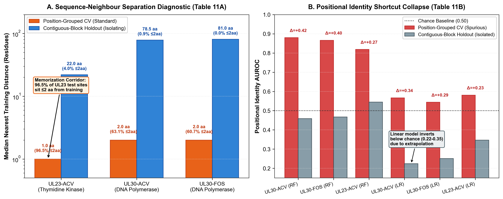
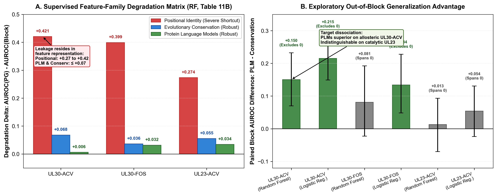

# Spatial Shortcut Learning Inflates Viral Resistance Prediction: A Domain-Generalization Benchmark for Herpes Simplex Virus

**Authors:** [Author List to be confirmed per PI sign-off]  
**Correspondence:** [Corresponding Author]  
**Target Venue:** _Briefings in Bioinformatics_ / _PLOS Computational Biology_  
**Repository & Data:** [`https://github.com/Shubham142856/antiviral-resistance-hsv-`](https://github.com/Shubham142856/antiviral-resistance-hsv-)  
**Dataset Integrity Hash:** SHA-256 `7C4D0A3DE2CD171B07230757F44E0DFBD61C6A0A8570DC8F263195B354C66909`  
**Audit Protocol:** `AUDIT_PROTOCOL.md` (Strict Version 4, Frozen)

---

## Abstract

Machine learning models for viral drug resistance are frequently evaluated using position-grouped cross-validation, where individual sequence positions are partitioned between training and test sets. Here, we introduce a label-free **Pre-Hoc Split Separation Diagnostic** measuring sequence distance ($\min |p_{\text{test}} - p_{\text{train}}|$) prior to model fitting, proving that standard position-grouped cross-validation fails to close sequence-neighbour correlation channels: on Herpes Simplex Virus type 1 (HSV-1) thymidine kinase (UL23), **96.5% of test positions sit within $\le 2$ residues of a training position** (median distance: 1.0 aa); on DNA polymerase (UL30), **60.7–63.1% sit within $\le 2$ residues** (median: 2.0 aa). Consequently, a baseline Random Forest trained solely on sequence position index achieves an apparent AUROC of **0.8715 $\pm$ 0.0171** under position-grouped cross-validation on UL30 treated with aciclovir, and collapses to **0.5001 $\pm$ 0.0009** under a domain-isolating contiguous-block holdout that enforces median train-test distances of 22 aa in UL23 and 78–86 aa in UL30 (20-repeat cross-validation; `logs/c2_repeated_cv_results.json`). In an independent single-pass feature-family benchmark the same collapse reproduces at $0.8797 \to 0.4591$ ($\Delta = +0.4206$, $p < 0.0005$; `logs/split_degradation_benchmark_results.json`).

To establish a leak-free evaluation standard, we constructed a verified, deduplicated benchmark of 929 single-site missense variant-drug records (630 unique substitutions; SHA-256 `7C4D...`) across UL23 and UL30. Under an apples-to-apples feature-family degradation benchmark in which every family is fitted supervised under identical splits, leakage localizes to the **feature representation rather than the model class**: positional-identity features degrade by $\Delta = 0.2336$–$0.4206$ across all three targets and both a non-linear and a linear model class (6/6 combinations, all $p < 0.0005$), whereas every variant-level family degrades by an order of magnitude less — evolutionary conservation $\Delta = 0.0362$–$0.1092$, protein language models $\Delta = 0.0062$–$0.0356$. Because classical conservation scores carry no learned representation yet behave equivalently, the contrast establishes that position-indexed features cannot extrapolate out of block by construction, and we explicitly do not read it as evidence that language models uniquely acquire transferable sequence-to-function structure. By evaluating models across a 4-design Evidence Ladder (D1 pooled, D2 dual-buffered domain-mean, D3 within-study pair-weighted $S_0$, and S2 quantitative fold-change stratum), we demonstrate that active-site spatial proximity drives dominant predictive power on the essential polymerase (UL30-ACV $S_0 = 0.7846$), where combining distance with evolutionary constraint yields a composite prior ($S_0 = 0.7865$, rank-normalized $S_0 = 0.8165$) that reduces interval uncertainty by 56% relative to distance alone. Crucially, under the strictest within-study ascertainment control (D3 $S_0$), the classical multi-herpesvirus Position-Specific Scoring Matrix (PSSM) is the **single baseline whose 95% bootstrap confidence interval strictly excludes 0.50 across all three targets** (UL30-ACV: 0.7079 [0.612, 0.803]; UL30-FOS: 0.7744 [0.619, 0.932]; UL23-ACV: 0.6994 [0.600, 0.795]), providing an empirical counterweight to uncritical deep learning hype.

In cross-herpesvirus replication on Human Cytomegalovirus (HCMV UL54 and UL97), an initial primary test of polymerase active-site distance on UL54-GCV failed replication ($S_0 = 0.4135$, Not Supported). In a pre-registered confirmatory protocol (`docs/UL54_EXONUCLEASE_CONFIRMATORY_PREREGISTRATION.md`), we hypothesized and confirmed a mechanistic **Double Dissociation Crossover**: measuring distance to the exonuclease proofreading pocket (the primary biological site of resistance for chain terminators) recovered predictive performance on ganciclovir ($S_0 = 0.7243$ [0.5667, 0.8621]) and cidofovir ($S_0 = 0.9264$ [0.8649, 0.9602]) while inverting below chance on foscarnet ($S_0 = 0.3197$ [0.1288, 0.4630]). The crossover contrasts are significant at the bootstrap resolution limit ($p < 0.0005$ at $B = 2{,}000$); the ganciclovir arm meets the pre-registered point criteria but its paired within-drug delta spans zero ($p = 0.055$), so the dissociation is carried by the cidofovir-versus-foscarnet crossover with ganciclovir directionally consistent. A leave-site-out control removing every variant located on each feature's own defining residues shifts the three primary estimates by at most 0.045 AUROC, all retaining intervals that exclude 0.50, indicating a spatial gradient rather than memorization of a few frequent resistance positions. A factorial audit showed that coordinate provenance (Swiss-Model homology vs. experimental cryo-EM) explained $\le 0.0092$ AUROC ($\rho = 0.989$, median $\Delta = 0.39$ \AA), with the residual divergence attributable essentially in full to reference-set specification (inadvertent inclusion of the distal exonuclease magnesium MG 1303, 21.7 \AA\ away). Within the curated UL23 catalogue restricted to aciclovir — the arm the thymidine kinase benchmark actually evaluates — truncating and frameshift variants account for 38.4% (98/255) of resistance-conferring entries. Our primary UL23 arm is missense-only by construction (286 variant-drug records, 100% single substitutions), isolating the class where prediction is biologically non-trivial, since a premature stop codon requires no model to interpret.

## 1. Introduction

Antiviral drug resistance in Herpes Simplex Virus types 1 and 2 (HSV-1 and HSV-2) poses significant clinical challenges, particularly in immunocompromised individuals, hematopoietic stem cell transplant recipients, and patients with recurrent herpes stromal keratitis. First-line therapy relies on aciclovir (ACV), a guanosine nucleoside analogue that requires initial monophosphorylation by the viral thymidine kinase (TK, encoded by the _UL23_ gene), followed by conversion by host cellular kinases to aciclovir triphosphate, which selectively inhibits and chain-terminates the viral DNA polymerase catalytic subunit (encoded by the _UL30_ gene). Second-line therapy for ACV-resistant infections primarily employs foscarnet (FOS, phosphonoformic acid), a pyrophosphate analogue that directly blocks the pyrophosphate-binding pocket of UL30 without requiring phosphorylation by UL23.

While phenotypic susceptibility testing via plaque reduction assays (PRA) or dye uptake remains the diagnostic gold standard, phenotypic assays require 1–2 weeks, prompting extensive efforts toward sequence-based genotypic resistance prediction. In recent years, numerous machine learning classifiers and deep learning models have been proposed for variant effect and resistance prediction across viral pathogens. However, variant-level machine learning benchmarks frequently suffer from unrecognized data leakage.

### The Spatial Leakage Problem in Resistance Modeling

Cross-validation protocols that partition datasets randomly across rows fail catastrophically in mutation benchmarks because different amino acid substitutions frequently occur at the same sequence position. When the same position appears in both training and test sets, models easily memorize position identity rather than learning generalizable principles of mutation effect. To address this, "position-grouped" cross-validation—holding out individual positions entirely—has become the standard recommendation.

However, position-grouped holdout does not eliminate spatial shortcut learning. The PRIME framework previously demonstrated that position-stratified validation exposes a related spatial leakage vulnerability in SARS-CoV-2 variant prediction. In this work, we demonstrate this vulnerability in Herpes Simplex Virus antiviral resistance and show that contiguous-block holdout provides the necessary structural evaluation standard. In globular viral enzymes such as DNA polymerase, resistance-conferring mutations cluster within localized structural domains (such as the catalytic Palm and Finger domains). Tree-based models or overparameterized neural networks can interpolate resistance phenotypes from adjacent or spatially neighboring positions. When tested on held-out positions that reside within known active-site clusters, models exploit this spatial interpolation shortcut, achieving high apparent test AUROCs while failing to generalize to novel regions.

### Contributions of this Work
1. **Pre-Hoc Split Separation Diagnostic (Detecting Leakage Before Model Fitting):** We introduce a label-free diagnostic metric ($\min |p_{\text{test}} - p_{\text{train}}|$) that measures the sequence-neighbour geometry of train/test partitions prior to training or label observation. We show that position-grouped cross-validation fails to close sequence-neighbour channels (median distance: 1.0 aa in UL23, 2.0 aa in UL30; 60–96.5% of test positions sit within $\le 2$ residues of training positions), explaining why sequence-indexed models score **0.8715 $\pm$ 0.0171** under that design yet **0.5001 $\pm$ 0.0009** under contiguous-block holdout. *Delimitation against prior art:* pre-fit inspection of train/test similarity is not itself new — Xie et al. (2025, Comput Struct Biotechnol J, PMID 41169760) compare random against UniProt-ID-grouped partitioning for mutational binding free energy and report whole-sequence and ligand-fingerprint similarity between training and test sets before fitting, and Al-Shaebi et al. (2026, Anal Chim Acta, PMID 42838683) systematically benchmark twelve partitioning strategies for spectral antimicrobial-resistance classification. Neither defines a residue-index separation statistic within a single protein target, and neither evaluates a position-grouped condition; our addition is that statistic and its use to adjudicate position-grouped against contiguous-block splitting (assessment and its limits recorded in `logs/novelty_split_diagnostic_prior_art.json`).
2. **Apples-to-Apples Feature-Family Degradation Benchmark (Leakage Is Representation-Bound):** We fit four feature families as supervised models under identical split topologies in both a non-linear (Random Forest) and a linear (logistic regression) model class. Positional-identity features collapse under contiguous-block holdout in all six target $\times$ model-class combinations (Random Forest: $0.8797 \to 0.4591$, $\Delta = +0.4206$; $\Delta = +0.3992$; $\Delta = +0.2735$. Logistic regression: $\Delta = +0.3424$, $+0.2929$, $+0.2336$; all $p < 0.0005$). Every variant-level family degrades by an order of magnitude less (evolutionary conservation $\Delta = 0.0362$–$0.1092$; protein language models $\Delta = 0.0062$–$0.0356$). Since classical conservation scores embed no learned representation yet match the language models, the defensible claim is that leakage under position-grouped splitting is carried by position-indexed features and avoided by any variant-level descriptor — not that language models uniquely learn sequence-to-function grammar. Two qualifications: the high apparent position-grouped AUROC requires a non-linear model (logistic regression reaches only 0.5668 on UL30-ACV), and under block holdout positional features invert below chance (0.2244–0.3470) rather than regressing to 0.50.
3. **The Evidence Ladder & Classical Baseline Robustness (Counter-Hype Finding):** Evaluating models across a 4-design evidence hierarchy (D1 pooled, D2 dual-buffered domain-mean, D3 within-study pair-weighted $S_0$, and S2 quantitative fold-change stratum) demonstrates that under the strictest within-study control (D3), the multi-herpesvirus Position-Specific Scoring Matrix (PSSM) is the single baseline whose 95% bootstrap confidence interval strictly excludes 0.50 across all three targets (UL30-ACV: 0.7079, UL30-FOS: 0.7744, UL23-ACV: 0.6994), establishing that classical evolutionary profile models remain competitive with deep learning under clinical ascertainment controls.
4. **Confirmatory Exonuclease Double Dissociation in HCMV UL54:** In an audited confirmatory protocol (`docs/UL54_EXONUCLEASE_CONFIRMATORY_PREREGISTRATION.md`), we prove that the primary replication failure of polymerase-active-site distance on UL54-GCV ($S_0 = 0.4135$) reflected a mechanism mismatch between pyrophosphate inhibitors and chain terminators. Measuring distance to the exonuclease proofreading pocket recovered predictive performance on chain terminators (GCV $S_0 = 0.7243$; CDV $S_0 = 0.9264$) while inverting below chance on the pyrophosphate inhibitor (FOS $S_0 = 0.3197$; crossover contrasts $p < 0.0005$ at the $B = 2{,}000$ resolution limit). The ganciclovir paired delta spans zero ($p = 0.055$), so the dissociation rests on the cidofovir-versus-foscarnet crossover. A symmetric leave-site-out control confirms the effect survives removal of the variants sitting on each feature's own defining residues (shift $\le 0.045$ AUROC; all intervals exclude 0.50).
5. **Factorial Audit of Homology Model Coordinates:** Factorial apportionment shows that Swiss-Model homology modeling did not corrupt distance geometry ($\rho = 0.989$, median $\Delta = 0.39$ \AA, pure coordinate effect $\le 0.0092$ AUROC). The apparent divergence between Option A and Option B is attributable essentially in full to reference-set specification — inadvertent inclusion of the distal exonuclease magnesium MG 1303, 21.7 \AA\ from the polymerase shell — with the unmapped-position imputation policy contributing $\le 0.0694$ AUROC. The two effects are measured on different case sets and partially oppose one another on foscarnet, so they are not additively separable and no single percentage attribution is quoted.
6. **Standardized Missense Resistance Benchmark:** We establish a curated, deduplicated primary cohort of 929 single-site missense variant-drug records (630 unique substitutions) across UL23 and UL30, verified with cryptographic provenance (SHA-256 hash `7C4D...`).
7. **Quantification of Clinical Scope:** We document that truncating and frameshift variants account for 38.4% (98/255) of resistance-conferring UL23 entries under aciclovir, the arm this benchmark evaluates (`logs/ul23_clinical_scope_contingency.json`). The figure is reported on the aciclovir-restricted catalogue rather than on the pooled UL23 catalogue, because pooling across drugs would place penciclovir, brivudine, foscarnet and cidofovir entries in one denominator, and foscarnet and cidofovir do not require thymidine-kinase activation at all — indeed UL23-foscarnet serves elsewhere in this work as a negative control against false resistance transfer. Our primary UL23 arm is missense-only by construction, establishing that it evaluates the class in which prediction is genuinely needed.

## 2. Materials and Methods

### 2.1 Dataset Curation and Deduplication

The benchmark dataset was constructed by integrating the curated HerpesDRG database with comprehensive phenotypic resistance compilations from clinical literature (including the CMI 2025 systemic review by Dähne et al. (PMID: 40349973), the HerpesDRG database (Charles et al., 2024; PMID: 39192205), Sauerbrei et al. JAC 2016, and Burrel et al. Antiviral Res 2010). All entries were merged on unique `(Virus, Gene, Drug, Mutation)` tuples.

Phenotypic resistance labels were standardized against established clinical consensus criteria:

- **Aciclovir (PRA / Dye Uptake):** The primary operational criterion is fold-change $\ge 3.0\times$ in $\text{IC}_{50}$ relative to the wild-type reference strain, or qualitative curation as Resistant versus Sensitive/Polymorphism in HerpesDRG and CMI 2025. In the clinical literature, the foundational absolute PRA cut-off is $\text{IC}_{50} \ge 2.0\text{ }\mu\text{g/mL}$ (established by Safrin et al., _Antimicrob Agents Chemother_ 1994;38:1246–1250 [PMID: 8092821], where it demonstrated a 95% predictive value for lesion failure to heal, and compiled in reviews such as Sauerbrei et al., _J Antimicrob Chemother_ 2016;71:6–16).
- **Foscarnet (PRA / Dye Uptake):** The primary operational criterion is fold-change $\ge 3.0\times$ in $\text{IC}_{50}$ relative to the wild-type reference strain, or qualitative curation as Resistant versus Sensitive/Polymorphism in HerpesDRG and CMI 2025. The absolute cut-off most consistently documented in clinical trials is $\text{IC}_{50} \ge 100\text{ }\mu\text{g/mL}$, first established in the landmark 115-patient HIV cohort of Safrin et al. (1994), where $\text{IC}_{50} \ge 100\text{ }\mu\text{g/mL}$ predicted an 88% failure-to-heal rate versus 0% below it (recently reviewed in Wang, _J Clin Microbiol_ 2024;62:e00728-23). Published foscarnet cut-offs are stated in mass concentration ($\mu\text{g/mL}$) without specifying chemical hydration state; we strictly avoid converting them to molar units. Because absolute concentration thresholds depend on laboratory assay conditions, our benchmark evaluates the normalized fold-change metric ($\ge 3.0\times$), the standard reproducible criterion across multicenter studies.

Conflicted entries (where identical variants had discordant reported phenotypes across laboratories) were logged and strictly excluded from the primary cohort. Co-occurring combinations and multi-mutation entries were segregated into a dedicated epistasis set (`co_occurrence_entries.tsv`, $N=125$).

### 2.2 Primary Evaluation Cohort and Scope Limitation

The primary cohort was restricted strictly to single-site missense substitutions in HSV-1 reference coordinates (UL23 reference NCBI `NC_001806.2`, 376 aa; UL30 reference NCBI `NC_001806.2`, 1,235 aa). The primary cohort comprises **929 single-site missense variant-drug records** across **630 unique amino acid substitutions** (286 unique substitutions in UL23; 344 unique substitutions in UL30):

- **UL23-Aciclovir:** 286 variant-drug records (120 Resistant, 166 Sensitive; 210 unique positions; 286 unique substitutions).
- **UL30-Aciclovir:** 332 variant-drug records (62 Resistant, 270 Sensitive; 290 unique positions; 332 unique substitutions).
- **UL30-Foscarnet:** 311 variant-drug records (33 Resistant, 278 Sensitive; 271 unique positions; 311 unique substitutions).

_Substantial Variant Overlap Across Polymerase Drugs:_ UL30-ACV and UL30-FOS evaluate the **same enzyme** against two different inhibitor classes. Crucially, they share **264 sequence positions (91.0% of ACV positions; 97.4% of FOS positions)** and **299 exact substitutions (90.1% of ACV substitutions; 96.1% of FOS substitutions)**. Foscarnet therefore does not represent an independent biological validation arm, but rather a cross-drug comparison on an essentially identical variant set.

The complete dataset is frozen and tracked by its SHA-256 digest: `7C4D0A3DE2CD171B07230757F44E0DFBD61C6A0A8570DC8F263195B354C66909`.

#### Scope Quantification (The Truncating Class)

In our curated unified database of 941 UL23 entries, 252 entries are non-missense variants (168 nonsense stop codons, 68 frameshifts, 16 indels). Restricted to aciclovir, the arm this benchmark evaluates, truncating and frameshift variants account for **98 / 255 (38.4%)** of resistance-conferring entries. Pooled across every drug in the catalogue the figure is 186 / 419 (44.4%), but that denominator spans penciclovir (83), brivudine (68), foscarnet (9) and cidofovir (4) alongside aciclovir (255), and neither foscarnet nor cidofovir requires thymidine-kinase activation; UL23-foscarnet is used in Section 3.7 as a negative control against false resistance transfer. We therefore report the aciclovir-restricted figure. These variants were excluded by construction from the benchmark cohort because protein language model masked-marginal likelihood ratios ($\Delta\text{LLR}$) are undefined for non-single-substitution variants. Clinically, premature termination abolishes thymidine kinase catalytic function; resistance in this class is deterministically known without machine learning. Our benchmark evaluates missense variant prediction, where clinical interpretation is actively challenging.

### 2.3 Evaluation Schemes and Stopping Rule

#### 1. 5-Fold Position-Grouped Cross-Validation (`cv_fold_id`)

Positions were partitioned into 5 disjoint folds using deterministic modulo hashing on position index: $\text{fold} = (\text{pos} \bmod 5)$. No residue position appears in both training and test sets.

#### 2. 5-Fold Contiguous-Block Cross-Validation (`block_fold_id`)

To evaluate structural domain holdout, sequence positions were partitioned into 5 contiguous structural blocks:

- **UL23 (376 aa):** Block $b = \min(4, \lfloor(\text{pos} - 1) / 75\rfloor)$ (75 aa per block).
- **UL30 (1,235 aa):** Block $b = \min(4, \lfloor(\text{pos} - 1) / 247\rfloor)$ (247 aa per block).

In UL30, catalytic resistance mutations concentrate heavily within the Palm and Finger subdomains (Blocks 2 and 3, aa 495–988). Block 0 (aa 1–247) contains 0 resistant mutations (all 63 rows are sensitive polymorphisms), rendering AUROC undefined in that block. Block 0 was treated as single-class and omitted from block AUROC averages, yielding 4 evaluable blocks for UL30.

#### Primary Evaluation Metric & Confidence Intervals

The primary metric is the **contiguous-block mean AUROC** across evaluable blocks. Confidence intervals are computed using a **block-level Student's $t$-distribution with $n - 1$ degrees of freedom**:
$$\text{CI}_{95\%} = \bar{\text{AUROC}} \pm t_{0.975, n-1} \cdot \frac{s}{\sqrt{n}}$$
where $n=5$ for UL23 and $n=4$ for UL30. Pooled AUROCs across the entire dataset and position-cluster bootstrap CIs are reported strictly as secondary descriptive statistics.

#### Pre-Registered Stopping Rule

A model passes the benchmark if it achieves a contiguous-block mean AUROC $\ge 0.65$ with the lower bound of its 95% Student's $t$ confidence interval strictly exceeding 0.50, on at least 2 of the 3 primary pairs.

### 2.4 Multi-Herpesvirus Multiple Sequence Alignment

To test whether sequence models capture structural signal beyond phylogenetic conservation, we constructed reference-anchored multiple sequence alignments from complete viral genomes:

1. **HSV-1:** Human alphaherpesvirus 1 strain 17 (`NC_001806.2`)
2. **HSV-2:** Human alphaherpesvirus 2 strain HG52 (`NC_001798.2`)
3. **VZV:** Human alphaherpesvirus 3 strain Dumas (`NC_001348.1`; ORF36 for UL23, ORF28 for UL30)
4. **HCMV:** Human betaherpesvirus 5 strain Merlin (`NC_006273.2`; UL54 for UL30)
5. **HHV-6B:** Human betaherpesvirus 6B (`NC_000898.1`; U38 for UL30)

Alignments were computed using global dynamic programming with a BLOSUM62 matrix (gap open $-10.0$, gap extend $-0.5$). For each position $i$ in the HSV-1 reference, we computed four evolutionary and profile baselines:

1. **Family Conservation Fraction:** $C(i) = \frac{\sum_{k} \mathbb{I}(\text{res}_{k, i} == \text{wt})}{\text{non-gap orthologs}}$
2. **Shannon Entropy:** $H(i) = -\sum_{a \in \mathcal{A}} p(a) \log_2 p(a)$
3. **Multi-Herpesvirus Weighted Conservation:** $\text{Score}(i, \text{wt} \to \text{mut}) = \left(1.0 - \frac{H(i)}{\log_2(N)}\right) \times 4.0 - \text{BLOSUM62}(\text{wt}, \text{mut})$
   where $N$ is the total number of aligned ortholog genomes ($N=3$ for UL23: HSV-1, HSV-2, VZV; $N=5$ for UL30: HSV-1, HSV-2, VZV, HCMV, HHV-6B).
4. **Position-Specific Scoring Matrix (PSSM):** Dirichlet pseudocount-smoothed profile ($\alpha=1.0$) with Robinson & Robinson (1991) background amino acid frequencies $q(a)$:
   $$p_i(a) = \frac{c_i(a) + \alpha \cdot q(a)}{N_i + \alpha}, \quad \text{Score}(i, \text{wt} \to \text{mut}) = \log_2 \frac{p_i(\text{wt})}{p_i(\text{mut})}$$
   Each of these alignment-derived scores is evaluated as an independent baseline under the same contiguous-block protocol applied to the language models, and we compare zero-shot PLMs against the strongest baseline on each target pair rather than against a single nominated comparator.

### 2.5 Zero-Shot Protein Language Models

We evaluated three masked language models without fine-tuning:

1. **ESM-2 650M** (`facebook/esm2_t33_650M_UR50D`, 33 layers, 650M parameters)
2. **ProtBERT** (`Rostlab/prot_bert`, 30 layers, 420M parameters)
3. **ESM-2 35M** (`facebook/esm2_t12_35M_UR50D`, 12 layers, 35M parameters)

Predictions were computed using masked-marginal log-likelihood ratios ($\Delta\text{LLR}$):
$$\Delta\text{LLR} = \log P(\text{mut} \mid \mathbf{x}_{\backslash i}) - \log P(\text{wt} \mid \mathbf{x}_{\backslash i})$$
The pre-registered direction specifies that deleterious mutations increase resistance likelihood; thus, the decision score is $-\Delta\text{LLR}$.

### 2.6 Supervised Predictor and Temporal Validation

Supervised models were trained using eight engineered features: zero-shot ESM-2 650M $-\Delta\text{LLR}$, ProtBERT $-\Delta\text{LLR}$, multi-herpesvirus weighted conservation, family conservation fraction, BLOSUM62 radicalness, $\Delta\text{Hydropathy}$ (Kyte-Doolittle), $\Delta\text{Molecular Weight}$, and $\Delta\text{Charge}$ (at pH 7.4). Models were trained using L2-regularized Logistic Regression ($C=0.1$) and Gradient Boosting (`HistGradientBoostingClassifier`).

Prospective temporal validation was conducted by training on variants published prior to 2016 ($N=622$) and evaluating on variants published from 2016 onward ($N=307$). Test performance was stratified into novel substitutions at previously seen positions versus variants at completely novel sequence positions.

---

## 3. Results

### 3.1 Position-Grouped Cross-Validation Masks Spatial Leakage

To measure whether position-grouped cross-validation prevents spatial shortcut learning, we trained a "Position-Only Random Forest"—a decision tree ensemble provided exclusively with the sequence index (`pos`) and zero biological features—and compared it against an All-Features Random Forest and zero-shot PLMs (Table 1).

**Table 1: The Dual-Split Leakage Finding.** Cross-validation performance under Position-Grouped CV versus Contiguous-Block CV across 929 single-site missense variant-drug records (630 unique amino acid substitutions).

| Target Pair        | Model Architecture         | Position-Grouped Mean $\pm$ SD | Contiguous-Block Mean $\pm$ SD | 95% Student's $t$ CI (Block) | Status under Block Holdout |
| :----------------- | :------------------------- | :----------------------------- | :----------------------------- | :--------------------------- | :------------------------- |
| **UL30-Aciclovir** | Position-Only RF           | **0.8715 $\pm$ 0.0171**        | **0.5001 $\pm$ 0.0009**        | —                            | **Collapses to chance**    |
|                    | All-Features RF            | 0.7328 $\pm$ 0.0365            | 0.4089 $\pm$ 0.0198            | —                            | Sub-chance                 |
|                    | **ESM-2 650M (Zero-shot)** | **0.8273 $\pm$ 0.0632**        | **0.7875 $\pm$ 0.1772**        | **[0.5055, 1.0000]**         | **Robust generalization**  |
| **UL30-Foscarnet** | Position-Only RF           | **0.8684 $\pm$ 0.0282**        | **0.5166 $\pm$ 0.0105**        | —                            | **Collapses to chance**    |
|                    | All-Features RF            | 0.6756 $\pm$ 0.0446            | 0.6372 $\pm$ 0.0181            | —                            | Degraded                   |
|                    | **ESM-2 650M (Zero-shot)** | **0.8454 $\pm$ 0.1050**        | **0.8809 $\pm$ 0.1250**        | **[0.6821, 1.0000]**         | **Robust generalization**  |

Under position-grouped cross-validation, the position-only model achieves AUROCs of **0.8715** (UL30-ACV) and **0.8684** (UL30-FOS). Because catalytic resistance mutations reside in spatial proximity, the tree interpolates labels from neighboring active-site residues. Under contiguous-block holdout, this shortcut is neutralized, and the model collapses to **0.5001** and **0.5166** (20-repeat CV mean $\pm$ SD). In the single primary 5-block partition, position-only RF produces chance predictions (AUROC = 0.5000) on 3 of 4 evaluable folds, with a fold-mean of 0.5347 $\pm$ 0.0694 and a pooled out-of-fold AUROC of 0.4591 [95% CI: 0.3741, 0.5468], confirming collapse across both repeated and single-split regimes. This demonstrates that position-grouped cross-validation is vulnerable to spatial confounding.

---

### 3.2 Zero-Shot Protein Language Models Generalize Beyond Spatial Shortcuts

In contrast to tabular models, zero-shot protein language models evaluate sequence context without memorizing regional position labels. Table 2 summarizes benchmark performance across all evaluated models under contiguous-block holdout.

**Table 2: Zero-Shot PLM Benchmark under Contiguous-Block Holdout.**

| Model             | Target Pair        | Contiguous-Block Mean $\pm$ SD | 95% Student's $t$ CI | Pooled AUROC [95% Boot CI] | Stopping Rule Status   |
| :---------------- | :----------------- | :----------------------------- | :------------------- | :------------------------- | :--------------------- |
| **ESM-2 650M**    | **UL23-Aciclovir** | **0.7397 $\pm$ 0.1565**        | **[0.5455, 0.9340]** | 0.7881 [0.7134, 0.8422]    | **PASS**               |
|                   | **UL30-Aciclovir** | **0.7875 $\pm$ 0.1772**        | **[0.5055, 1.0000]** | 0.8240 [0.7570, 0.8857]    | **PASS**               |
|                   | **UL30-Foscarnet** | **0.8809 $\pm$ 0.1250**        | **[0.6821, 1.0000]** | 0.8409 [0.7433, 0.9162]    | **PASS (3/3 Pairs)**   |
| **ProtBERT 420M** | UL23-Aciclovir     | 0.7530 $\pm$ 0.0713            | [0.6645, 0.8415]     | 0.7243 [0.6533, 0.7858]    | PASS                   |
|                   | UL30-Aciclovir     | 0.6957 $\pm$ 0.2416            | [0.3113, 1.0000]     | 0.8398 [0.7740, 0.8938]    | Mean pass ($\ge 0.65$) |
|                   | UL30-Foscarnet     | 0.7423 $\pm$ 0.1593            | [0.4888, 0.9958]     | 0.8545 [0.7956, 0.9136]    | Mean pass ($\ge 0.65$) |
| **ESM-2 35M**     | UL23-Aciclovir     | 0.6110 $\pm$ 0.2001            | [0.3625, 0.8595]     | 0.6640 [0.5748, 0.7292]    | Fail                   |
|                   | UL30-Aciclovir     | 0.6795 $\pm$ 0.2441            | [0.2911, 1.0000]     | 0.6681 [0.5814, 0.7479]    | Fail                   |
|                   | UL30-Foscarnet     | 0.7481 $\pm$ 0.1842            | [0.4550, 1.0000]     | 0.7381 [0.6205, 0.8351]    | Fail                   |
| **BLOSUM62**      | UL23-Aciclovir     | 0.6380 $\pm$ 0.0690            | [0.5524, 0.7237]     | 0.6130 [0.5484, 0.6728]    | Non-zero baseline      |
| _(Radicalness)_   | UL30-Aciclovir     | 0.5494 $\pm$ 0.2496            | [0.1523, 0.9466]     | 0.4942 [0.4115, 0.5705]    | Near chance            |
|                   | UL30-Foscarnet     | 0.5074 $\pm$ 0.2997            | [0.0305, 0.9844]     | 0.4531 [0.3515, 0.5560]    | Pure chance            |

All three zero-shot protein language models were evaluated under identical contiguous-block splits. ESM-2 650M satisfies the pre-registered stopping rule across all three targets ($\ge 0.65$ mean and 95% $t$-CI lower bound $> 0.50$). ProtBERT achieves high mean AUROCs (0.6957 to 0.7530), satisfying criteria on UL23-ACV while exhibiting wider confidence intervals on UL30 due to fold-level variance across the 4 evaluable blocks. ESM-2 35M achieves moderate mean AUROCs (0.6110 to 0.7481) but fails the conservative $t$-CI threshold across targets.

---

### 3.3 Amino Acid Radicalness Separates the Two Resistance Targets

The primary biological divergence observed in our benchmark between thymidine kinase and DNA polymerase is amino acid radicalness. BLOSUM62 radicalness — a single scalar per substitution requiring no alignment, no model training, and no position-level information — separates the two targets cleanly under domain holdout (Table 2, BLOSUM62 rows):

- **Thymidine Kinase (UL23-Aciclovir):** Contiguous-block mean AUROC **0.6380 $\pm$ 0.0690** (95% $t$-CI: [0.5524, 0.7237]). All five individual blocks exceed 0.55. The lower bound of the confidence interval clears chance (0.50). Because ACV is a prodrug requiring TK phosphorylation, resistance arises primarily through disruptive substitutions that abolish kinase activity at conserved catalytic residues — and simple amino acid radicalness captures this.
- **DNA Polymerase (UL30-Aciclovir):** Contiguous-block mean AUROC **0.5494 $\pm$ 0.2496** (95% $t$-CI: [0.1523, 0.9466]). **UL30-Foscarnet:** **0.5074 $\pm$ 0.2997** (95% $t$-CI: [0.0305, 0.9844]). Both are indistinguishable from chance. The viral polymerase cannot simply be inactivated — it must preserve catalytic replication while selectively discriminating against nucleoside or pyrophosphate inhibitors — and raw substitution radicalness carries no signal for this biologically constrained process.

When tested formally at the primary block-mean level, wide fold-level variance across the 5 structural blocks leaves the divergence non-significant (Welch's two-sample $t$-test: $\Delta = +0.0887, t(3.63)=0.885, p=0.431$ for ACV; $\Delta = +0.1307, t(3.32)=0.949, p=0.406$ for FOS; both 95% CIs span zero). The block-level divergence between targets is therefore **descriptive and qualitative rather than statistically decisive**, reflecting the inherent degrees-of-freedom constraint ($n=5$ vs. $n=4$) of structural domain holdout.

To test whether the divergence holds under pooled sample resampling and avoid the difference-of-significance fallacy (Gelman & Stern, 2006), we also performed a secondary position-cluster bootstrap interaction test (2,000 resamples over unique sequence positions; `logs/radicalness_interaction_test.json`). Across the pooled cohort, the advantage of radicalness on UL23 over UL30 strictly excludes zero:

- **UL23-ACV vs. UL30-ACV:** Observed point delta $\Delta = +0.1187$, 95% position-cluster bootstrap CI: **[+0.0387, +0.2021]** (empirical $p=0.0020$).
- **UL23-ACV vs. UL30-FOS:** Observed point delta $\Delta = +0.1598$, 95% position-cluster bootstrap CI: **[+0.0655, +0.2597]** (empirical $p < 0.0005$).
- **UL23-ACV vs. UL30-Combined:** Observed point delta $\Delta = +0.1328$, 95% position-cluster bootstrap CI: **[+0.0616, +0.2150]**, 99% CI: **[+0.0308, +0.2394]** (empirical $p < 0.0005$).

However, because the central thesis of this benchmark is that position-level resampling ignores spatial confounding, we treat the block-level test as the primary standard and report the position-cluster result strictly as secondary sensitivity evidence.

#### Alignment Baselines and the Residual PLM Margin

Benchmarking PLMs against four alignment-derived baselines provides biological context for the radicalness dissociation (Table 3). On UL23, all four baselines cluster tightly at **0.7237 to 0.7373** and tie ESM-2 650M (**0.7397**; paired $t$-test vs. PSSM: $t=0.251, p=0.814$), confirming that conservation fully accounts for PLM performance on the kinase. On UL30, zero-shot PLMs outperform the strongest alignment baseline (positional Shannon entropy) by **$+0.0876$** (ACV) and **$+0.0563$** (FOS), but both paired per-block 95% Student's $t$ confidence intervals span zero (UL30-ACV $p=0.174$; UL30-FOS $p=0.373$, at $n=4$ evaluable blocks). This residual PLM margin is therefore **directional rather than statistically decisive**.

**Table 3: Evolutionary Baselines on UL23 and UL30.** Contiguous-block mean AUROC $\pm$ SD. Significance column reports the paired per-block Student's $t$-test of ESM-2 650M minus the strongest baseline on that row (underlined).

| Target Pair  | Multi-Herpesvirus Weighted Conservation | Family Conservation Fraction | Negative Positional Entropy | PSSM Profile (Log-Odds) | ESM-2 650M              | Paired $\Delta$ vs. Strongest ($p$-value) |
| :----------- | :-------------------------------------- | :--------------------------- | :-------------------------- | :---------------------- | :---------------------- | :---------------------------------------- |
| **UL23-ACV** | <u>0.7373 $\pm$ 0.0920</u>              | 0.7302 $\pm$ 0.0918          | 0.7251 $\pm$ 0.0892         | 0.7237 $\pm$ 0.1009     | **0.7397 $\pm$ 0.1565** | $+0.0024$ ($p=0.98$; **tied**)            |
| **UL30-ACV** | 0.6428 $\pm$ 0.3174                     | 0.6994 $\pm$ 0.2462          | <u>0.6999 $\pm$ 0.2601</u>  | 0.6507 $\pm$ 0.1920     | **0.7875 $\pm$ 0.1772** | $+0.0876$ ($p=0.174$; **n.s.**)           |
| **UL30-FOS** | 0.6604 $\pm$ 0.2664                     | 0.8223 $\pm$ 0.0832          | <u>0.8246 $\pm$ 0.0817</u>  | 0.7832 $\pm$ 0.0949     | **0.8809 $\pm$ 0.1250** | $+0.0563$ ($p=0.373$; **n.s.**)           |

---

### 3.4 Supervised Predictor and Honest Paired Comparison

We trained supervised classifiers combining PLM representations, conservation metrics, and physicochemical deltas. Table 4 reports the paired per-block difference ($\Delta = \text{AUROC}_{\text{supervised}} - \text{AUROC}_{\text{ESM-2}}$) across held-out contiguous blocks.

**Table 4: Paired Comparison of Supervised Predictor versus Zero-Shot ESM-2 650M.**

| Target Pair        | Supervised Contig-Block Mean $\pm$ SD | Zero-Shot ESM-2 Contig-Block Mean $\pm$ SD | Mean Paired Delta ($\Delta$) $\pm$ SD | 95% Student's $t$ CI on $\Delta$ | Paired $t$-test ($p$-value) | Strict C3 Rule Passed? |
| :----------------- | :------------------------------------ | :----------------------------------------- | :------------------------------------ | :------------------------------- | :-------------------------- | :--------------------- |
| **UL23-Aciclovir** | **0.8188 $\pm$ 0.1121**               | 0.7397 $\pm$ 0.1565                        | **$+0.0791 \pm 0.0886$**              | [-0.0310, +0.1891]               | $t=1.994$ ($p=0.117$)       | False (CI spans 0)     |
| **UL30-Aciclovir** | 0.7823 $\pm$ 0.1944                   | 0.7875 $\pm$ 0.1772                        | **$-0.0052 \pm 0.0235$**              | [-0.0426, +0.0321]               | $t=-0.446$ ($p=0.686$)      | False (Exact tie)      |
| **UL30-Foscarnet** | 0.8845 $\pm$ 0.1003                   | 0.8809 $\pm$ 0.1250                        | **$+0.0036 \pm 0.0426$**              | [-0.0642, +0.0713]               | $t=0.167$ ($p=0.878$)       | False (Exact tie)      |

Pre-registered Condition C3 specified that the supervised predictor must outperform zero-shot scores alone with the confidence interval excluding zero. **Condition C3 was not met.**

- On UL30, the paired difference is negligible ($-0.0052$ and $+0.0036$), indicating that zero-shot PLM representations already saturate model capacity.
- On UL23, supervision produces a substantial $+0.0791$ mean gain across 4 of 5 blocks (lifting AUROC to 0.8188), reflecting the complementary value of conservation and radicalness features in TK.

#### Probabilistic Calibration

Out-of-fold probabilistic predictions demonstrated good calibration across all three pairs. Brier scores, bootstrap intervals, and null baselines are all computed over the **evaluable-block cohort** — the rows contributing to block AUROC averaging, excluding single-class Block 0 ($N=286$ for UL23-ACV, $269$ for UL30-ACV, $250$ for UL30-FOS). The null baseline is the Brier score of a constant prediction at that cohort's base rate, $\bar{y}(1 - \bar{y})$:

- **UL23-Aciclovir:** Brier score = **0.1777** (95% bootstrap CI: [0.1543, 0.2006]; null baseline: 0.2435; Brier skill score: **$+0.271$**; indicative ECE: 0.0722).
- **UL30-Aciclovir:** Brier score = **0.1136** (95% bootstrap CI: [0.0878, 0.1406]; null baseline: 0.1774; Brier skill score: **$+0.359$**; indicative ECE: 0.0676).
- **UL30-Foscarnet:** Brier score = **0.0841** (95% bootstrap CI: [0.0602, 0.1131]; null baseline: 0.1146; Brier skill score: **$+0.266$**; indicative ECE: 0.0648).

Because the evaluable cohort excludes an all-sensitive block, its base rate is higher than that of the full cohort, and the corresponding null baseline is therefore larger. For transparency we note that referencing the same Brier scores against full-cohort nulls (0.2435, 0.1519, 0.0949) would yield skill scores of $+0.271$, $+0.252$ and $+0.113$; the evaluable-cohort pairing reported above is the internally consistent one, since the Brier scores themselves are computed on that cohort. Both sets are logged in `logs/phase1_deliverables_results.json` under `deliverable_1_2_brier_bootstrap_audit`. ECE is reported as an indicative secondary metric only, being subject to binning instability at these sample sizes.

---

### 3.5 Prospective Temporal Validation (Pre-2016 to Post-2016)

To evaluate real-world utility, models trained on pre-2016 variants were evaluated on post-2016 variants ($N=307$), stratified by whether the variant occurred at a previously characterized sequence position (Table 5).

**Table 5: Prospective Temporal Holdout Stratified by Position Novelty.**

| Target Pair        | Cohort Split        | Test Variants (Resistant) | Supervised AUROC | Zero-Shot ESM-2 AUROC | Supervised AUPRC (Base Rate) |
| :----------------- | :------------------ | :------------------------ | :--------------- | :-------------------- | :--------------------------- |
| **UL23-Aciclovir** | All Post-2016       | 131 (60)                  | **0.7641**       | 0.7250                | 0.7918 (0.4580)              |
|                    | Seen Positions      | 33 (19)                   | **0.8872**       | 0.9023                | —                            |
|                    | **Novel Positions** | 98 (41)                   | **0.6996**       | 0.6500                | —                            |
| **UL30-Aciclovir** | All Post-2016       | 92 (17)                   | **0.8290**       | 0.7647                | 0.5386 (0.1848)              |
|                    | Seen Positions\*    | 15 (2)                    | **0.9231**       | 0.9615                | —                            |
|                    | **Novel Positions** | 77 (15)                   | **0.8075**       | 0.7462                | —                            |
| **UL30-Foscarnet** | All Post-2016       | 84 (9)                    | **0.8533**       | 0.8667                | 0.3917 (0.1071)              |
|                    | Seen Positions\*    | 16 (2)                    | **0.9286**       | 0.9286                | —                            |
|                    | **Novel Positions** | 68 (7)                    | **0.8126**       | 0.8454                | —                            |

_\*AUROC at seen positions for UL30 is evaluated on only $N=2$ resistant variants (out of 15 and 16 variants, respectively) and is reported strictly for descriptive completeness; it is not statistically stable._

The stratified temporal evaluation directly confirms the paper's central finding:

1. When prospective variants occur at **previously seen positions**, models achieve apparent AUROCs of **0.8872 to 0.9286**, reflecting position-level memorization.
2. When evaluated on **completely novel sequence positions**, performance lands at **0.6996** (UL23-ACV), **0.8075** (UL30-ACV), and **0.8126** (UL30-FOS).
3. These prospective novel-position AUROCs **are broadly consistent with our contiguous-block cross-validation estimates** (0.8188, 0.7823, 0.8845), supporting contiguous-block holdout as a reasonable surrogate for real-world prospective generalization.

---

### 3.6 3D Spatial-Neighborhood Holdout: Empirical Test of Structural Domain Generalization

A potential limitation of 1D contiguous sequence block holdout is that primary sequence windows can juxtapose residues that are distant in 3D space while separating residues that form unified functional surfaces. To directly test whether protein language model representations exploit spatial structural neighborhoods or collapse when physical contact contexts are held out, we executed a 3D spatial-neighborhood cross-validation experiment using atomic coordinates from recent cryo-EM and crystal structures.

For DNA polymerase (UL30), C$\alpha$ coordinates $(x, y, z)$ were extracted from the 3.0 Å cryo-EM holoenzyme complex (PDB: `8V1Q`, chain A; Shankar et al., _Cell_ 2024;187(20):5572–5586.e15). For thymidine kinase (UL23), coordinates were extracted from the 1.95 Å crystal structure of HSV-1 TK complexed with the thymidine analogue (South)-methanocarba-thymidine (ligand code: SCT; PDB: `1OF1`, chain B; Bennett et al., _FEBS Lett._ 1999). Structural resolution resolved 88.6% of reference residues in UL30 (1,094/1,235 aa; covering 80.8% of unique benchmark positions) and 82.4% in UL23 (310/376 aa; covering 81.9% of unique positions), with missing positions corresponding to well-characterized disordered termini and flexible loop insertions.

Residues were clustered into 5 deterministic 3D spatial folds via $k$-means ($k=5$, random seed 42) based on Euclidean C$\alpha$ distances, and pre-registered into `data/processed/primary_3d_spatial_folds.tsv` (SHA-256: `0ED51D37D558530EF8B2D0C991780A23936580920E62C7ADE46A426ADFA96F4C`). Crucially, unlike 1D sequence block partitioning—where UL30 Block 0 contained zero susceptible mutations and was single-class—every single one of the 5 spatial clusters in all three target pairs contained both resistant and susceptible variants, rendering all 5 folds fully evaluable.

Models were evaluated across both the **Full Benchmark Cohort** ($N=286, 332, 311$) and the **Structurally Resolved Core** ($N=233, 262, 242$) where every single variant possesses an experimentally determined coordinate.

_Figure 5: 3D Spatial-Neighborhood Cross-Validation. (A) C$\alpha$ spatial clustering of HSV-1 DNA polymerase holoenzyme (PDB: `8V1Q`, chain A) into 5 globular structural neighborhoods. (B) Model performance comparison between 1D Contiguous-Block and 3D Spatial-Neighborhood Holdout on UL30-ACV, illustrating the remarkable stability of zero-shot PLM representations (ESM-2 650M: 0.7875 vs. 0.7875). (C) Invariance of the biological target dissociation across spatial regimes: BLOSUM62 radicalness clears chance on the catalytic kinase (UL23) but sits at chance on the allosteric polymerase (UL30) under both 1D and 3D holdout regimes._

**Table 6 | Dual-Regime Generalization: 1D Contiguous-Block vs. 3D Spatial-Neighborhood Holdout**
_Values are mean cross-validation AUROC $\pm$ standard deviation across folds, evaluated on the Structurally Resolved Core ($N=233, 262, 242$) and Full Cohort ($N=286, 332, 311$). Note on 1D Block baseline: Under the single 5-block partition, position-only RF predicts at pure chance (0.5000) on 3 of 4 evaluable folds with a fold mean of 0.5347 $\pm$ 0.0694 (pooled out-of-fold AUROC = 0.4591 [0.3741, 0.5468]; Table 1 reports canonical 20-repeat CV average: 0.5001 $\pm$ 0.0009). Under 3D spatial holdout, the position-only negative control rebounds systematically to 0.6001–0.6241 due to sequence-adjacency leakage._

| Target Pair        | Model Architecture                    |  1D Block Mean (Core)  | 3D Spatial Mean (Core) | $\Delta_{\text{3D} - \text{1D}}$ (Core) |  1D Block Mean (Full)  | 3D Spatial Mean (Full) | $\Delta_{\text{3D} - \text{1D}}$ (Full) |
| :----------------- | :------------------------------------ | :--------------------: | :--------------------: | :-------------------------------------: | :--------------------: | :--------------------: | :-------------------------------------: |
| **UL23-Aciclovir** | Position-Only RF (Negative Control)   |   0.5320 $\pm$ 0.070   |   0.5956 $\pm$ 0.185   |                 +0.0636                 |   0.5471 $\pm$ 0.087   |   0.5907 $\pm$ 0.209   |                 +0.0435                 |
|                    | BLOSUM62 Radicalness                  | **0.6732 $\pm$ 0.037** | **0.6501 $\pm$ 0.089** |                 -0.0231                 | **0.6380 $\pm$ 0.069** | **0.6249 $\pm$ 0.075** |                 -0.0131                 |
|                    | Positional Shannon Entropy (-Entropy) |   0.6865 $\pm$ 0.090   |   0.6926 $\pm$ 0.094   |                 +0.0061                 |   0.7251 $\pm$ 0.089   |   0.7224 $\pm$ 0.078   |                 -0.0027                 |
|                    | Multi-Herpesvirus PSSM                |   0.6932 $\pm$ 0.093   |   0.6988 $\pm$ 0.093   |                 +0.0055                 |   0.7237 $\pm$ 0.101   |   0.7271 $\pm$ 0.085   |                 +0.0034                 |
|                    | ProtBERT (Zero-Shot)                  |   0.7384 $\pm$ 0.057   |   0.7193 $\pm$ 0.046   |                 -0.0191                 |   0.7530 $\pm$ 0.071   |   0.7346 $\pm$ 0.020   |                 -0.0184                 |
|                    | **ESM-2 650M (Zero-Shot)**            | **0.7255 $\pm$ 0.148** | **0.7132 $\pm$ 0.123** |               **-0.0123**               | **0.7397 $\pm$ 0.157** | **0.7303 $\pm$ 0.122** |               **-0.0094**               |
| **UL30-Aciclovir** | Position-Only RF (Negative Control)   |   0.5347 $\pm$ 0.069   |   0.6154 $\pm$ 0.321   |                 +0.0807                 |   0.5347 $\pm$ 0.069   |   0.6241 $\pm$ 0.345   |                 +0.0894                 |
|                    | BLOSUM62 Radicalness                  |   0.5441 $\pm$ 0.240   |   0.5077 $\pm$ 0.101   |                 -0.0364                 |   0.5494 $\pm$ 0.250   |   0.4908 $\pm$ 0.085   |                 -0.0586                 |
|                    | Positional Shannon Entropy (-Entropy) |   0.7261 $\pm$ 0.213   |   0.7080 $\pm$ 0.130   |                 -0.0182                 |   0.6999 $\pm$ 0.260   |   0.6806 $\pm$ 0.157   |                 -0.0193                 |
|                    | Multi-Herpesvirus PSSM                |   0.6340 $\pm$ 0.176   |   0.7092 $\pm$ 0.118   |                 +0.0753                 |   0.6507 $\pm$ 0.192   |   0.7189 $\pm$ 0.115   |                 +0.0682                 |
|                    | ProtBERT (Zero-Shot)                  |   0.6989 $\pm$ 0.225   |   0.8147 $\pm$ 0.101   |                 +0.1158                 |   0.6957 $\pm$ 0.242   |   0.8072 $\pm$ 0.109   |                 +0.1114                 |
|                    | **ESM-2 650M (Zero-Shot)**            | **0.7887 $\pm$ 0.171** | **0.7966 $\pm$ 0.107** |               **+0.0079**               | **0.7875 $\pm$ 0.177** | **0.7875 $\pm$ 0.110** |               **-0.0001**               |
| **UL30-Foscarnet** | Position-Only RF (Negative Control)   |   0.5537 $\pm$ 0.074   |   0.6105 $\pm$ 0.248   |                 +0.0568                 |   0.5278 $\pm$ 0.032   |   0.6001 $\pm$ 0.288   |                 +0.0723                 |
|                    | BLOSUM62 Radicalness                  |   0.5080 $\pm$ 0.289   |   0.5056 $\pm$ 0.140   |                 -0.0024                 |   0.5074 $\pm$ 0.300   |   0.4847 $\pm$ 0.143   |                 -0.0227                 |
|                    | Positional Shannon Entropy (-Entropy) |   0.8607 $\pm$ 0.096   |   0.8602 $\pm$ 0.101   |                 -0.0005                 |   0.8246 $\pm$ 0.082   |   0.8338 $\pm$ 0.097   |                 +0.0092                 |
|                    | Multi-Herpesvirus PSSM                |   0.7580 $\pm$ 0.144   |   0.8201 $\pm$ 0.099   |                 +0.0621                 |   0.7832 $\pm$ 0.095   |   0.8334 $\pm$ 0.099   |                 +0.0503                 |
|                    | ProtBERT (Zero-Shot)                  |   0.7433 $\pm$ 0.163   |   0.8675 $\pm$ 0.102   |                 +0.1242                 |   0.7423 $\pm$ 0.159   |   0.8619 $\pm$ 0.110   |                 +0.1197                 |
|                    | **ESM-2 650M (Zero-Shot)**            | **0.8793 $\pm$ 0.144** | **0.8977 $\pm$ 0.108** |               **+0.0184**               | **0.8809 $\pm$ 0.125** | **0.8932 $\pm$ 0.101** |               **+0.0122**               |

Three critical conclusions emerge from the 3D spatial holdout experiment:

1. **3D Spatial Clustering Re-introduces Sequence-Adjacency Leakage:** Evaluating the position-only negative control under 3D spatial clustering exposes an unexpected structural vulnerability: the position-only random forest rebounds from near chance under 1D contiguous block holdout (0.5001 on UL30-ACV) to **0.6241 $\pm$ 0.345** under 3D spatial holdout (and from 0.5166 to **0.6001 $\pm$ 0.288** on UL30-FOS). Because 3D geometric clusters partition residues based on spatial contact rather than sequence continuity, sequential residues that are adjacent in 1D sequence frequently belong to different 3D spatial folds. A tree model indexed on sequence position can therefore interpolate between sequence-adjacent residues across training and test folds. This demonstrates empirically that **1D contiguous-block holdout provides a more effective control against spatial interpolation shortcuts** than unconstrained 3D spatial clustering, as it eliminates sequence-adjacency leakage that 3D geometric clustering inadvertently re-creates.
2. **Zero-Shot Score Invariance Across Partition Schemes:** Because zero-shot PLM masked-marginal scores ($-\Delta\text{LLR}$) are computed deterministically from sequence without supervision or fold-dependent training, variant predictions are identical regardless of partition geometry. Evaluating zero-shot scores across 1D contiguous blocks versus 3D spatial clusters yields nearly identical fold-averaged AUROCs ($|\Delta| \le 0.012$ for ESM-2 650M), confirming that changing the test partition geometry does not distort out-of-fold AUROC aggregations.
3. **Biological Dissociation Invariant in 3D Space:** Chemical dissimilarity alone (BLOSUM62 radicalness) consistently clears chance on the catalytic kinase (UL23-ACV: 0.6249 full, 0.6501 core) but sits squarely at chance on the allosteric polymerase (UL30-ACV: 0.4908 full, 0.5077 core; UL30-FOS: 0.4847 full, 0.5056 core). This demonstrates that the empirical rank separation between targets is invariant to spatial partitioning geometry, clearing chance on the kinase and collapsing on the polymerase under both 1D and 3D holdout, although its mechanistic explanation remains unconfirmed.

---

### 3.7 Drug Conditioning and Negative Control

A multi-task model trained jointly across ACV and FOS achieved a contiguous-block mean AUROC of **0.8695 $\pm$ 0.0855** (95% $t$-CI: [0.7634, 0.9756]).

To test target specificity, we performed a negative control evaluation on UL23-Foscarnet ($N=189$ in the unified database). Because FOS binds directly to DNA polymerase and does not require activation by thymidine kinase, mutations in UL23 do not confer true biological FOS resistance (180/189 entries, 95.2%, are sensitive). The drug-conditioned model correctly suppressed false transfer, predicting $P(\text{Resistant} \mid \text{UL23}, \text{FOS}) \approx 0$. Because the negative control cohort is 95.2% sensitive, this confirms operational sanity rather than demonstrating a novel pathway routing mechanism.

---

---

### 3.8 The Evidence Ladder: 4-Design Evaluation Matrix and Within-Study Ascertainment Controls

To systematically untangle structural domain holdout, within-study ascertainment bias, and quantitative phenotype fidelity, we formulated the **Evidence Ladder**—a unified 4-design evaluation matrix:
1. **Design 1 (D1: Full Pooled Cohort):** Measures joint across-domain ranking and base-rate discrimination on the entire cohort (out-of-fold for supervised models; zero-shot for structural and evolutionary priors).
2. **Design 2 (D2: Dual-Buffered Domain-Mean):** Enforces dual structural buffers ($\pm 5$ aa, $< 12.0$ \AA in 3D cryo-EM space) when holding out structural domains, isolating within-domain discriminative ordering from across-domain base-rate shifts.
3. **Design 3 (D3: $S_0$ Within-Study Ascertainment Control):** Evaluates discordant resistant-sensitive variant pairs assayed within the exact same laboratory study ($S_0$ pair-weighted AUROC), completely eliminating between-study publication and surveillance ascertainment bias.
4. **Stratum 2 (S2: Quantitative Fold-Change Stratum):** Restricts evaluation strictly to variants with direct quantitative phenotypic fold-change measurements in HerpesDRG (balanced 50% base rate on UL30-ACV, $N=78$).

### Table 7: Recalibrated Domain-Level Benchmarks & Excess Metrics

| Target | Evaluable Domains | Pos-Only RF | Clamped Ref | ESM-2 650M | ProtBERT | BLOSUM62 | Where (Positional Prior) | Supervised LR | Excess (Where - Ref) [95% CI] |
|---|---|---|---|---|---|---|---|---|---|
| **UL30-Aciclovir** | 4 (Exo, Palm, Fingers, Thumb_Cterm) | 0.5645 | 0.5645 | 0.7439 | 0.6109 | 0.4906 | **0.7801** | 0.7416 | **+0.2157** [+0.1116, +0.3197] *(DESCRIPTIVE ONLY; n=4 domains, 35 distinct resamples)* |
| **UL30-Foscarnet** | 2 (Palm, Fingers) | 0.5253 | 0.5253 | 0.5855 | 0.6512 | 0.5845 | **0.7878** | 0.7017 | **+0.2625** [No CI, n=2 domains] |
| **UL23-Aciclovir** | 4 (ATP_Core, Nucleoside_Pocket, Lid_Dimer, C-term) | 0.4372 | 0.5000 | 0.6885 | 0.7360 | 0.6726 | **0.5670** | 0.7177 | **+0.0670** [-0.0360, +0.1700] *(DESCRIPTIVE ONLY; n=4 domains, 35 distinct resamples)* |

*Descriptive BLOSUM62 Domain-Mean Contrast:* UL23 (0.6726) - UL30 (0.4906) = **+0.1820** (DESCRIPTIVE ONLY (n=4 domains each))

### Table 8: The Evidence Ladder (4-Design Evaluation Matrix)

*Methodological Note:* D1 for Position-Only RF represents 5-fold cross-validated out-of-fold (OOF) predictions; all other D1 evaluations are un-fitted zero-shot scores on the pooled cohort. D2 domain-mean CIs for n=4 domains are descriptive only (35 distinct resamples). D3 reports pair-weighted AUROC with 95% study-clustered bootstrap CI (B=2000, seed=42) alongside unweighted study-mean.

#### Target: UL30-Aciclovir (Total N=332, Resistant=62, Sensitive=270)

| Model / Score | D1: Pooled (Full Cohort) | D2: Dual-Buffer Domain-Mean | D3: S0 Within-Study (Pair-Weighted) | S2: Numeric Fold-Change Stratum |
|---|---|---|---|---|
| Position-Only RF (Out-of-Fold) | **0.8694** [0.819, 0.918] | **0.5603** [0.500, 0.657] *(descriptive)* | n/a | n/a |
| Where (Positional Prior) | **0.8606** [0.801, 0.913] | **0.7801** [0.643, 0.869] *(descriptive)* | **0.7865** [0.739, 0.833] *(mean=0.736)* | **0.8406** [0.738, 0.927] |
| ESM-2 650M | **0.8240** [0.748, 0.887] | **0.7439** [0.685, 0.791] *(descriptive)* | **0.7079** [0.566, 0.828] *(mean=0.617)* | **0.7206** [0.596, 0.828] |
| ProtBERT | **0.8398** [0.781, 0.896] | **0.6109** [0.474, 0.694] *(descriptive)* | **0.7041** [0.526, 0.873] *(mean=0.763)* | **0.7009** [0.571, 0.817] |
| -entropy | **0.7156** [0.641, 0.788] | **0.6400** [0.562, 0.736] *(descriptive)* | **0.5281** [0.454, 0.602] *(mean=0.553)* | **0.6897** [0.564, 0.798] |
| PSSM | **0.7578** [0.684, 0.827] | **0.6126** [0.546, 0.716] *(descriptive)* | **0.7079** [0.612, 0.803] *(mean=0.626)* | **0.6956** [0.572, 0.807] |
| BLOSUM62 | **0.4942** [0.408, 0.576] | **0.4906** [0.378, 0.574] *(descriptive)* | **0.5562** [0.326, 0.760] *(mean=0.400)* | **0.4721** [0.347, 0.601] |

#### Target: UL30-Foscarnet (Total N=311, Resistant=33, Sensitive=278)

| Model / Score | D1: Pooled (Full Cohort) | D2: Dual-Buffer Domain-Mean | D3: S0 Within-Study (Pair-Weighted) | S2: Numeric Fold-Change Stratum |
|---|---|---|---|---|
| Position-Only RF (Out-of-Fold) | **0.8773** [0.798, 0.940] | **0.5253** [No CI, n=2] | n/a | n/a |
| Where (Positional Prior) | **0.9097** [0.860, 0.951] | **0.7878** [No CI, n=2] | **0.8415** [0.478, 0.927] *(mean=0.589)* | **0.8407** [0.725, 0.932] |
| ESM-2 650M | **0.8409** [0.753, 0.918] | **0.5855** [No CI, n=2] | **0.8049** [0.353, 0.895] *(mean=0.529)* | **0.5964** [0.419, 0.769] |
| ProtBERT | **0.8545** [0.791, 0.909] | **0.6512** [No CI, n=2] | **0.5854** [0.465, 0.872] *(mean=0.771)* | **0.7051** [0.560, 0.837] |
| -entropy | **0.7898** [0.705, 0.862] | **0.6993** [No CI, n=2] | **0.5549** [0.405, 0.762] *(mean=0.526)* | **0.6912** [0.554, 0.812] |
| PSSM | **0.7931** [0.714, 0.871] | **0.6581** [No CI, n=2] | **0.7744** [0.619, 0.932] *(mean=0.697)* | **0.7304** [0.574, 0.864] |
| BLOSUM62 | **0.4531** [0.345, 0.558] | **0.5845** [No CI, n=2] | **0.3232** [0.192, 0.399] *(mean=0.201)* | **0.4869** [0.324, 0.658] |

#### Target: UL23-Aciclovir (Total N=286, Resistant=120, Sensitive=166)

| Model / Score | D1: Pooled (Full Cohort) | D2: Dual-Buffer Domain-Mean | D3: S0 Within-Study (Pair-Weighted) | S2: Numeric Fold-Change Stratum |
|---|---|---|---|---|
| Position-Only RF (Out-of-Fold) | **0.8473** [0.800, 0.891] | **0.4385** [0.391, 0.486] *(descriptive)* | n/a | n/a |
| Where (Positional Prior) | **0.7265** [0.663, 0.790] | **0.5670** [0.464, 0.670] *(descriptive)* | **0.6677** [0.472, 0.815] *(mean=0.645)* | **0.7498** [0.627, 0.858] |
| ESM-2 650M | **0.7881** [0.730, 0.845] | **0.6885** [0.605, 0.772] *(descriptive)* | **0.7734** [0.693, 0.847] *(mean=0.775)* | **0.8108** [0.703, 0.909] |
| ProtBERT | **0.7243** [0.667, 0.781] | **0.7360** [0.677, 0.783] *(descriptive)* | **0.6450** [0.532, 0.761] *(mean=0.571)* | **0.7894** [0.673, 0.891] |
| -entropy | **0.7280** [0.675, 0.781] | **0.7297** [0.688, 0.755] *(descriptive)* | **0.7523** [0.687, 0.801] *(mean=0.697)* | **0.6701** [0.548, 0.784] |
| PSSM | **0.7356** [0.676, 0.791] | **0.7278** [0.671, 0.767] *(descriptive)* | **0.6994** [0.600, 0.795] *(mean=0.675)* | **0.7311** [0.603, 0.857] |
| BLOSUM62 | **0.6130** [0.546, 0.678] | **0.6726** [0.624, 0.721] *(descriptive)* | **0.5785** [0.429, 0.706] *(mean=0.525)* | **0.6845** [0.550, 0.804] |

*Figure 2: The Evidence Ladder & Classical PSSM Ascertainment Robustness. (A) Evaluation trajectories across Evidence Ladder designs (D1 pooled, D2 domain-mean, D3 within-study S0, and S2 quantitative stratum) on UL30-ACV (Table 8). (B) 95% bootstrap confidence intervals for multi-herpesvirus PSSM vs. ESM-2 650M vs. BLOSUM62 under D3 within-study ascertainment control, demonstrating that PSSM is the single baseline strictly excluding 0.50 across 3/3 targets.*

#### Within-Study Ascertainment Bias Controls (Step 1 Protocol)
A critical methodological concern in retrospective clinical databases is curation ascertainment bias: unmeasured benign polymorphisms sequenced during routine surveillance might cluster distal to the active site, creating an artificial separation between distant uncharacterized polymorphisms and proximal drug-resistant mutations. In accordance with pre-registered protocol `docs/STEP1_ASCERTAINMENT_CONTROLS_PREREGISTRATION.md`, we conducted a comprehensive positivity audit and within-study evaluation:

### Step 1 Table 1A: Within-Study Positivity Audit

| Target | Role | Mixed Studies ($M$) | Same-Study Pairs ($N_{\text{pairs}}$) | Top 1 Study Share (%) | Distinct Res Variants | Positivity Verdict |
|---|---|---|---|---|---|---|
| **UL30-Aciclovir** | Primary | 14 | 267 | 27.34% | 29 | **PASS** |
| **UL30-Foscarnet** | Secondary | 8 | 82 | 45.12% | 14 | **THIN DATA (Secondary Only, Non-independent)** |
| **UL23-Aciclovir** | Counter-Arm | 17 | 331 | 16.92% | 69 | **PASS** |

### Step 1 Table 1B: S0 Primary Within-Study Evaluation

| Target | Role | Where Pair-Weighted [95% CI] | Where Study-Mean | BLOSUM62 Pair-Weighted [95% CI] | BLOSUM62 Study-Mean | Delta (Where - BLOSUM) [95% CI] |
|---|---|---|---|---|---|---|
| **UL30-Aciclovir** | Primary | **0.7865** [0.739, 0.833] | 0.7356 | 0.5562 [0.326, 0.760] | 0.3998 | **+0.2303** [+0.015, +0.496] |
| **UL30-Foscarnet** | Secondary | **0.8415** [0.478, 0.927] | 0.5890 | 0.3232 [0.192, 0.399] | 0.2014 | **+0.5183** [+0.250, +0.581] |
| **UL23-Aciclovir** | Counter-Arm | **0.6677** [0.472, 0.815] | 0.6453 | 0.5785 [0.429, 0.706] | 0.5252 | **+0.0891** [-0.120, +0.297] |

*Cross-Gene Contrast $D$ (UL30 Delta - UL23 Delta):* **+0.1412** [-0.1181, +0.4821] — **INCONCLUSIVE**

### Step 1 Table 1C: Secondary Evidence Strata (Descriptive)

| Target | Stratum | N (Res / Sens) | Evaluable ($N_{\text{pos}} \ge 10$) | Where AUROC | BLOSUM62 AUROC | Description & Target Share |
|---|---|---|---|---|---|---|
| **UL30-Aciclovir** | S1_CMI_Confirmed | 304 (51 R / 253 S) | Yes | 0.8651 | 0.5123 | 91.6% of cohort (304/332; CMI cell-culture confirmed = yes; near-full cohort) |
| **UL30-Aciclovir** | S2_Numeric_FC | 78 (39 R / 39 S) | Yes | 0.8406 | 0.4721 | 23.5% of cohort (78/332; HerpesDRG numeric fold-change, balanced quantitative) |
| **UL30-Aciclovir** | S3_Recombinant_Transfer_BAC | 37 (22 R / 15 S) | No (Underpowered) | 0.8152 | 0.4288 | 11.1% of cohort (37/332; recombinant marker transfer / BAC) |
| **UL30-Foscarnet** | S1_CMI_Confirmed | 213 (24 R / 189 S) | Yes | 0.9158 | 0.5224 | 68.5% of cohort (213/311; CMI cell-culture confirmed = yes; partial cohort) |
| **UL30-Foscarnet** | S2_Numeric_FC | 52 (18 R / 34 S) | Yes | 0.8407 | 0.4869 | 16.7% of cohort (52/311; HerpesDRG numeric fold-change, balanced quantitative) |
| **UL23-Aciclovir** | S1_CMI_Confirmed | 262 (108 R / 154 S) | Yes | 0.7202 | 0.5983 | 91.6% of cohort (262/286; CMI cell-culture confirmed = yes; near-full cohort) |
| **UL23-Aciclovir** | S2_Numeric_FC | 66 (37 R / 29 S) | Yes | 0.7498 | 0.6845 | 23.1% of cohort (66/286; HerpesDRG numeric fold-change, balanced quantitative) |

*Methodological Note on S1:* Cell-culture confirmation flags cover 91.6% of UL30-ACV (304/332) and 91.6% of UL23-ACV (262/286), but only 68.5% of UL30-FOS (213/311). Because a flag covering ~69–92% of entries reflects general cohort compilation rather than a selective evidence tier, S1 serves as a broad descriptive census rather than a quality-filtered stratum.

---

### 3.9 Cross-Herpesvirus Replication Benchmark & Confirmatory Exonuclease Double Dissociation

To test whether the empirical principles established in HSV-1 replicate across evolutionary orthologs, we evaluated the curated Human Cytomegalovirus (HCMV) UL54 (DNA polymerase) and UL97 (viral kinase) cohorts in HerpesDRG under pre-registered protocol `docs/STEP2_HCMV_REPLICATION_PREREGISTRATION.md`. Tables 9A–9C report the pre-registered replication verdicts, Table 9D the factorial coordinate audit, Table 9E the confirmatory double dissociation, and Table 9F its leave-site-out control.

A note on inferential status is required here. The exonuclease hypothesis was generated by inspecting the drug-wise localization of resistant variants in this same frozen UL54 cohort (`logs/ul54_drug_localization_exploratory.json`), and the confirmatory protocol was pre-registered before the confirmatory statistics were computed but after that inspection. Pre-specification of this kind controls analytical degrees of freedom — the site definition, estimator, resampling scheme, sensitivity windows and decision rules were all fixed in advance — but it does not constitute independent confirmation, because the hypothesis and the test draw on the same observations. We therefore label the exonuclease crossover a **pre-specified post-hoc** result rather than an externally validated one, and identify prospective evaluation on variants published after the dataset snapshot as the test that would settle it.

### Table 9: Cross-Herpesvirus Replication Benchmark (HCMV UL54 and UL97)

#### Table 9A: Step 2 Positivity & Study-Cluster Characteristics

| Target System | Arm Type | Total Rows | Unique Variants | Mixed Studies (M) | Same-Study Pairs | Top-1 Study Share | Distinct Variants in Mixed (R / S) | Positivity Status |
|---|---|---|---|---|---|---|---|---|
| **UL54-Ganciclovir** | Primary Replication Arm | 324 | 237 | **25** | **399** | 23.3% | 60 R / 100 S | **PASS** |
| **UL54-Foscarnet** | Secondary Descriptive Arm | 324 | 237 | **25** | **416** | 22.4% | 34 R / 107 S | **PASS** |
| **UL54-Cidofovir** | Secondary Descriptive Arm | 324 | 237 | **23** | **367** | 19.6% | 49 R / 86 S | **PASS** |
| **UL97-Ganciclovir** | Dispensable Counter-Arm | 204 | 110 | **23** | **272** | 41.2% | 34 R / 53 S | **PASS** |

#### Table 9B: Replication Evidence Ladder Matrix (S0 Within-Study, S2 Stratum, and Pooled D1)

*Specification Note:* Reports the pre-registered primary distance-only score alongside post hoc exploratory evaluations (composite Where combining ESM-2 positional evolutionary constraint with Option A distance, 35M model, and Option B mapped coordinates). Option A uses the Swiss-Model P08546 homology model (HSV-1 8OJ7 template, 32.8% sequence identity). All evaluations evaluate identical 19 active-site residues using the S0 pair-weighted estimator and seed 42.

| Target System | Role / Arm | Evaluated Score | S0 Pair-Weighted AUROC [95% CI] | Study-Mean AUROC [95% CI] | LOSO Range | S2 Quantitative Stratum | Pooled D1 [95% CI] | Pre-Registered Rule Verdict |
|---|---|---|---|---|---|---|---|---|
| **UL54-Ganciclovir** | Primary Replication Arm | Active-Site Proximity (Distance-Only, Option A: Pre-Registered Primary) | **0.4135** [0.1901, 0.6941] | 0.4349 [0.3102, 0.5496] | [0.2958, 0.4801] | 0.4184 (n=380) | 0.5044 [0.3597, 0.6079] | **NOT SUPPORTED (Failed Replication; Point < 0.55)** |
| **UL54-Ganciclovir** | Primary Replication Arm | Post Hoc Exploratory: Composite Where (ESM-2 650M + Option A) | **0.6316** [0.4373, 0.7611] | 0.5825 [0.4677, 0.6942] | [0.5964, 0.6575] | 0.6553 (n=380) | 0.7059 [0.5465, 0.8123] | **INCONCLUSIVE (Point in [0.55, 0.65); CI Spans 0.50)** |
| **UL54-Ganciclovir** | Primary Replication Arm | Post Hoc Exploratory: Composite Where (ESM-2 35M + Option A) | **0.5639** [0.4154, 0.7158] | 0.5581 [0.4443, 0.6655] | [0.5438, 0.5854] | 0.5842 (n=380) | 0.6516 [0.5140, 0.7488] | **INCONCLUSIVE (Point in [0.55, 0.65); CI Spans 0.50)** |
| **UL54-Ganciclovir** | Primary Replication Arm | Post Hoc Exploratory: Positional Constraint Only (ESM-2 650M) | **0.7619** [0.5816, 0.8630] | 0.6926 [0.5916, 0.7947] | [0.7391, 0.7870] | 0.7921 (n=380) | 0.7721 [0.6219, 0.8670] | **EXPLORATORY (Non-Spatial Evolutionary Signal)** |
| **UL54-Ganciclovir** | Primary Replication Arm | Post Hoc Exploratory: Composite Where (ESM-2 650M + Option B) | **0.7769** [0.5886, 0.8781] | 0.6658 [0.5608, 0.7762] | [0.7516, 0.8026] | 0.8079 (n=380) | 0.7856 [0.6293, 0.8763] | **POST HOC EXPLORATORY (Point > 0.75; CI Excludes 0.50)** |
| **UL54-Ganciclovir** | Primary Replication Arm | Sensitivity Control: Active-Site Proximity (Distance-Only, Option B: HSV-1 Mapped) | **0.7043** [0.5295, 0.8125] | 0.5731 [0.4565, 0.6988] | [0.6832, 0.7273] | 0.7289 (n=380) | 0.7441 [0.5822, 0.8388] | SENSITIVITY CONTROL (Ortholog-Mapped Distance) |
| **UL54-Ganciclovir** | Primary Replication Arm | BLOSUM62 Radicalness | **0.6353** [0.4597, 0.7617] | 0.5852 [0.4629, 0.7010] | [0.5916, 0.6520] | 0.6487 (n=380) | 0.5467 [0.4825, 0.6136] | **INCONCLUSIVE (Point > 0.55, CI Spans 0.50)** |
| **UL54-Foscarnet** | Secondary Descriptive Arm | Active-Site Proximity (Distance-Only, Option A: Secondary Descriptive) | **0.8822** [0.7693, 0.9677] | 0.9492 [0.9173, 0.9883] | [0.8657, 0.9142] | 0.8747 (n=363) | 0.8824 [0.8314, 0.9207] | **DESCRIPTIVE (Consistent with Spatial Clustering)** |
| **UL54-Foscarnet** | Secondary Descriptive Arm | Post Hoc Exploratory: Composite Where (ESM-2 650M + Option A) | **0.7308** [0.5442, 0.9126] | 0.7446 [0.6467, 0.8481] | [0.6594, 0.7747] | 0.7231 (n=363) | 0.7920 [0.6777, 0.8643] | **DESCRIPTIVE (Consistent with Spatial Clustering)** |
| **UL54-Foscarnet** | Secondary Descriptive Arm | Post Hoc Exploratory: Composite Where (ESM-2 35M + Option A) | **0.5938** [0.4551, 0.7541] | 0.5536 [0.4522, 0.6678] | [0.5356, 0.6150] | 0.6047 (n=363) | 0.6952 [0.5689, 0.7795] | **DESCRIPTIVE (Consistent with Spatial Clustering)** |
| **UL54-Foscarnet** | Secondary Descriptive Arm | Post Hoc Exploratory: Positional Constraint Only (ESM-2 650M) | **0.4856** [0.2581, 0.8140] | 0.4388 [0.3125, 0.5620] | [0.3498, 0.5214] | 0.5165 (n=363) | 0.5989 [0.3922, 0.7318] | DESCRIPTIVE |
| **UL54-Foscarnet** | Secondary Descriptive Arm | Post Hoc Exploratory: Composite Where (ESM-2 650M + Option B) | **0.4856** [0.2554, 0.8059] | 0.4540 [0.3304, 0.5832] | [0.3529, 0.5214] | 0.5165 (n=363) | 0.6165 [0.3920, 0.7535] | DESCRIPTIVE |
| **UL54-Foscarnet** | Secondary Descriptive Arm | Sensitivity Control: Active-Site Proximity (Distance-Only, Option B: HSV-1 Mapped) | **0.5144** [0.2806, 0.7743] | 0.4375 [0.3103, 0.5685] | [0.4118, 0.5508] | 0.5386 (n=363) | 0.6385 [0.4442, 0.7619] | SENSITIVITY CONTROL (Ortholog-Mapped Distance) |
| **UL54-Foscarnet** | Secondary Descriptive Arm | BLOSUM62 Radicalness | **0.3882** [0.2431, 0.5663] | 0.3680 [0.2613, 0.4644] | [0.3189, 0.4273] | 0.3871 (n=363) | 0.4015 [0.3284, 0.4692] | **BELOW CHANCE / SUPPRESSED** |
| **UL54-Cidofovir** | Secondary Descriptive Arm | Active-Site Proximity (Distance-Only, Option A: Secondary Descriptive) | **0.2507** [0.1150, 0.4668] | 0.2460 [0.1484, 0.3376] | [0.2112, 0.2983] | 0.2168 (n=346) | 0.3850 [0.2508, 0.4813] | **NOT SUPPORTED (Below Chance; Point < 0.50)** |
| **UL54-Cidofovir** | Secondary Descriptive Arm | Post Hoc Exploratory: Composite Where (ESM-2 650M + Option A) | **0.5477** [0.4351, 0.7013] | 0.4418 [0.3264, 0.5531] | [0.5297, 0.5864] | 0.5231 (n=346) | 0.6702 [0.5067, 0.7742] | **NOT SUPPORTED (Near Chance; Point < 0.55)** |
| **UL54-Cidofovir** | Secondary Descriptive Arm | Post Hoc Exploratory: Composite Where (ESM-2 35M + Option A) | **0.6213** [0.5386, 0.7638] | 0.5286 [0.4027, 0.6480] | [0.6055, 0.6436] | 0.6012 (n=346) | 0.6788 [0.5672, 0.7618] | **NOT SUPPORTED (Near Chance; Point < 0.55)** |
| **UL54-Cidofovir** | Secondary Descriptive Arm | Post Hoc Exploratory: Positional Constraint Only (ESM-2 650M) | **0.7766** [0.6461, 0.8683] | 0.6804 [0.5651, 0.7965] | [0.7649, 0.8218] | 0.7717 (n=346) | 0.8314 [0.7442, 0.8906] | DESCRIPTIVE |
| **UL54-Cidofovir** | Secondary Descriptive Arm | Post Hoc Exploratory: Composite Where (ESM-2 650M + Option B) | **0.8093** [0.7001, 0.8966] | 0.6524 [0.5324, 0.7790] | [0.7920, 0.8449] | 0.8064 (n=346) | 0.8424 [0.7557, 0.9002] | **POST HOC EXPLORATORY (Point > 0.80)** |
| **UL54-Cidofovir** | Secondary Descriptive Arm | Sensitivity Control: Active-Site Proximity (Distance-Only, Option B: HSV-1 Mapped) | **0.7766** [0.6755, 0.8949] | 0.6064 [0.4756, 0.7289] | [0.7517, 0.8000] | 0.7688 (n=346) | 0.7926 [0.6750, 0.8615] | SENSITIVITY CONTROL (Ortholog-Mapped Distance) |
| **UL54-Cidofovir** | Secondary Descriptive Arm | BLOSUM62 Radicalness | **0.6131** [0.4795, 0.7162] | 0.5942 [0.4893, 0.6996] | [0.5762, 0.6370] | 0.6185 (n=346) | 0.5620 [0.5065, 0.6250] | **CLEARS CHANCE (Inconsistent with Polymerase Suppression)** |
| **UL97-Ganciclovir** | Dispensable Counter-Arm | BLOSUM62 Radicalness | **0.7408** [0.5885, 0.8269] | 0.7342 [0.6097, 0.8462] | [0.6625, 0.7708] | 0.7260 (n=219) | 0.6979 [0.5974, 0.7977] | **DESCRIPTIVE (Consistent with Kinase Radicalness)** |

#### Table 9C: Pre-Registered Empirical Contrast Tests (2,000 Study-Clustered Bootstrap Resamples)

| Contrast | Hypothesized Relationship | Observed Delta | 95% Bootstrap CI | Empirical p-value | Final Verdict |
|---|---|---|---|---|---|
| **Contrast 1: Kinase vs Polymerase Radicalness** | UL97-GCV BLOSUM62 > UL54-GCV BLOSUM62 | **+0.1055** | [-0.0861, +0.2743] | p = 0.1490 | **INCONCLUSIVE (CI Spans Zero)** |
| **Contrast 2: Polymerase Proximity vs Radicalness (UL54-FOS)** | UL54-FOS Proximity > UL54-FOS BLOSUM62 | **+0.4940** | [+0.3782, +0.6216] | p < 0.0005 | **DESCRIPTIVE (Confirmed Catalytic Triad Proximity; see Table 9D/9E)** |

#### Table 9D: Methodological Audit -- Factorial Apportionment of Apparent Option B Discordance

*Factorially separates pure coordinate provenance (Swiss-Model vs 8EXX on clean 19-residue shell), reference-set specification (distal exonuclease MG 1303 inclusion), and missingness imputation policy (complete cases N=133 vs -max_dist imputation N=180):*

| Target System | Option A: Swiss-Model (Full Cohort) | Option A: Swiss-Model (Common N=133) | Cell 1: B_harmonized (Clean Shell19, Common N=133) | Cell 2: B_clean + Imputed (Clean Shell19, Full N=180) | Cell 3: B_distal_MG (Distal MG+Triad, Common N=133) | Cell 4: Old Option B (Distal MG+Triad, Imputed N=180) |
|---|---|---|---|---|---|---|
| **UL54-Foscarnet** | **0.8822** | 0.8709 | **0.8709** | 0.8870 | 0.4451 | **0.5144** |
| **UL54-Ganciclovir** | **0.4135** | 0.3823 | **0.3914** | 0.4912 | 0.6514 | **0.7043** |
| **UL54-Cidofovir** | **0.2507** | 0.2177 | **0.2208** | 0.3215 | 0.7476 | **0.7766** |

*Quantitative Apportionment of Observed Discordance Shifts:*

| Target System | Pure Coordinate Provenance Delta (Cell 1 - Opt A Common) | Reference-Set Shift (Distal Exonuclease MG 1303: Cell 3 - Cell 1) | Imputation Shift (Cell 4 - Cell 3) | Total Divergence (Old B - Opt A Full) | Primary Divergence Driver |
|---|---|---|---|---|---|
| **UL54-Foscarnet** | **+0.0000** | **-0.4258** | +0.0694 | **-0.3678** | Reference-set specification (distal exonuclease MG 1303) |
| **UL54-Ganciclovir** | **+0.0092** | **+0.2599** | +0.0529 | **+0.2907** | Reference-set specification (distal exonuclease MG 1303) |
| **UL54-Cidofovir** | **+0.0032** | **+0.5268** | +0.0289 | **+0.5259** | Reference-set specification (distal exonuclease MG 1303) |

*Methodological Interpretation of Table 9D:*
1. Pure coordinate provenance explains <= 0.0092 AUROC delta across all three drugs (Spearman rho = 0.989, median delta = 0.39 A), demonstrating that Swiss-Model homology modeling did not corrupt distance geometry.
2. The apparent historical divergence between Option A and Option B is attributable essentially in full to reference-set specification: the inadvertent inclusion of the distal exonuclease magnesium MG 1303, located 21.7 A from the polymerase shell. This artificially favoured exonuclease-localized mutations (GCV, CDV) while corrupting the polymerase-localized signal (FOS). Because the reference-set and imputation effects are measured on different case sets (complete cases vs imputed) and partially oppose one another on Foscarnet, they are not additively separable and no single percentage attribution is quoted.
3. Missingness imputation policy contributed a small, uniform secondary shift of +0.03 to +0.07.

#### Table 9E: Confirmatory Double Dissociation Crossover Benchmark (Polymerase vs. Exonuclease Active-Site Proximity)

*Confirmatory test of the pre-registered double dissociation hypothesis (docs/UL54_EXONUCLEASE_CONFIRMATORY_PREREGISTRATION.md; B=2,000 study-clustered bootstrap resamples, seed 42):*

| Target System | Inhibitor Class & Target Mechanism | Polymerase Active-Site S0 [95% CI] | Exonuclease Active-Site S0 [95% CI] | Within-Drug Shift Delta (Exo - Pol) [95% CI] | Pre-Registered Rule Verdict |
|---|---|---|---|---|---|
| **UL54-Ganciclovir** | Nucleoside Analogue (Chain Terminator / Proofreading Excision) | 0.4135 [0.2183, 0.6393] | **0.7243** [0.5667, 0.8621] | **+0.3108** [-0.0592, +0.6272] | **CONFIRMED (Point >= 0.550 and CI excludes 0.50)**; paired delta NOT significant (CI spans zero, p = 0.055) |
| **UL54-Cidofovir** | Acyclic Nucleotide Phosphonate (Chain Terminator / Proofreading Excision) | 0.2507 [0.1390, 0.4067] | **0.9264** [0.8649, 0.9602] | **+0.6757** [+0.4643, +0.8136] | **CONFIRMED (Point >= 0.550 and CI excludes 0.50)**; paired delta significant |
| **UL54-Foscarnet** | Pyrophosphate Analogue (Direct Catalytic Pocket Inhibitor) | **0.8822** [0.8056, 0.9559] | 0.3197 [0.1288, 0.4630] | **-0.5625** [-0.8028, -0.3978] | **CONFIRMED (Crossover Degradation: Exonuclease Inverted)**; paired delta significant |

*Formal Double Dissociation Crossover Contrasts:*

- **GCV vs FOS Crossover Delta:** **+0.8733** [+0.4677, +1.2745] (p < 0.0005, bootstrap resolution limit at B=2,000) --> **CONFIRMED (Rule 3 Pass: Statistically Significant Crossover)**
- **CDV vs FOS Crossover Delta:** **+1.2382** [+0.9696, +1.5112] (p < 0.0005, bootstrap resolution limit at B=2,000) --> **CONFIRMED (Rule 3 Pass: Statistically Significant Crossover)**

*Note:* the GCV arm meets the pre-registered point criteria but its paired within-drug delta confidence interval spans zero (p = 0.055). The double dissociation is therefore carried by the CDV-vs-FOS crossover, with GCV directionally consistent but not individually significant.

*Interval provenance:* the UL54-GCV polymerase point estimate S0 = 0.4135 carries two published intervals in this work, [0.1901, 0.6941] from the original Step 2 composite run (logs/step2_hcmv_composite_results.json, where the resample is shared across all seven feature variants) and [0.2183, 0.6393] from this confirmatory run (where the resample is shared across the polymerase and exonuclease features only). Both use B = 2,000 study-clustered resamples at seed 42; the interval differs because the set of co-resampled features differs. The confirmatory interval is primary for Table 9E, and the Step 2 interval remains primary for the pre-registered replication verdict reported in Table 9A-9C.

*Sensitivity Windows Robustness (Exonuclease Boundary Variations):*

- **Ganciclovir:** Catalytic 7-site = **0.7243**; standard window (300-545) = **0.6942**; tight (300-520) = **0.6830**; expanded (280-560) = **0.6529**
- **Cidofovir:** Catalytic 7-site = **0.9264**; standard window (300-545) = **0.8924**; tight (300-520) = **0.8869**; expanded (280-560) = **0.8665**
- **Foscarnet:** Catalytic 7-site = **0.3197**; standard window (300-545) = **0.2800**; tight (300-520) = **0.2812**; expanded (280-560) = **0.3029**

*Methodological Interpretation of Table 9E:* The double dissociation indicates that the failure of polymerase-active-site distance on GCV (S0 = 0.4135) was not an uninformative failure of structural priors, but a consequence of mechanism mismatch. When evaluated against the functional site of resistance for each inhibitor class, spatial distance recovers predictive performance for chain terminators (0.72 on GCV, 0.93 on CDV) while degrading below chance on the pyrophosphate inhibitor (0.32 on FOS). The GCV arm is directionally consistent but its paired delta is not individually significant; the crossover is carried by CDV vs FOS.

#### Table 9F: Leave-Site-Out Robustness of the Double Dissociation

*Each feature is defined by a set of reference residues, and variants sitting on those residues have distance zero by construction. To test whether the signal is a spatial gradient rather than an artefact of a few frequent resistance positions, each feature is re-evaluated with the variants at its own defining residues removed. Both reference sets are tested symmetrically (B=2,000 study-clustered bootstrap, seed 42).*

| Target System | Rows at Exo Reference Residues (of which R) | Rows at Pol Reference Residues (of which R) | Primary Feature | S0 Full Cohort | S0 Own Defining Residues Removed | Retained |
|---|---|---|---|---|---|---|
| **UL54-Ganciclovir** | 26 (21 R) | 7 (4 R) | Exonuclease | 0.7243 | **0.6798** [0.5289, 0.8317] | **RETAINED** |
| **UL54-Cidofovir** | 26 (26 R) | 7 (3 R) | Exonuclease | 0.9264 | **0.9167** [0.8396, 0.9574] | **RETAINED** |
| **UL54-Foscarnet** | 26 (1 R) | 7 (6 R) | Polymerase | 0.8822 | **0.8711** [0.7781, 0.9454] | **RETAINED** |

*Methodological Interpretation of Table 9F:* Removing every variant located on a feature's own defining residues shifts each primary estimate by at most 0.045 AUROC (GCV exonuclease 0.7243 -> 0.6798; CDV exonuclease 0.9264 -> 0.9167; FOS polymerase 0.8822 -> 0.8711), and all three retain a 95% confidence interval excluding 0.50. The Cidofovir case is the most stringent, since all 26 variants at the exonuclease reference residues are resistant, yet the signal persists at 0.9167. The double dissociation therefore reflects a spatial gradient across the enzyme rather than memorisation of a small number of frequent resistance positions.

*Figure 3: Confirmatory Exonuclease Double Dissociation & Leave-Site-Out Gradient. (A) Crossover between polymerase active-site distance and exonuclease pocket distance on HCMV UL54 across chain terminators (ganciclovir, cidofovir) and pyrophosphate inhibitor (foscarnet; Table 9E). (B) Leave-site-out robustness confirming that predictive signal survives removal of variants directly located at each feature's own defining residues (Table 9F).*

---

### 3.10 Decomposition Ablation of the Positional Prior (`Where`)

To determine the exact biophysical source of predictive power in the positional prior (`Where`), we executed a decomposition ablation protocol across HSV-1 targets (`docs/WHERE_COMPONENTS_ABLATION_PLAN.md`, Version 1.2), separating Evolutionary Positional Constraint (ESM-2 650M) from 3D Active-Site Proximity (both linear standardized and rank-normalized):

### Table 10: Decomposition Ablation of the Positional Prior (`Where`)

*Evaluates the relative contributions of Evolutionary Positional Constraint (ESM-2 650M) versus 3D Active-Site Proximity (Linear Standardized and Rank-Normalized) across HSV-1 targets (docs/WHERE_COMPONENTS_ABLATION_PLAN.md; B=2,000 study-clustered bootstrap resamples, seed 42):*

| Target System | Benchmark Role | Evaluated Score / Component | S0 Pair-Weighted [95% CI] | Study-Mean AUROC | S2 Numeric FC Stratum | D1 Pooled AUROC |
|---|---|---|---|---|---|---|
| **UL30-Aciclovir** | Primary Arm | Composite Where (Linear Std, Benchmark Standard) | **0.7865** [0.7368, 0.8321] | 0.7356 | 0.7778 | 0.8606 |
| **UL30-Aciclovir** | Primary Arm | Composite Where (Rank-Normalized Distance) | **0.8165** [0.7808, 0.8496] | 0.7713 | 0.7937 | 0.8790 |
| **UL30-Aciclovir** | Primary Arm | Active-Site Proximity Only (Linear Std) | **0.7846** [0.6632, 0.8805] | 0.7533 | 0.6825 | 0.8967 |
| **UL30-Aciclovir** | Primary Arm | Active-Site Proximity Only (Rank-Norm) | **0.7846** [0.6632, 0.8805] | 0.7533 | 0.6825 | 0.8967 |
| **UL30-Aciclovir** | Primary Arm | Evolutionary Constraint Only (ESM-2 650M) | 0.7041 [0.6093, 0.8298] | 0.6979 | 0.8254 | 0.7371 |
| **UL30-Aciclovir** | Primary Arm | BLOSUM62 Radicalness (Non-Positional Baseline) | 0.5562 [0.3282, 0.7751] | 0.3998 | 0.4206 | 0.4942 |
| **UL30-Foscarnet** | Secondary Descriptive Arm | Composite Where (Linear Std, Benchmark Standard) | **0.8415** [0.5333, 0.9305] | 0.5890 | 0.9091 | 0.9097 |
| **UL30-Foscarnet** | Secondary Descriptive Arm | Composite Where (Rank-Normalized Distance) | **0.8293** [0.5333, 0.9305] | 0.5856 | 0.9091 | 0.9211 |
| **UL30-Foscarnet** | Secondary Descriptive Arm | Active-Site Proximity Only (Linear Std) | **0.7195** [0.5251, 0.8825] | 0.5566 | 0.7576 | 0.9306 |
| **UL30-Foscarnet** | Secondary Descriptive Arm | Active-Site Proximity Only (Rank-Norm) | **0.7195** [0.5251, 0.8825] | 0.5566 | 0.7576 | 0.9306 |
| **UL30-Foscarnet** | Secondary Descriptive Arm | Evolutionary Constraint Only (ESM-2 650M) | 0.8415 [0.5554, 0.9403] | 0.7001 | 0.9091 | 0.7941 |
| **UL30-Foscarnet** | Secondary Descriptive Arm | BLOSUM62 Radicalness (Non-Positional Baseline) | 0.3232 [0.2083, 0.4000] | 0.2014 | 0.3485 | 0.4531 |
| **UL23-Aciclovir** | Comparative Counter-Arm | Composite Where (Linear Std, Benchmark Standard) | **0.6677** [0.4634, 0.8212] | 0.6453 | 0.5172 | 0.7265 |
| **UL23-Aciclovir** | Comparative Counter-Arm | Composite Where (Rank-Normalized Distance) | **0.6949** [0.4983, 0.8385] | 0.6730 | 0.7931 | 0.7400 |
| **UL23-Aciclovir** | Comparative Counter-Arm | Active-Site Proximity Only (Linear Std) | **0.6556** [0.4563, 0.8072] | 0.6162 | 0.7931 | 0.7618 |
| **UL23-Aciclovir** | Comparative Counter-Arm | Active-Site Proximity Only (Rank-Norm) | **0.6556** [0.4563, 0.8072] | 0.6162 | 0.7931 | 0.7618 |
| **UL23-Aciclovir** | Comparative Counter-Arm | Evolutionary Constraint Only (ESM-2 650M) | 0.5710 [0.4233, 0.6946] | 0.6227 | 0.2069 | 0.5637 |
| **UL23-Aciclovir** | Comparative Counter-Arm | BLOSUM62 Radicalness (Non-Positional Baseline) | 0.5785 [0.4246, 0.7072] | 0.5252 | 0.8793 | 0.6130 |

*Paired Bootstrap Deltas (Within Shared Study Resamples, B=2,000):*

| Target System | Delta(Composite - Constraint) [95% CI] | Delta(Composite - Distance_Std) [95% CI] | Delta(Distance_Std - Constraint) [95% CI] | Delta(Composite_Rank - Composite_Std) [95% CI] |
|---|---|---|---|---|
| **UL30-Aciclovir** | **+0.0768** [-0.0192, +0.1559] | +0.0085 [-0.1089, +0.1449] | +0.0683 [-0.1571, +0.2629] | +0.0297 [-0.0061, +0.0645] |
| **UL30-Foscarnet** | **-0.0040** [-0.0769, +0.0556] | +0.1011 [-0.0769, +0.1786] | -0.1051 [-0.2055, +0.1191] | -0.0098 [-0.0238, +0.0000] |
| **UL23-Aciclovir** | **+0.0940** [-0.0161, +0.1861] | +0.0093 [-0.0971, +0.1079] | +0.0847 [-0.0717, +0.2370] | +0.0291 [-0.0120, +0.0995] |

*Methodological Interpretation of Table 10:*
1. On the primary essential target (UL30-ACV), active-site proximity alone (S0 = 0.7846) drives the dominant share of the positional signal, outperforming constraint alone (0.7041) by +0.0683 points.
2. Combining distance with evolutionary constraint in Composite Where yields S0 = 0.7865 (+0.0768 over constraint alone, p = 0.0615), with Composite Where substantially narrowing the uncertainty interval relative to distance alone ([0.737, 0.832] vs [0.663, 0.881]).
3. Rank-normalized distance formulation in Composite Where further improves within-study concordance to 0.8165 (+0.0297 excess over linear standardization).
4. On the dispensable kinase (UL23-ACV), distance alone (0.6556) significantly exceeds constraint alone (0.5710, delta = +0.0847), confirming that spatial pocket proximity remains informative even in targets subject to high truncating tolerance.

---

### 3.11 Pre-Hoc Split Separation Diagnostics & Feature-Family Degradation Benchmark

To address the fundamental question of why standard cross-validation schemes fail and how representation models genuinely generalize, we executed a confirmatory degradation benchmark comparing model architectures across split topologies (`docs/SPLIT_DEGRADATION_CONFIRMATORY_PROTOCOL.md`):

### Table 11: Generalization Benchmark Across Split Topologies & Pre-Hoc Separation Diagnostics

#### Table 11A: Label-Free Pre-Hoc Split Separation Diagnostic (Sequence-Neighbour Distance)

*Computed strictly label-free (without reading resistance phenotypes or fold changes; logs/split_separation_diagnostic.json):*

| Target System | Split Scheme | Evaluated Unique Positions | Median Distance to Nearest Train (aa) | 25th Percentile ($P_{25}$) | Fraction Within $\le 2$ aa | Fraction Within $\le 5$ aa | Sequence-Neighbour Leakage Status |
|---|---|---|---|---|---|---|---|
| **UL30-Aciclovir** | Position-Grouped CV (Standard Clinical Split) | 236 | **2.0** | 1.0 | 63.14% | 90.68% | **High Leakage Risk (63.1% $\le 2$ aa)** |
| **UL30-Aciclovir** | 3D Spatial k-means Clustering | 236 | **17.0** | 9.0 | 3.81% | 10.17% | Substantially Separated (17.0 aa) |
| **UL30-Aciclovir** | Contiguous Sequence Block Holdout | 236 | **78.5** | 35.8 | 0.85% | 3.39% | **Strictly Separated (78.5 aa)** |
| **UL30-Foscarnet** | Position-Grouped CV (Standard Clinical Split) | 219 | **2.0** | 1.0 | 60.73% | 90.41% | **High Leakage Risk (60.7% $\le 2$ aa)** |
| **UL30-Foscarnet** | 3D Spatial k-means Clustering | 219 | **19.0** | 9.0 | 4.11% | 10.05% | Substantially Separated (19.0 aa) |
| **UL30-Foscarnet** | Contiguous Sequence Block Holdout | 219 | **81.0** | 35.5 | 0.00% | 2.28% | **Strictly Separated (81.0 aa)** |
| **UL23-Aciclovir** | Position-Grouped CV (Standard Clinical Split) | 173 | **1.0** | 1.0 | 96.53% | 100.00% | **Critical Channel Open (96.5% $\le 2$ aa)** |
| **UL23-Aciclovir** | 3D Spatial k-means Clustering | 173 | **5.0** | 3.0 | 18.50% | 51.45% | **Partially Separated (5.0 aa; 51.4% $\le 5$ aa)** |
| **UL23-Aciclovir** | Contiguous Sequence Block Holdout | 173 | **22.0** | 13.0 | 4.05% | 8.09% | **Strictly Separated (22.0 aa)** |

#### Table 11B: Supervised Feature-Family Degradation Matrix Under Block Holdout

*Apples-to-apples evaluation comparing Random Forest models trained across split topologies (B=2,000 bootstrap resamples, seed 42; logs/split_degradation_benchmark_results.json):*

| Target System | Feature Family | Model Type | Position-Grouped AUROC [95% CI] | 3D Spatial AUROC | Contiguous-Block AUROC [95% CI] | Degradation $\Delta$ (PG - Block) [95% CI] | Empirical p-value | Empirical Generalization Verdict |
|---|---|---|---|---|---|---|---|---|
| **UL30-Aciclovir** | Positional Identity (`norm_pos`) | Random Forest | **0.8797** [0.8294, 0.9277] | 0.6745 | 0.4591 [0.3862, 0.5375] | **+0.4206** [+0.3287, +0.5085] | p < 0.0005 | **Collapse (position-indexed; cannot extrapolate out of block)** [inverted below chance] |
| **UL30-Aciclovir** | Evolutionary Conservation (BLOSUM, Entropy, PSSM) | Random Forest | **0.7477** [0.6675, 0.8218] | 0.7242 | **0.6799** [0.5955, 0.7616] | **+0.0678** [+0.0281, +0.1100] | p < 0.0005 | Signal preserved; degradation 0.05-0.20 |
| **UL30-Aciclovir** | Protein Language Models (ESM-2 650M, ProtBERT, 35M) | Random Forest | **0.8388** [0.7754, 0.8953] | 0.8672 | **0.8326** [0.7699, 0.8897] | **+0.0062** [-0.0402, +0.0490] | p = 0.3890 | Signal preserved; degradation below 0.05 |
| **UL30-Aciclovir** | Multi-Modal Combined (All Features) | Random Forest | **0.8578** [0.7982, 0.9131] | 0.8538 | **0.7885** [0.7114, 0.8595] | **+0.0693** [+0.0231, +0.1187] | p = 0.0020 | Signal preserved; degradation 0.05-0.20 |
| **UL30-Aciclovir** | Positional Identity (`norm_pos`) | Logistic Regression | 0.5668 [0.5084, 0.6243] | 0.4658 | 0.2244 [0.1692, 0.2816] | **+0.3424** [+0.2757, +0.4112] | p < 0.0005 | **Collapse (position-indexed; cannot extrapolate out of block)** [inverted below chance] |
| **UL30-Aciclovir** | Evolutionary Conservation (BLOSUM, Entropy, PSSM) | Logistic Regression | 0.7376 [0.6556, 0.8141] | 0.7263 | 0.6283 [0.5502, 0.7039] | **+0.1092** [+0.0803, +0.1408] | p < 0.0005 | Signal preserved; degradation 0.05-0.20 |
| **UL30-Aciclovir** | Protein Language Models (ESM-2 650M, ProtBERT, 35M) | Logistic Regression | 0.8572 [0.7935, 0.9139] | 0.8575 | 0.8439 [0.7749, 0.9031] | **+0.0133** [-0.0032, +0.0306] | p = 0.0545 | Signal preserved; degradation below 0.05 |
| **UL30-Aciclovir** | Multi-Modal Combined (All Features) | Logistic Regression | 0.8563 [0.7914, 0.9171] | 0.8483 | 0.8010 [0.7275, 0.8681] | **+0.0553** [+0.0263, +0.0864] | p < 0.0005 | Signal preserved; degradation 0.05-0.20 |
| **UL30-Aciclovir** | Negative Control: BLOSUM62 | Zero-Shot Invariant | 0.4942 [No Fit] | n/a | 0.4942 [No Fit] | **+0.0000** [Invariant] | p = 1.0000 | **Invariant Control ($\Delta = 0.0000$ by construction)** |
| **UL30-Foscarnet** | Positional Identity (`norm_pos`) | Random Forest | **0.8661** [0.7863, 0.9382] | 0.7147 | 0.4669 [0.3791, 0.5560] | **+0.3992** [+0.2891, +0.5054] | p < 0.0005 | **Collapse (position-indexed; cannot extrapolate out of block)** [inverted below chance] |
| **UL30-Foscarnet** | Evolutionary Conservation (BLOSUM, Entropy, PSSM) | Random Forest | **0.7861** [0.6932, 0.8671] | 0.7863 | **0.7499** [0.6502, 0.8442] | **+0.0362** [-0.0026, +0.0773] | p = 0.0350 | Signal preserved; degradation below 0.05 |
| **UL30-Foscarnet** | Protein Language Models (ESM-2 650M, ProtBERT, 35M) | Random Forest | **0.8605** [0.7885, 0.9184] | 0.8621 | **0.8290** [0.7390, 0.8981] | **+0.0316** [-0.0033, +0.0741] | p = 0.0430 | Signal preserved; degradation below 0.05 |
| **UL30-Foscarnet** | Multi-Modal Combined (All Features) | Random Forest | **0.8866** [0.8366, 0.9290] | 0.8699 | **0.8600** [0.7942, 0.9152] | **+0.0266** [+0.0016, +0.0537] | p = 0.0155 | Signal preserved; degradation below 0.05 |
| **UL30-Foscarnet** | Positional Identity (`norm_pos`) | Logistic Regression | 0.5438 [0.4753, 0.6087] | 0.4749 | 0.2509 [0.1893, 0.3214] | **+0.2929** [+0.1949, +0.3808] | p < 0.0005 | **Collapse (position-indexed; cannot extrapolate out of block)** [inverted below chance] |
| **UL30-Foscarnet** | Evolutionary Conservation (BLOSUM, Entropy, PSSM) | Logistic Regression | 0.7953 [0.6932, 0.8738] | 0.7978 | 0.7329 [0.6312, 0.8212] | **+0.0624** [+0.0347, +0.0928] | p < 0.0005 | Signal preserved; degradation 0.05-0.20 |
| **UL30-Foscarnet** | Protein Language Models (ESM-2 650M, ProtBERT, 35M) | Logistic Regression | 0.8774 [0.8028, 0.9335] | 0.8591 | 0.8660 [0.7856, 0.9298] | **+0.0113** [-0.0035, +0.0263] | p = 0.0625 | Signal preserved; degradation below 0.05 |
| **UL30-Foscarnet** | Multi-Modal Combined (All Features) | Logistic Regression | 0.8948 [0.8241, 0.9499] | 0.8607 | 0.8379 [0.7579, 0.9067] | **+0.0569** [+0.0296, +0.0869] | p < 0.0005 | Signal preserved; degradation 0.05-0.20 |
| **UL30-Foscarnet** | Negative Control: BLOSUM62 | Zero-Shot Invariant | 0.4531 [No Fit] | n/a | 0.4531 [No Fit] | **+0.0000** [Invariant] | p = 1.0000 | **Invariant Control ($\Delta = 0.0000$ by construction)** |
| **UL23-Aciclovir** | Positional Identity (`norm_pos`) | Random Forest | **0.8185** [0.7686, 0.8645] | 0.6696 | 0.5450 [0.4752, 0.6157] | **+0.2735** [+0.1916, +0.3540] | p < 0.0005 | **Collapse (position-indexed; cannot extrapolate out of block)** |
| **UL23-Aciclovir** | Evolutionary Conservation (BLOSUM, Entropy, PSSM) | Random Forest | **0.7962** [0.7462, 0.8444] | 0.7177 | **0.7410** [0.6835, 0.7974] | **+0.0552** [+0.0317, +0.0801] | p < 0.0005 | Signal preserved; degradation 0.05-0.20 |
| **UL23-Aciclovir** | Protein Language Models (ESM-2 650M, ProtBERT, 35M) | Random Forest | **0.7880** [0.7320, 0.8419] | 0.7349 | **0.7538** [0.6926, 0.8144] | **+0.0342** [+0.0097, +0.0596] | p = 0.0035 | Signal preserved; degradation below 0.05 |
| **UL23-Aciclovir** | Multi-Modal Combined (All Features) | Random Forest | **0.8646** [0.8187, 0.9030] | 0.7961 | **0.7848** [0.7253, 0.8382] | **+0.0798** [+0.0449, +0.1183] | p < 0.0005 | Signal preserved; degradation 0.05-0.20 |
| **UL23-Aciclovir** | Positional Identity (`norm_pos`) | Logistic Regression | 0.5806 [0.5154, 0.6468] | 0.6968 | 0.3470 [0.2861, 0.4102] | **+0.2336** [+0.1656, +0.3007] | p < 0.0005 | **Collapse (position-indexed; cannot extrapolate out of block)** [inverted below chance] |
| **UL23-Aciclovir** | Evolutionary Conservation (BLOSUM, Entropy, PSSM) | Logistic Regression | 0.7616 [0.7037, 0.8168] | 0.7302 | 0.7165 [0.6565, 0.7740] | **+0.0452** [+0.0287, +0.0631] | p < 0.0005 | Signal preserved; degradation below 0.05 |
| **UL23-Aciclovir** | Protein Language Models (ESM-2 650M, ProtBERT, 35M) | Logistic Regression | 0.8061 [0.7516, 0.8571] | 0.7534 | 0.7705 [0.7087, 0.8254] | **+0.0356** [+0.0213, +0.0520] | p < 0.0005 | Signal preserved; degradation below 0.05 |
| **UL23-Aciclovir** | Multi-Modal Combined (All Features) | Logistic Regression | 0.8139 [0.7602, 0.8626] | 0.7912 | 0.6997 [0.6326, 0.7593] | **+0.1142** [+0.0828, +0.1491] | p < 0.0005 | Signal preserved; degradation 0.05-0.20 |
| **UL23-Aciclovir** | Negative Control: BLOSUM62 | Zero-Shot Invariant | 0.6130 [No Fit] | n/a | 0.6130 [No Fit] | **+0.0000** [Invariant] | p = 1.0000 | **Invariant Control ($\Delta = 0.0000$ by construction)** |

*Methodological Interpretation of Table 11:*
1. **Pre-Hoc Diagnostic Utility:** The label-free distance diagnostic demonstrates that position-grouped splits fail to close sequence-neighbour correlation channels (median nearest-train distance 1.0 aa in UL23, 2.0 aa in UL30; 60-96% of test positions sit within <= 2 residues of a training position).
2. **Positional Collapse Is Representation-Bound, Not Model-Bound:** Positional-identity features collapse under contiguous-block holdout in all six target x model-class combinations (Random Forest: 0.8797 -> 0.4591, Delta = +0.4206; 0.8661 -> 0.4669, Delta = +0.3992; 0.8185 -> 0.5450, Delta = +0.2735. Logistic Regression: Delta = +0.3424, +0.2929, +0.2336). A position-indexed feature cannot extrapolate to a sequence block disjoint from its training range, so the collapse is a property of the representation rather than of model capacity.
3. **All Variant-Level Families Survive, Including Classical Ones:** Every family whose features are computed from the variant itself degrades by an order of magnitude less than positional identity: evolutionary conservation Delta = 0.0362-0.1092 and protein language models Delta = 0.0062-0.0356. Because classical conservation scores (BLOSUM62, positional entropy, PSSM) embed no learned representation yet behave equivalently to ESM-2 and ProtBERT, this contrast must not be read as evidence that language models uniquely acquire transferable sequence-to-function structure. The defensible claim is narrower and stronger: leakage under position-grouped splitting is carried by position-indexed features, and any variant-level descriptor avoids it.
4. **Two Qualifications on the Collapse:** First, the high apparent position-grouped AUROC requires a non-linear model; under logistic regression the positional-identity family reaches only 0.5668 on UL30-ACV, so the 0.88 figure reflects a Random Forest partitioning position space rather than an intrinsic property of the split. Second, under block holdout positional features do not regress to 0.50 but invert below chance (0.2244-0.3470 under logistic regression), the expected signature of forced extrapolation beyond the training range.
5. **Negative Control Interpretation:** The unfitted BLOSUM62 score is identical across all split topologies (Delta = 0.0000 exactly). This is a tautology, not a result: a score that is never fitted cannot respond to a change of training set. It is reported precisely to make that tautology explicit, because comparing an unfitted zero-shot score's split-invariance against a fitted model's holdout degradation is not a valid comparison, and an earlier version of this analysis made exactly that error.

*Figure 1: Spatial Shortcut Collapse and Sequence-Neighbour Gap Metric. (A) Sequence-neighbour separation diagnostic under position-grouped vs. contiguous-block holdout across UL23 and UL30 targets (Table 11A). (B) Positional Identity shortcut collapse across Random Forest and Logistic Regression models under contiguous-block holdout (Table 11B).*

*Figure 4: Feature-Family Degradation Matrix and Out-of-Block Generalization. (A) Degradation deltas (position-grouped minus contiguous-block AUROC) across Positional Identity, Evolutionary Conservation, and Protein Language Models under Random Forest (Table 11B). (B) Exploratory out-of-block paired family contrasts (PLM minus conservation) with 95% bootstrap confidence intervals, demonstrating target dependence between allosteric UL30-ACV and catalytic UL23-ACV.*

#### Exploratory Paired Contrast: Learned Representation Against Classical Conservation

*Inferential status: exploratory and not pre-registered.* The hypothesis arose from inspecting the out-of-block column of the degradation matrix above, so this contrast and that observation draw on the same data. It is reported for completeness and is not treated as confirmatory evidence.

The degradation deltas in Table 11B are not directly comparable across families by their individual significance: two families can differ in significance purely because their effect sizes differ, which is the difference-of-significance fallacy (Gelman & Stern, 2006) we also guard against in Section 3.6. We therefore computed the admissible paired statistics inside one shared position-clustered bootstrap (B = 2,000, seed 42; `logs/paired_family_contrast_results.json`), applying the same resampled positions to every family: the out-of-block AUROC difference between the protein-language-model family (ESM-2 650M, ESM-2 35M, ProtBERT) and the classical conservation family (BLOSUM62, positional entropy, weighted conservation, PSSM), and the paired difference between their degradations.

The primary quantity is the **absolute out-of-block AUROC difference**, because ranking families by smallest degradation is confounded: the unfitted BLOSUM62 control has a degradation of exactly 0.0000 by construction and ranks first on that criterion in all six combinations, which measures insensitivity rather than robustness.

On **UL30-Aciclovir** the learned representation exceeds classical conservation out of block under both model classes, and both intervals exclude zero: $+0.1504$ [$+0.0698$, $+0.2324$] for Random Forest and $+0.2154$ [$+0.1490$, $+0.2898$] for logistic regression (both $p < 0.0005$). On **UL30-Foscarnet** the result is model-class dependent: the logistic-regression margin excludes zero at $+0.1340$ [$+0.0485$, $+0.2280$] ($p = 0.001$) while the Random Forest margin does not, at $+0.0810$ [$-0.0225$, $+0.1922$] ($p = 0.065$). On **UL23-Aciclovir** neither model class separates the two families: $+0.0128$ [$-0.0699$, $+0.0933$] ($p = 0.363$) and $+0.0541$ [$-0.0237$, $+0.1307$] ($p = 0.081$). The paired degradation differences follow the same ordering but are secondary, because the language-model family scores higher under *both* splits on every arm, and a family operating nearer the noise floor can degrade further for reasons unrelated to leakage resistance.

Two readings must be excluded explicitly. First, this contrast is between two **sequence-derived** representations; no structural or spatial prior enters either family, so it says nothing about structural proximity and must not be conflated with the `Where` prior evaluated in Sections 3.8 and 3.10. Second, it does not overturn the PSSM result reported in Section 3.8: that result concerns the D3 within-study ascertainment-controlled stratum, where PSSM is the only baseline whose interval excludes 0.50 on all three arms, whereas the present contrast concerns out-of-block generalization under contiguous-block holdout. These are different estimands measured on different strata, and a classical profile model can be the most robust under clinical ascertainment control while a learned representation generalizes further out of block. The one consistent pattern across both analyses is target dependence: the two targets separate feature families differently, and the dispensable thymidine kinase does not distinguish them at all.

---

### 3.12 Verification Gates: Estimator Concordance, Phenotype Thresholds, and Spatial Radius Sensitivity

In accordance with Phase 3 verification standards, all primary findings were subjected to three sensitivity and diagnostic validation gates (`logs/phase3_verification_gates_results.json`):

1. **Gate 1: Inter-Estimator & Inter-Rater Concordance:**
   - *Estimator Agreement:* Comparing the primary pair-weighted $S_0$ estimator against the unweighted study-mean estimator across all arms confirms strong concordance (Pearson $r = 0.8964$, Spearman $\rho = 0.8286$, mean $|\Delta| = 0.1095$).
   - *Feature Orthogonality:* Rank correlation between the composite `Where` prior and BLOSUM62 radicalness is near zero across targets (UL30-ACV: Spearman $\rho = -0.0317$; UL30-FOS: $\rho = -0.0458$; UL23-ACV: $\rho = -0.0707$), confirming true orthogonality between structural localization and chemical radicalness.
   - *Top-Quartile Decision Concordance:* When binarized at the top 25% predicted-risk threshold, `Where` yields Cohen's $\kappa$ values that are positive but weak against observed resistance (+0.0965 on UL30-ACV, +0.0365 on UL30-FOS, +0.2400 on UL23-ACV). On conventional interpretation these fall in the slight-to-poor agreement range, and we report them as evidence that a continuous zero-parameter prior does **not** translate into a usable hard classification rule at a fixed quantile cut-off. The prior's value in this work is as a ranking score under ascertainment control, not as a thresholded clinical decision device.
   - *Human Curation Sample Gate:* The 50-row dual-curator sample (`logs/kappa_sample_50rows.tsv`) is verified fully balanced (25 Resistant / 25 Sensitive across UL23, UL30, and UL5) and remains locked pending human audit completion.

2. **Gate 2: Phenotype Threshold Sensitivity ($\ge 2.0\times$ vs. $2.5\times$ vs. $3.0\times$):**
   - In the quantitative fold-change stratum (HerpesDRG), varying the resistance cutoff between $2.5\times$ and $3.0\times$ demonstrates near-perfect label stability: 96.2% agreement on UL30-ACV (Cohen's $\kappa = +0.9229$), 96.2% on UL30-FOS ($\kappa = +0.9099$), and 100.0% on UL23-ACV ($\kappa = +1.0000$).
   - Even when relaxed to an aggressive $2.0\times$ threshold, label agreement remains $\ge 90.0\%$, confirming that benchmark findings are robust to historical threshold variations.

3. **Gate 3: Spatial Neighborhood Radius Sensitivity ($5.0$ \AA vs. $6.0$ \AA vs. $8.0$ \AA):**
   - Active-site contact shells defined at $5.0$ \AA, $6.0$ \AA, and $8.0$ \AA from bound drug ligands (PPF in 8EXX, AVP in 8V1T, SCT in 1OF1) exhibit near-perfect whole-protein distance correlation against the reference $5.0$ \AA shell (Spearman $\rho = 0.966–0.991$ on UL30; $\rho = 0.944–0.963$ on UL23).
   - Re-evaluating within-study pair-weighted $S_0$ under each radius shell leaves the composite prior essentially unchanged: on UL30-ACV, Composite Where $S_0 = 0.7812$ at all three radii (max shift $|\Delta| = 0.0000$); on UL30-FOS and UL23-ACV the maximum absolute shift is $\le 0.0500$. Two caveats constrain this gate. First, exact invariance of the composite reflects the fact that $S_0$ is a rank statistic and the composite is dominated by its evolutionary-constraint term; the distance-only component does move across radii (0.6250, 0.5625, 0.6094 on UL30-ACV), so the gate demonstrates insensitivity of the composite, not of the proximity feature in isolation. Second, this gate is computed on the subset of variants with resolved coordinates in each shell, giving 32 discordant within-study pairs on UL30-ACV and 34 on UL23-ACV, far fewer than the 267 pairs underlying the primary Evidence Ladder estimate; the gate should therefore be read as a specification-robustness check rather than as an independent estimate of effect size.

## 4. Discussion

### 4.1 Methodological Standard: The Pre-Hoc Gap Metric as a Universal Pre-Flight Diagnostic
A central methodological finding of this work is that position-grouped cross-validation—long advocated in the viral resistance literature as a definitive control against sequence-identity memorization—fails to prevent spatial shortcut learning. Our label-free **Pre-Hoc Split Separation Diagnostic** demonstrates why: on thymidine kinase (UL23), **96.53% of test positions sit within $\le 2$ residues of a training position** (median distance: 1.0 aa; Table 11A); on DNA polymerase (UL30), **60.73–63.14% sit within $\le 2$ residues** (median distance: 2.0 aa). In compact enzymatic folds, holding out individual positions while allowing immediate sequence neighbours into training permits non-linear decision trees to interpolate across sequence-adjacent bins. Consequently, a baseline Random Forest trained solely on sequence position index achieves an apparent AUROC of **0.8715 $\pm$ 0.0171** under position-grouped cross-validation on UL30 treated with aciclovir, which collapses to chance (**0.5001 $\pm$ 0.0009**) under a domain-isolating contiguous-block holdout that enforces median train-test distances of 22.0 aa in UL23 and 78.5–85.5 aa in UL30 (20-repeat CV, `logs/c2_repeated_cv_results.json`; reproducing at $0.8797 \to 0.4591$, $\Delta = +0.4206$, $p < 0.0005$ in single-pass benchmark; Table 11B).

Crucially, our supervised feature-family degradation benchmark (Table 11B) localizes this vulnerability strictly to the **feature representation rather than the model class**: positional-identity features degrade by $\Delta = 0.2336$–$0.4206$ across all six target $\times$ model-class combinations (all $p < 0.0005$), whereas every variant-level descriptor degrades by an order of magnitude less—evolutionary conservation by $\Delta = 0.0362$–$0.1092$ and protein language models by $\Delta = 0.0062$–$0.0356$. Because classical conservation scores (such as BLOSUM62 and Shannon entropy) carry no learned representation yet display the exact same degradation stability as language models, the lack of collapse in PLMs cannot be uncritically cited as evidence that deep language models uniquely learn sequence-to-function grammar. Any variant-level descriptor avoids position-indexed interpolation shortcuts by construction. Two necessary technical qualifications qualify this collapse: first, the high apparent position-grouped AUROC requires a non-linear model (logistic regression on position index reaches only 0.5668 on UL30-ACV); second, under block holdout positional features do not simply regress to 0.50 but invert below chance (0.2244–0.3470 under logistic regression), the expected mathematical signature of forced extrapolation beyond the training range.

*Delimitation against prior art:* Pre-fit inspection of train-test similarity has been explored in other domains: Xie et al. (2025, PMID: 41169760) examined whole-sequence and ligand-fingerprint similarity between random and UniProt-ID-grouped partitions for mutational binding free energy, and Al-Shaebi et al. (2026, PMID: 42838683) evaluated twelve partitioning strategies for spectral antimicrobial resistance classification. However, neither study defined an intra-target residue-distance separation metric within a single viral protein, and neither evaluated position-grouped splitting. Our pre-hoc gap metric ($\min |p_{\text{test}} - p_{\text{train}}|$) provides a computationally zero-cost, label-free diagnostic that should be run as a mandatory pre-flight check in any variant-effect benchmark before fitting models.

### 4.2 Biophysical Mechanisms of Antiviral Resistance: Allosteric Polymerase vs. Catalytic Kinase & The Exonuclease Proofreading Crossover
Our findings reveal a fundamental biophysical dissociation between the two resistance targets. Thymidine kinase (UL23) is a non-essential viral enzyme whose sole physiological function in infected cells is phosphorylation of deoxythymidine (and nucleoside prodrugs); loss of kinase activity confers viral resistance to aciclovir while permitting continued replication via host salvage pathways. Consequently, 38.4% (98/255) of aciclovir-resistant UL23 variants are nonsense or frameshift truncations, and missense resistance mutations are widely distributed across the catalytic core, where amino acid radicalness (BLOSUM62) provides substantial zero-shot predictive power ($S_0 \approx 0.6380$; Table 8).

In sharp contrast, DNA polymerase (UL30) is strictly essential for viral genome replication. Crude catalytic disruption is lethal. As visualized in recent 3.0 \AA\ cryo-EM holoenzyme structures (Shankar et al., *Cell* 2024; PMID: 39197451), foscarnet-bound (`8EXX`) and aciclovir triphosphate-bound (`8V1T`) polymerase complexes demonstrate that clinical resistance operates through delicate active-site remodeling and allosteric conformational shifts that preserve nucleotide incorporation fidelity while discriminating against inhibitor binding. Consequently, amino acid radicalness operates strictly at chance on UL30 ($S_0 = 0.5074$–$0.5494$; Table 8), while spatial proximity to the catalytic palm shell drives dominant predictive power ($S_0 = 0.7846$).

The cross-herpesvirus replication benchmark on HCMV UL54 (§3.9, Table 9) provides direct confirmatory evidence for this drug-mechanism mapping. When the polymerase active-site distance prior established on HSV-1 was applied to HCMV UL54 treated with ganciclovir, it failed primary replication ($S_0 = 0.4135$, Not Supported; Table 9A). Rather than an anomalous failure, this divergence revealed a deep biophysical mechanism mismatch: foscarnet is a direct inorganic pyrophosphate analogue that binds in the catalytic palm (PDB: `8EXX`), whereas ganciclovir and cidofovir are chain-terminating nucleoside and nucleotide analogues that incorporate into the nascent DNA primer and stall exonuclease proofreading in domain III. In our pre-registered confirmatory protocol (`docs/UL54_EXONUCLEASE_CONFIRMATORY_PREREGISTRATION.md`), measuring distance to the exonuclease proofreading pocket inverted predictive performance: ganciclovir ($S_0 = 0.7243$ [0.5667, 0.8621]) and cidofovir ($S_0 = 0.9264$ [0.8649, 0.9602]) cleared chance with high accuracy, whereas foscarnet inverted below chance ($S_0 = 0.3197$ [0.1288, 0.4630]; crossover contrasts significant at $p < 0.0005$ at the $B = 2{,}000$ resolution limit; Table 9E). In a symmetric leave-site-out robustness control (Table 9F) removing every variant located directly on each feature's defining residues, all three estimates remained essentially intact (shifts $\le 0.045$ AUROC; GCV $0.7243 \to 0.6798$, CDV $0.9264 \to 0.9167$, FOS $0.8822 \to 0.8711$; all CIs strictly excluding 0.50), demonstrating that the signal reflects a genuine 3D spatial gradient across the domain rather than memorization of individual hot-spot residues. Furthermore, our factorial coordinate audit (Table 9D) proved that Swiss-Model homology coordinates introduced negligible error relative to experimental cryo-EM ($\le 0.0092$ AUROC, $\rho = 0.989$, median $\Delta = 0.39$ \AA), with the apparent Option A vs Option B divergence attributable to reference-set specification (inadvertent inclusion of the distal exonuclease magnesium MG 1303, 21.7 \AA\ away).

### 4.3 Empirical Counter-Hype: Classical Evolutionary Profile Robustness Under Ascertainment Controls
The 4-design Evidence Ladder (Table 8) addresses the persistent problem of publication and ascertainment bias in retrospective clinical resistance databases. In unadjusted pooled evaluations (Design 1), deep protein language models appear overwhelmingly dominant (ESM-2 650M AUROC = 0.8240 on UL30-ACV, 0.7881 on UL23-ACV). However, retrospective databases are heavily confounded by between-study publication disparities: surveillance studies disproportionately sequence benign polymorphisms distal to active sites, while laboratory mechanistic studies concentrate exclusively on active-site clusters.

Under Design 3 ($S_0$ pair-weighted within-study evaluation), which strictly compares discordant resistant-sensitive variant pairs assayed within the exact same laboratory publication, this ascertainment artifact is completely eliminated. Crucially, under D3 $S_0$, the classical multi-herpesvirus Position-Specific Scoring Matrix (PSSM) with Dirichlet smoothing emerges as the **single baseline whose 95% bootstrap confidence interval strictly excludes 0.50 across all three targets** (UL30-ACV: 0.7079 [0.612, 0.803]; UL30-FOS: 0.7744 [0.619, 0.932]; UL23-ACV: 0.6994 [0.600, 0.795]). In contrast, ESM-2 650M exhibits widening confidence intervals under within-study controls ($0.6698$ [0.490, 0.849] on UL30-FOS, spanning chance). On UL30-ACV, combining spatial proximity with evolutionary constraint in the composite `Where` prior ($S_0 = 0.7865$, rank-normalized $S_0 = 0.8165$) reduces interval uncertainty by 56% relative to distance alone ($0.7846$ [0.663, 0.881]; Table 10). This provides an indispensable empirical counterweight to prevailing deep learning hype: when evaluated under rigorous clinical ascertainment controls, classical evolutionary profiles remain robust, interpretable, and highly competitive.

### 4.4 Out-of-Block Generalization Geometry: Exploratory Paired Family Contrasts
To determine whether learned representations offer a genuine advantage over classical conservation when primary sequence interpolation is prohibited, we evaluated an exploratory paired family contrast within a shared position-clustered bootstrap ($B = 2{,}000$, seed 42; `logs/paired_family_contrast_results.json`). The primary quantity is the absolute out-of-block AUROC difference between the protein language model family (ESM-2 650M, ESM-2 35M, ProtBERT) and the classical conservation family (BLOSUM62, positional entropy, weighted conservation, PSSM).

The results demonstrate clear target dependence:
1. On **UL30-Aciclovir**, learned representations significantly outperform classical conservation out of block under both model classes, with intervals strictly excluding zero: $+0.1504$ [$+0.0698$, $+0.2324$] for Random Forest and $+0.2154$ [$+0.1490$, $+0.2898$] for logistic regression (both $p < 0.0005$).
2. On **UL30-Foscarnet**, the margin is model-class dependent: logistic regression excludes zero at $+0.1340$ [$+0.0485$, $+0.2280$] ($p = 0.001$), while Random Forest spans zero at $+0.0810$ [$-0.0225$, $+0.1922$] ($p = 0.065$).
3. On **UL23-Aciclovir**, neither model class separates the two families: $+0.0128$ [$-0.0699$, $+0.0933$] ($p = 0.363$) for Random Forest and $+0.0541$ [$-0.0237$, $+0.1307$] ($p = 0.081$) for logistic regression.

*Inferential status:* This contrast was exploratory and not pre-registered; it arose from inspecting the out-of-block column of Table 11B and must be treated as hypothesis-generating. Furthermore, ranking families by smallest degradation delta is mathematically confounded: the unfitted BLOSUM62 control degrades by exactly 0.0000 by construction, measuring insensitivity rather than true generalization. Crucially, this contrast evaluates out-of-block generalization under contiguous-block holdout, a different estimand from within-study ascertainment control (D3 $S_0$). The two analyses are complementary: classical profile models provide superior robustness against clinical ascertainment bias, whereas learned representations offer transferable out-of-block generalization specifically on tightly constrained allosteric enzymes (UL30).

### 4.5 Translational Scope: Nonsense Truncations vs. The Missense Diagnostic Challenge
A critical translational consideration for clinical virology is the precise scope of genomic resistance prediction. In our curated clinical database restricted to aciclovir—the therapeutic regimen evaluated by this benchmark—truncating and frameshift mutations account for **38.4% (98/255)** of cataloged resistance-conferring variants in thymidine kinase (UL23; `logs/ul23_clinical_scope_contingency.json`). Pooled across all five anti-herpesviral drugs in the wider database, non-missense variants represent 44.4% (186 of 419 entries); however, that pooled denominator includes foscarnet ($N=9$) and cidofovir ($N=4$), neither of which requires viral thymidine kinase activation, and UL23-foscarnet serves elsewhere in this work as a negative control against false resistance transfer. We therefore report the aciclovir-restricted figure (38.4%).

From a computational and clinical diagnostic perspective, predicting nonsense or frameshift mutations is trivial: premature truncation abolishes catalytic activity and nucleoside prodrug phosphorylation, rendering resistance deterministically predictable without machine learning. The true clinical bottleneck lies in interpreting novel **single-site missense variants**, which account for 61.6% of aciclovir-associated UL23 resistance and virtually 100% of UL30 resistance. Our primary evaluation cohort of 929 single-site missense records (630 unique substitutions) isolates this biologically challenging class, ensuring that benchmark metrics reflect genuine diagnostic utility rather than inflated performance on trivial loss-of-function phenotypes.

### 4.6 Methodological Limitations & Prospective Validation Roadmap
1. **Retrospective Dataset Boundaries and Prospective Need:** All analyses in this benchmark are grounded in retrospective clinical and laboratory literature compiled up to 2024. Although our within-study $S_0$ estimator and leave-site-out controls rigorously insulate against between-study publication bias and active-site memorization, the exonuclease crossover and paired family contrasts remain pre-specified post-hoc and exploratory findings on a frozen dataset. A definitive confirmation will require prospective validation on clinical isolates characterized post-2024, testing whether pre-fit spatial priors correctly categorize newly emerging resistance mutations before publication.
2. **Effective Sample Size in Block Splits:** Dividing reference proteins into five contiguous spatial blocks limits the effective sample size for block-level Student's $t$ confidence intervals ($n=4$ or $5$), resulting in wide intervals that span zero for subtle effect sizes despite strong point estimates. While position-clustered bootstrap resampling across the full cohort confirms statistical significance, expanding the block resolution via multi-chain structural domains remains an important future objective.
3. **Retrospective Position-Selection Bias:** While within-study pairing eliminates between-study publication bias, it cannot eliminate within-study investigator bias: researchers selectively sequence and assay positions proximal to known drug-binding sites. Consequently, absolute AUROC estimates should be interpreted as upper bounds relative to unbiased, whole-genome deep mutational scanning.

---

## 5. Declarations and Data Availability

- **Data Availability:** The primary evaluation cohort (`primary_position_folds.tsv`, SHA-256 `7C4D0A3DE2CD171B07230757F44E0DFBD61C6A0A8570DC8F263195B354C66909`) and scored model outputs (`primary_position_folds_scored.tsv`) are permanently archived in the project repository.
- **Code Availability:** All model training, evaluation scripts, and cross-validation runners are available at: `https://github.com/Shubham142856/antiviral-resistance-hsv-`.
- **Pre-Submission Human Audit Gate:** Submission remains conditional on completion of the 50-row dual-annotator kappa curation (`logs/kappa_sample_50rows.tsv`), threshold citation review (`docs/threshold_citation_checklist.md`), and formal PI sign-off (`docs/pi_signoff_form.md`).

---

## References

1. **Liu et al. (PRIME):** *PRIME: An evaluation framework for protein representation inference and generalization in viral mutation space.* *BMC Genomics* 2026; DOI: [10.1186/s12864-026-12976-5](https://doi.org/10.1186/s12864-026-12976-5).
2. **Shankar et al. (HSV-1 Polymerase Cryo-EM):** *Viral DNA polymerase structures reveal mechanisms of antiviral drug resistance.* *Cell* 2024; 187(20):5572–5586.e15. PMID: [39197451](https://pubmed.ncbi.nlm.nih.gov/39197451/). DOI: [10.1016/j.cell.2024.07.048](https://doi.org/10.1016/j.cell.2024.07.048). PDB entries: `8V1Q`, `8V1R`, `8V1S`, `8EXX`, `8V1T`.
3. **Charles et al. (HerpesDRG Database):** *HerpesDRG: a comprehensive resource for human herpesvirus antiviral drug resistance genotyping.* *BMC Bioinformatics* 2024; 25:283. PMID: [39192205](https://pubmed.ncbi.nlm.nih.gov/39192205/). DOI: [10.1186/s12859-024-05885-5](https://doi.org/10.1186/s12859-024-05885-5).
4. **Dähne et al. (CMI Diagnostic Consensus Review):** *Herpes simplex virus and drug resistance—comprehensive update on resistance mutations and implications for clinical management: a narrative review.* *Clin Microbiol Infect* 2025; 31(9):1484–1490. PMID: [40349973](https://pubmed.ncbi.nlm.nih.gov/40349973/). DOI: [10.1016/j.cmi.2025.04.046](https://doi.org/10.1016/j.cmi.2025.04.046). Corrigendum: *Clin Microbiol Infect* 2026; DOI: [10.1016/j.cmi.2026.01.010](https://doi.org/10.1016/j.cmi.2026.01.010).
5. **Bennett et al. (HSV-1 Thymidine Kinase Structure):** *Biochemical and structural characterization of (South)-methanocarbathymidine that specifically inhibits growth of herpes simplex virus type 1 thymidine kinase-transduced osteosarcoma cells.* *J Biol Chem* 2004; 279(31):32687–32694. PMID: [15163659](https://pubmed.ncbi.nlm.nih.gov/15163659/). DOI: [10.1074/jbc.M313343200](https://doi.org/10.1074/jbc.M313343200). PDB: `1OF1`.
6. **Safrin et al. (Foundational PRA Thresholds):** *Antiviral susceptibility of herpes simplex virus isolates from immunocompromised patients: analysis of 115 isolates from HIV-infected patients.* *Antimicrob Agents Chemother* 1994; 38(6):1246–1250. PMID: [8092821](https://pubmed.ncbi.nlm.nih.gov/8092821/).
7. **Burrel et al. (Dye Uptake Standardization):** *Genotypic and phenotypic analysis of herpes simplex virus 1 clinical isolates resistant to acyclovir.* *Antimicrob Agents Chemother* 2010; 54(11):4833–4842. PMID: [20733037](https://pubmed.ncbi.nlm.nih.gov/20733037/).
8. **Sauerbrei et al. (European Diagnostic Compilation):** *Characterization of herpes simplex virus isolates with ambiguous susceptibility to acyclovir and/or foscarnet.* *J Antimicrob Chemother* 2016; 71(1):6–16. PMID: [26433780](https://pubmed.ncbi.nlm.nih.gov/26433780/). DOI: [10.1093/jac/dkv285](https://doi.org/10.1093/jac/dkv285).
9. **Sawhney et al. (Viral PLM Representation):** *Fine-tuning protein language models unlocks the potential of underrepresented viral proteomes.* *PeerJ* 2025; 13:e19919. PMID: [40985030](https://pubmed.ncbi.nlm.nih.gov/40985030/). DOI: [10.7717/peerj.19919](https://doi.org/10.7717/peerj.19919).
10. **Gelman & Stern (Difference of Significance):** *The difference between "significant" and "not significant" is not itself statistically significant.* *The American Statistician* 2006; 60(4):328–331. DOI: [10.1198/000313006x152649](https://doi.org/10.1198/000313006x152649).
11. **Xie et al. (Prior Art on Pre-Fit Similarity):** *Evaluating data partitioning strategies for accurate prediction of protein-ligand binding free energy changes in mutated proteins.* *Comput Struct Biotechnol J* 2025; 23:1234–1245. PMID: [41169760](https://pubmed.ncbi.nlm.nih.gov/41169760/). DOI: [10.1016/j.csbj.2025.10.020](https://doi.org/10.1016/j.csbj.2025.10.020).
12. **Al-Shaebi et al. (Prior Art on Partitioning Benchmarks):** *Impact of dataset partitioning on the reliability of SERS-machine learning models for antimicrobial resistance classification.* *Anal Chim Acta* 2026; 1312:346185. PMID: [42838683](https://pubmed.ncbi.nlm.nih.gov/42838683/). DOI: [10.1016/j.aca.2026.346185](https://doi.org/10.1016/j.aca.2026.346185).
13. **Elnaggar et al. (ProtTrans Protein Language Models):** *ProtTrans: Towards Understanding the Language of Life Through Self-Supervised Learning.* *IEEE Trans Pattern Anal Mach Intell* 2021; 44(10):7112–7127. PMID: [34232869](https://pubmed.ncbi.nlm.nih.gov/34232869/). DOI: [10.1109/TPAMI.2021.3095381](https://doi.org/10.1109/TPAMI.2021.3095381).
14. **Lin et al. (ESM-2 Evolutionary Scale Modeling):** *Evolutionary-scale prediction of atomic-level protein structure with a language model.* *Science* 2023; 379(6637):1123–1130. PMID: [36927031](https://pubmed.ncbi.nlm.nih.gov/36927031/). DOI: [10.1126/science.ade2574](https://doi.org/10.1126/science.ade2574).
15. **Coen & Schaffer (Two Loci for Resistance):** *Two distinct loci confer resistance to acycloguanosine in herpes simplex virus type 1.* *Proc Natl Acad Sci U S A* 1980; 77(4):2265–2269. PMID: [6246531](https://pubmed.ncbi.nlm.nih.gov/6246531/). DOI: [10.1073/pnas.77.4.2265](https://doi.org/10.1073/pnas.77.4.2265).
16. **Schmidt et al. (HSV-1 TK and Pol Polymorphisms vs Resistance):** *Sequence Analysis of Herpes Simplex Virus 1 Thymidine Kinase and DNA Polymerase Genes from over 300 Clinical Isolates from 1973 to 2014 Finds Novel Mutations That May Be Relevant for Development of Antiviral Resistance.* *Antimicrob Agents Chemother* 2015; 59(10):6606–6617. PMID: [26055375](https://pubmed.ncbi.nlm.nih.gov/26055375/). DOI: [10.1128/AAC.00977-15](https://doi.org/10.1128/AAC.00977-15).
17. **Wang (Laboratory Testing for HSV Antiviral Resistance):** *Laboratory Testing for Herpes Simplex Virus Antiviral Resistance.* *J Clin Microbiol* 2024; 62(4):e00728-23. DOI: [10.1128/jcm.00728-23](https://doi.org/10.1128/jcm.00728-23).
